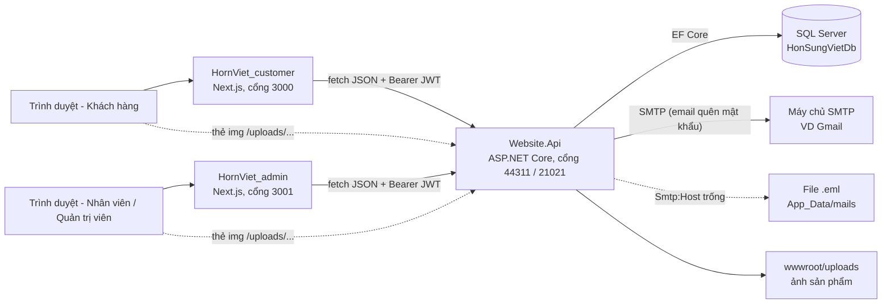
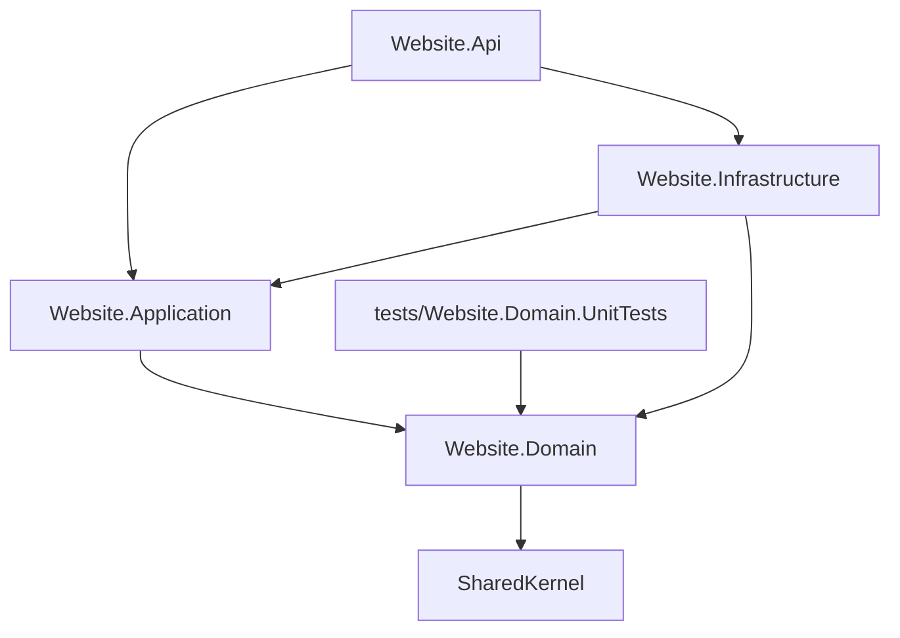
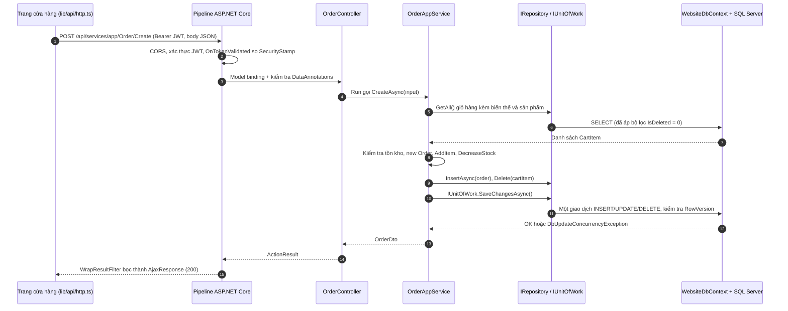

# Tổng quan hệ thống Hồn Sừng Việt

Hồn Sừng Việt là website thương mại điện tử bán đồ mỹ nghệ làm từ sừng (đồ án tốt nghiệp). Hệ thống có 3 ứng dụng: một Web API .NET dùng chung và hai frontend Next.js (trang cửa hàng, trang quản trị). Tài liệu này là điểm bắt đầu: kiến trúc, vai trò, quy ước API, cách chạy ở máy dev và mục lục các tài liệu chi tiết.

## Mục lục bộ tài liệu

| # | Tài liệu | Nội dung chính |
|---|---|---|
| 00 | [Tổng quan hệ thống](00-tong-quan.md) | Tài liệu này |
| 01 | [Xác thực & tài khoản](01-xac-thuc-tai-khoan.md) | Đăng ký, đăng nhập (JWT), đăng xuất, quên/đặt lại mật khẩu, hồ sơ, sổ địa chỉ |
| 02 | [Phân quyền & quản lý người dùng](02-phan-quyen-nguoi-dung.md) | Vai trò, chính sách `Management` / `AdminOnly`, quản lý tài khoản |
| 03 | [Danh mục & nguyên liệu](03-danh-muc-nguyen-lieu.md) | Danh mục sản phẩm, nguyên liệu và nguồn gốc |
| 04 | [Sản phẩm, biến thể & tồn kho](04-san-pham-bien-the-ton-kho.md) | Sản phẩm, biến thể (kích cỡ/kiểu dáng), ảnh, tồn kho, tìm kiếm & lọc |
| 05 | [Giỏ hàng](05-gio-hang.md) | Thêm/sửa/xóa dòng giỏ, kiểm tra tồn kho |
| 06 | [Đặt hàng & đơn hàng](06-dat-hang-don-hang.md) | Đặt hàng từ giỏ, máy trạng thái đơn, hủy đơn, quản trị đơn |
| 07 | [Nhập kho & giá vốn](07-nhap-kho-gia-von.md) | Phiếu nhập, giá vốn bình quân gia quyền di động |
| 08 | [Thống kê & báo cáo](08-thong-ke-bao-cao.md) | Dashboard, doanh thu, lợi nhuận, sản phẩm bán chạy |
| 09 | [Giao diện frontend](09-giao-dien-frontend.md) | Cấu trúc 2 repo Next.js, màn hình, HTTP client |
| 10 | [Cơ sở dữ liệu](10-co-so-du-lieu.md) | ERD 15 bảng, collation, xóa mềm, RowVersion, migration, seed |
| 11 | [Cấu hình & triển khai](11-cau-hinh-trien-khai.md) | appsettings, user-secrets, SMTP, build/triển khai, xử lý sự cố |

Tài liệu API chi tiết (tham số, kết quả từng endpoint): [`../API.md`](../API.md).

---

## 1. Mục đích & phạm vi

**Mục đích.** Cho phép khách hàng xem, tìm kiếm, mua sản phẩm mỹ nghệ từ sừng trâu/sừng bò; cho nhân viên và quản trị viên quản lý danh mục, sản phẩm, tồn kho, đơn hàng; cho quản trị viên quản lý người dùng, nhập kho, giá vốn và xem báo cáo doanh thu – lợi nhuận.

**Phạm vi hệ thống:**

| Ứng dụng | Repo | Công nghệ | Cổng dev | Người dùng |
|---|---|---|---|---|
| Web API | `Website.Api` | .NET 10, ASP.NET Core, EF Core 10, SQL Server | `https://localhost:44311`, `http://localhost:21021` | Hai frontend gọi tới |
| Trang cửa hàng | `HornViet_customer` | Next.js 15 (App Router), React 19, Tailwind CSS | `http://localhost:3000` | Khách vãng lai, Khách hàng |
| Trang quản trị | `HornViet_admin` | Next.js 15 (App Router), React 19, Tailwind CSS | `http://localhost:3001` | Nhân viên, Quản trị viên |

**Ngoài phạm vi** (theo code hiện tại): cổng thanh toán trực tuyến (phương thức "Chuyển khoản" chỉ được ghi nhận, xem `Website.Domain/Orders/Enums/PaymentMethod.cs`), tính phí vận chuyển, đa ngôn ngữ.

## 2. Kiến trúc

### 2.1 Sơ đồ 3 ứng dụng



Điểm cần biết:

- Hai frontend là ứng dụng Next.js chạy phía trình duyệt gọi API trực tiếp bằng `fetch` (`lib/api/http.ts` ở cả hai repo). Vì khác origin nên backend phải bật CORS cho cả hai (`App:CorsOrigins`).
- Token JWT lưu ở `localStorage` của từng origin, nên đăng nhập ở cửa hàng và ở trang quản trị là hai phiên độc lập.
- Ảnh sản phẩm được backend phục vụ dạng file tĩnh (`app.UseStaticFiles()` trong `Website.Api/Program.cs`); frontend ghép `NEXT_PUBLIC_API_BASE_URL` + đường dẫn `/uploads/...`.
- Email "Quên mật khẩu" gửi qua SMTP; nếu chưa cấu hình `Smtp:Host` thì lưu thành file `.eml` (xem [Cấu hình & triển khai](11-cau-hinh-trien-khai.md)).

### 2.2 Kiến trúc DDD của backend

| Project | Tầng | Vai trò | Thành phần chính |
|---|---|---|---|
| `SharedKernel` | Nhân dùng chung | Khối dựng không phụ thuộc framework | `Entity<TKey>`, `ValueObject`, `IHasCreationTime`, `ISoftDelete`, `UserFriendlyException`, `EntityNotFoundException` (namespace `Website.Domain.SharedKernel`) |
| `Website.Domain` | Miền (Domain) | Entity và quy tắc nghiệp vụ | `Catalog`, `Carts`, `Orders`, `Inventory`, `Users`; interface `IRepository<TEntity,TKey>`, `IUnitOfWork`; `AppConsts` |
| `Website.Application` | Ứng dụng | Application Service + DTO cho từng use case | `*AppService`, `DataSeeder`, `IAppSession`, `IEmailSender`, `AppUrlOptions`, `PagedInput` |
| `Website.Infrastructure` | Hạ tầng | Cài đặt truy cập dữ liệu, gửi email | `WebsiteDbContext` (cũng là `IUnitOfWork`), `Repository<,>`, `Migrations/`, `SmtpEmailSender` |
| `Website.Api` | Trình bày (Presentation) | HTTP, xác thực, bọc response | `Controllers/`, `Authorization/Authentication.cs`, `Middlewares/ResponseHandling.cs`, `Models/AjaxResponse.cs`, `Program.cs` |
| `tests/Website.Domain.UnitTests` | Kiểm thử | Unit test cho tầng Domain (xUnit) | `Carts`, `Catalog`, `Inventory`, `Orders`, `Users`, `SharedKernel` |

**Quy tắc phụ thuộc** (theo `ProjectReference` trong các file `.csproj`):



- `Website.Domain` chỉ phụ thuộc `SharedKernel`, không biết EF Core hay HTTP. Interface repository nằm ở Domain, lớp cài đặt nằm ở Infrastructure (đảo ngược phụ thuộc).
- `Website.Infrastructure` tham chiếu `Website.Application` để cài đặt các interface khai báo ở đó (`IEmailSender`, `AppUrlOptions`…).
- `Website.Application` có tham chiếu gói `Microsoft.EntityFrameworkCore` để dùng `Include`, `ToListAsync`… trên `IQueryable` trả về từ repository.
- Quy tắc nghiệp vụ cốt lõi nằm trong entity, ví dụ `ProductVariant.DecreaseStock / IncreaseStock / SetStock / ReceiveStock` (`Website.Domain/Catalog/Entities/Catalog.cs`), `Order.ChangeStatus` (`Website.Domain/Orders/Entities/Order.cs`).

### 2.3 Đăng ký dịch vụ & pipeline (Program.cs)

Thứ tự trong `Website.Api/Program.cs`:

1. `AddInfrastructure(config)` — `WebsiteDbContext` (SQL Server, `EnableRetryOnFailure`, `SplitQuery`), `IUnitOfWork`, `IRepository<,>`, `IEmailSender` (`Website.Infrastructure/DependencyInjectionRegister.cs`).
2. `AddApplication()` — các Application Service (Scoped), `PasswordHasher<User>`, `DataSeeder` (`Website.Application/ApplicationModule.cs`).
3. `Configure<AppUrlOptions>(App)` — địa chỉ hai frontend cho link trong email.
4. `AddJwtAuthentication(config)` — JWT Bearer, `IAppSession`, chính sách `Management` và `AdminOnly` (`Website.Api/Authorization/Authentication.cs`).
5. `AddControllers` với `WrapResultFilter` và `ValidationResponse.Create`; CORS theo `App:CorsOrigins`; Swagger.
6. Nếu `Database:MigrateOnStartup = true`: áp migration rồi chạy `DataSeeder.SeedAsync`.
7. Pipeline: `ExceptionHandlingMiddleware` → Swagger (chỉ Development) → `UseStaticFiles` → `UseCors` → `UseAuthentication` → `UseAuthorization` → `MapControllers`.

## 3. Module nghiệp vụ

| Module | Controller (`Website.Api/Controllers/`) | Application Service | Entity (Domain) | Tài liệu |
|---|---|---|---|---|
| Xác thực & tài khoản | `Account/TokenAuthController.cs`, `Account/AccountController.cs`, `Account/ProfileController.cs` | `Accounts/AccountAppService.cs`, `Profiles/ProfileAppService.cs` | `User`, `UserAddress`, `PasswordResetToken` | [01](01-xac-thuc-tai-khoan.md) |
| Phân quyền & người dùng | `Admin/UserController.cs` | `Users/UserAppService.cs` | `User`, `Role`, `UserRole` | [02](02-phan-quyen-nguoi-dung.md) |
| Danh mục & nguyên liệu | `Catalog/CategoryController.cs`, `Catalog/MaterialController.cs` | `Catalog/CategoryMaterialAppServices.cs` | `Category`, `Material` | [03](03-danh-muc-nguyen-lieu.md) |
| Sản phẩm, biến thể, tồn kho | `Catalog/ProductController.cs`, `Admin/FileController.cs` | `Catalog/ProductAppService.cs` | `Product`, `ProductVariant`, `ProductImage` | [04](04-san-pham-bien-the-ton-kho.md) |
| Giỏ hàng | `Shopping/CartController.cs` | `Carts/CartAppService.cs` | `Cart`, `CartItem` | [05](05-gio-hang.md) |
| Đặt hàng & đơn hàng | `Shopping/OrderController.cs` | `Orders/OrderAppService.cs` | `Order`, `OrderItem` | [06](06-dat-hang-don-hang.md) |
| Nhập kho & giá vốn | `Admin/StockReceiptController.cs` | `Inventory/StockReceiptAppService.cs` | `StockReceipt`, `ProductVariant.AverageCost` | [07](07-nhap-kho-gia-von.md) |
| Thống kê & báo cáo | `Admin/StatisticController.cs` | `Statistics/StatisticAppService.cs` | (đọc `Order`, `OrderItem`) | [08](08-thong-ke-bao-cao.md) |

Đường dẫn Application Service tính từ `Website.Application/`.

## 4. Vai trò & quyền

### 4.1 Vai trò

| Vai trò | Tên trong token / CSDL | Đăng nhập ở | Cách có tài khoản |
|---|---|---|---|
| Khách vãng lai | (không có token) | — | — |
| Khách hàng | `Customer` | Cửa hàng (`POST /api/TokenAuth/Authenticate`) | Tự đăng ký (`Account/Register`) |
| Nhân viên | `Staff` | Trang quản trị (`POST /api/TokenAuth/AuthenticateAdmin`) | Quản trị viên tạo (`User/Create`) hoặc seed `staff` |
| Quản trị viên | `Admin` | Trang quản trị | Seed `admin`, hoặc Quản trị viên khác gán vai trò |

Vai trò được định nghĩa trong `Website.Domain/Users/Enums/RoleName.cs` và lưu ở bảng `AbpRoles`. Hai chính sách phân quyền (`Website.Api/Authorization/Authentication.cs`):

- `Management` = có vai trò `Admin` **hoặc** `Staff`.
- `AdminOnly` = có vai trò `Admin`.

### 4.2 Ma trận quyền theo chức năng

Ký hiệu: ✅ được phép · ➖ một phần (xem ghi chú) · ❌ không được.

| Chức năng | Khách vãng lai | Customer | Staff | Admin | Cơ chế kiểm tra |
|---|---|---|---|---|---|
| Xem danh mục, nguyên liệu, danh sách & chi tiết sản phẩm đang bán | ✅ | ✅ | ✅ | ✅ | Không có `[Authorize]` |
| Xem chi tiết sản phẩm đang ẩn | ❌ | ❌ | ✅ | ✅ | `ProductAppService.GetAsync` kiểm tra `IsManagement()` |
| Đăng ký, quên / đặt lại mật khẩu | ✅ | ✅ | ✅ | ✅ | Công khai |
| Đăng nhập trang quản trị | ❌ | ❌ | ✅ | ✅ | `TokenAuthController.AuthenticateAdmin` |
| Hồ sơ, đổi mật khẩu, sổ địa chỉ | ❌ | ✅ | ✅ | ✅ | `[Authorize]` |
| Giỏ hàng, đặt hàng, đơn của tôi, hủy đơn chờ xử lý | ❌ | ✅ | ➖ | ➖ | `[Authorize]` (xem ghi chú 1) |
| Quản lý danh mục, nguyên liệu | ❌ | ❌ | ✅ | ✅ | `Management` |
| Quản lý sản phẩm, biến thể, tồn kho, tải ảnh | ❌ | ❌ | ✅ | ✅ | `Management` |
| Xem & cập nhật trạng thái mọi đơn hàng | ❌ | ❌ | ✅ | ✅ | `Management` |
| Dashboard tổng quan | ❌ | ❌ | ➖ | ✅ | `Management`; Staff nhận `todayRevenue`, `monthRevenue`, `monthProfit` = `null` |
| Báo cáo doanh thu, lợi nhuận, sản phẩm bán chạy | ❌ | ❌ | ❌ | ✅ | `AdminOnly` |
| Nhập kho & giá vốn | ❌ | ❌ | ❌ | ✅ | `AdminOnly` |
| Quản lý người dùng (tạo, đổi vai trò, khóa, đặt lại mật khẩu) | ❌ | ❌ | ❌ | ✅ | `AdminOnly` |

Ghi chú:

1. Ở backend, các API giỏ hàng / đơn của tôi chỉ yêu cầu đã đăng nhập (`[Authorize]`), không kiểm tra vai trò `Customer`. Việc chặn Nhân viên / Quản trị viên mua hàng do trang cửa hàng thực hiện: `HornViet_customer/contexts/auth-context.tsx` từ chối đăng nhập tài khoản có vai trò `Admin`/`Staff` với thông báo "Tài khoản Nhân viên / Quản trị viên vui lòng đăng nhập tại trang quản trị.".
2. Trang quản trị ẩn menu chỉ dành cho Admin (`adminOnly` trong `HornViet_admin/app/(panel)/layout.tsx`), nhưng quyền thật luôn do backend quyết định (gọi sai quyền nhận 403).

Chi tiết: [Phân quyền & quản lý người dùng](02-phan-quyen-nguoi-dung.md).

## 5. Quy ước API

### 5.1 Đường dẫn & định dạng

| Mục | Quy ước | Nguồn |
|---|---|---|
| Route | `/api/services/app/{Service}/{Action}` (giống ABP), VD `/api/services/app/Product/GetAll` | `[Route("api/services/app/[controller]/[action]")]` trong `Website.Api/Controllers/WebsiteBaseController.cs` |
| Ngoại lệ | Đăng nhập: `/api/TokenAuth/Authenticate`, `/api/TokenAuth/AuthenticateAdmin` | `[Route("api/[controller]/[action]")]` trong `TokenAuthController.cs` |
| GET / DELETE | Tham số qua query string (`?id=1`, mảng lặp tên `categoryIds=1&categoryIds=2`) | `[FromQuery]` |
| POST / PUT | Body JSON, camelCase | `[FromBody]` |
| Xác thực | Header `Authorization: Bearer <accessToken>`, hạn 24 giờ (`Jwt:ExpirationHours`) | `Authentication.cs` |
| Enum | Gửi/nhận dạng số | Xem bảng enum trong [`../API.md`](../API.md) |
| Ngày giờ | Lưu giờ địa phương, JSON có offset (VD `+07:00`) | Bộ chuyển đổi `DateTimeKind.Local` trong `WebsiteDbContext.OnModelCreating` |

### 5.2 Vỏ response (AjaxResponse)

Mọi response (thành công hay lỗi) có cùng dạng, định nghĩa ở `Website.Api/Models/AjaxResponse.cs`:

```json
{ "result": { }, "targetUrl": null, "success": true, "error": null, "unauthorizedRequest": false, "__abp": true }
```

```json
{
  "result": null, "targetUrl": null, "success": false, "unauthorizedRequest": false, "__abp": true,
  "error": {
    "code": 0,
    "message": "Dữ liệu không hợp lệ.",
    "details": "Số điện thoại không hợp lệ.",
    "validationErrors": [ { "message": "Số điện thoại không hợp lệ.", "members": ["phoneNumber"] } ]
  }
}
```

- Kết quả thành công được bọc tự động bởi `WrapResultFilter` (`Website.Api/Middlewares/ResponseHandling.cs`); action không trả dữ liệu (`Ok()`) cho `result: null`.
- `error.code` hiện luôn là `0`; frontend phân biệt lỗi qua mã HTTP.

### 5.3 Phân trang

| Thành phần | Mô tả | Nguồn |
|---|---|---|
| Input `skipCount` | Số bản ghi bỏ qua, ≥ 0, mặc định 0 | `PagedInput` trong `Website.Application/Common/CommonDtos.cs` |
| Input `maxResultCount` | Số bản ghi mỗi trang, 1–100, mặc định 12 | `AppConsts.DefaultPageSize`, `AppConsts.MaxPageSize` |
| Output | `{ totalCount, items }` | `PagedResultDto<T>` |
| Danh sách không phân trang | `{ items }` | `ListResultDto<T>` |

Vượt giới hạn `maxResultCount` (VD 500) → lỗi validation 400.

### 5.4 Xử lý lỗi

Lỗi nghiệp vụ được ném dưới dạng exception ở tầng Domain/Application và đổi thành mã HTTP tại một nơi duy nhất: `BusinessErrors.TryMap` (`Website.Api/Middlewares/ResponseHandling.cs`).

| Nguồn lỗi | HTTP | `error.message` | Nơi xử lý |
|---|---|---|---|
| `UserFriendlyException` | 400 | Thông điệp nghiệp vụ, VD "Giỏ hàng đang trống." | `BusinessErrors.TryMap` |
| `EntityNotFoundException` | 404 | VD "Không tìm thấy đơn hàng." | `BusinessErrors.TryMap` (kiểm tra trước `UserFriendlyException` vì là lớp con) |
| `DbUpdateConcurrencyException` | 409 | "Dữ liệu (tồn kho) vừa được cập nhật bởi giao dịch khác. Vui lòng tải lại và thử lại." | `BusinessErrors.TryMap` |
| Vi phạm DataAnnotations (`[Required]`, `[Range]`…) | 400 | "Dữ liệu không hợp lệ." + `validationErrors[]` | `ValidationResponse.Create` |
| Chưa đăng nhập / token hết hạn / tài khoản bị khóa / đổi mật khẩu | 401 | "Bạn chưa đăng nhập hoặc phiên đăng nhập đã hết hạn." (`unauthorizedRequest: true`) | `JwtBearerEvents.OnChallenge` |
| Không đủ quyền | 403 | "Bạn không có quyền thực hiện chức năng này." | `JwtBearerEvents.OnForbidden` |
| Lỗi khác (bug, mất kết nối CSDL) | 500 | "Đã có lỗi xảy ra trong quá trình xử lý." (chi tiết chỉ ghi log) | `ExceptionHandlingMiddleware` |

**Vì sao có `WebsiteBaseController.Run(...)`?** Mọi action viết dạng `=> Run(() => _service.XxxAsync(input))`. `Run` bắt lỗi nghiệp vụ ngay trong controller và trả `ObjectResult` với mã 400/404/409. Nhờ vậy khi debug bằng Visual Studio (F5, Just My Code), chương trình không dừng ở "Exception User-Unhandled" mỗi lần người dùng nhập sai. `ExceptionHandlingMiddleware` vẫn là lưới an toàn cho lỗi ném ngoài controller.

## 6. Luồng một request điển hình

Ví dụ: khách hàng bấm **Đặt hàng** (`POST /api/services/app/Order/Create`).



Mô tả từng bước:

| Bước | Việc xảy ra | File / hàm |
|---|---|---|
| 1 | Frontend gửi request kèm header `Authorization`. | `HornViet_customer/lib/api/http.ts` |
| 2 | CORS kiểm tra origin; JwtBearer kiểm tra chữ ký, hạn, issuer/audience; `OnTokenValidated` truy vấn `AbpUsers` để chắc tài khoản còn `IsActive` và `SecurityStamp` khớp claim `sstamp`. | `Website.Api/Authorization/Authentication.cs` |
| 3 | `[ApiController]` kiểm tra DataAnnotations của `CreateOrderInput`; sai → 400 qua `ValidationResponse.Create`. | `Website.Application/Orders/OrderAppService.cs` (class `CreateOrderInput`) |
| 4 | Controller gọi service qua `Run(...)`. | `Website.Api/Controllers/Shopping/OrderController.cs` |
| 5–7 | Service đọc giỏ qua repository; `GetAll()` trả `IQueryable` đã áp bộ lọc xóa mềm. | `Website.Infrastructure/Persistence/Repositories/Repository.cs` |
| 8 | Quy tắc nghiệp vụ trong entity: `ProductVariant.DecreaseStock`, `Order.AddItem` (lưu tên, đơn giá, giá vốn lúc mua). | `Website.Domain/Catalog/Entities/Catalog.cs`, `Website.Domain/Orders/Entities/Order.cs` |
| 9–10 | Ghi nhận thay đổi trong Change Tracker, rồi một lần `SaveChangesAsync` = một giao dịch. Trước khi ghi, `ApplyAuditConcepts` gán `CreationTime` và đổi xóa thành xóa mềm. | `Website.Infrastructure/Persistence/WebsiteDbContext.cs` |
| 11–12 | SQL Server so `RowVersion` của biến thể; nếu đơn khác vừa đổi tồn kho → `DbUpdateConcurrencyException` → 409. | `BusinessErrors.TryMap` |
| 13–15 | Kết quả được `WrapResultFilter` bọc thành `AjaxResponse`. | `Website.Api/Middlewares/ResponseHandling.cs` |

Chi tiết nghiệp vụ đặt hàng: [Đặt hàng & đơn hàng](06-dat-hang-don-hang.md).

## 7. Chạy cả 3 ứng dụng ở máy dev

### 7.1 Yêu cầu

| Thành phần | Phiên bản |
|---|---|
| .NET SDK | 10 |
| SQL Server | 2019 trở lên (Developer/Express), đăng nhập Windows |
| Node.js + npm | Bản hỗ trợ Next.js 15 |

### 7.2 Các bước

1. **Database** — có hai cách:
   - Để backend tự tạo: ở môi trường Development, `Database:MigrateOnStartup = true` (`Website.Api/appsettings.Development.json`) nên lần chạy đầu tự tạo database, áp migration và seed.
   - Hoặc chạy 3 script trong `database/` (xem [Cơ sở dữ liệu](10-co-so-du-lieu.md)).
2. **Backend** (thư mục `Website.Api`):

   ```bash
   dotnet tool restore
   dotnet run --project Website.Api --launch-profile https
   ```

   Swagger: `https://localhost:44311/swagger`. Lần đầu dùng HTTPS có thể cần `dotnet dev-certs https --trust`.
3. **Trang quản trị** (thư mục `HornViet_admin`):

   ```bash
   npm install
   cp .env.example .env.local
   npm run dev
   ```

   Mở `http://localhost:3001` (script `dev` là `next dev -p 3001`).
4. **Trang cửa hàng** (thư mục `HornViet_customer`): các lệnh như trên; `npm run dev` chạy cổng mặc định `http://localhost:3000`.

Trên PowerShell, thay `cp` bằng `Copy-Item .env.example .env.local`. Mặc định `.env.example` của cả hai repo trỏ `NEXT_PUBLIC_API_BASE_URL=http://localhost:21021` (cổng HTTP của backend, tránh lỗi chứng chỉ). Cấu hình đầy đủ: [Cấu hình & triển khai](11-cau-hinh-trien-khai.md).

## 8. Tài khoản demo

Do `Website.Application/DataSeeder.cs` hoặc `database/03_seed.sql` tạo:

| Tài khoản | Mật khẩu | Vai trò | Đăng nhập tại |
|---|---|---|---|
| `admin` | `123qwe` | Quản trị viên | `http://localhost:3001/login` |
| `staff` | `123qwe` | Nhân viên | `http://localhost:3001/login` |

- Seed **không** tạo tài khoản khách hàng: tự đăng ký ở `http://localhost:3000/register` với dữ liệu giả (VD "Khách hàng A", `khach@example.com`).
- Email của hai tài khoản demo có đuôi `@honsungviet.local` nên không nhận được thư thật (dùng để thử Quên mật khẩu thì xem file `.eml`).
- Đổi mật khẩu demo trước khi triển khai thật (xem [checklist triển khai](11-cau-hinh-trien-khai.md)).

## 9. Mã nguồn liên quan

| Nội dung | Đường dẫn |
|---|---|
| Khởi động, DI, pipeline | `Website.Api/Program.cs` |
| Controller gốc, `Run(...)` | `Website.Api/Controllers/WebsiteBaseController.cs` |
| Bọc response, ánh xạ lỗi, lỗi validation | `Website.Api/Middlewares/ResponseHandling.cs` |
| Vỏ response | `Website.Api/Models/AjaxResponse.cs` |
| JWT, chính sách phân quyền, `IAppSession` | `Website.Api/Authorization/Authentication.cs` |
| Đăng ký Application Service | `Website.Application/ApplicationModule.cs` |
| Phân trang, DTO chung | `Website.Application/Common/CommonDtos.cs` |
| Hằng số nghiệp vụ | `Website.Domain/AppConsts.cs` |
| Exception nghiệp vụ, entity cơ sở | `SharedKernel/Exceptions.cs`, `SharedKernel/Entity.cs` |
| Repository, Unit of Work | `Website.Domain/Interfaces/Repositories/IRepository.cs`, `Website.Infrastructure/Persistence/Repositories/Repository.cs` |
| DbContext | `Website.Infrastructure/Persistence/WebsiteDbContext.cs` |
| Đăng ký hạ tầng | `Website.Infrastructure/DependencyInjectionRegister.cs` |
| HTTP client frontend | `HornViet_customer/lib/api/http.ts`, `HornViet_admin/lib/api/http.ts` |
| Gọi API theo service | `HornViet_customer/lib/api/services.ts`, `HornViet_admin/lib/api/services.ts` |
| Tài liệu API | [`../API.md`](../API.md) |
