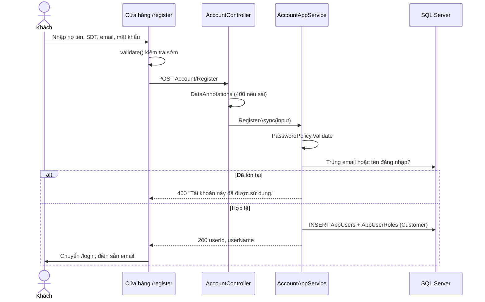
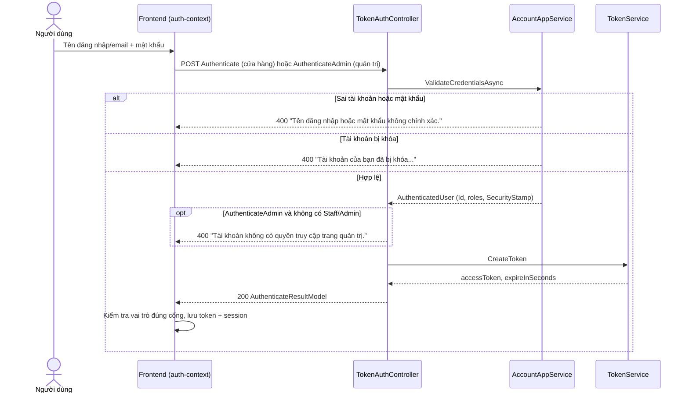
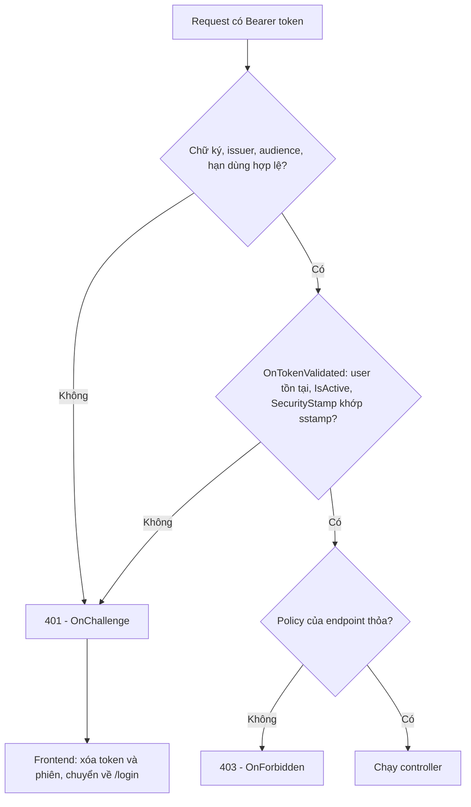
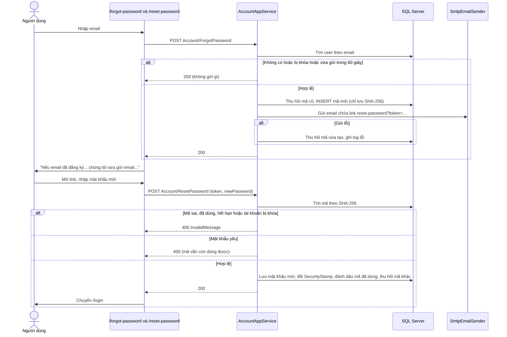
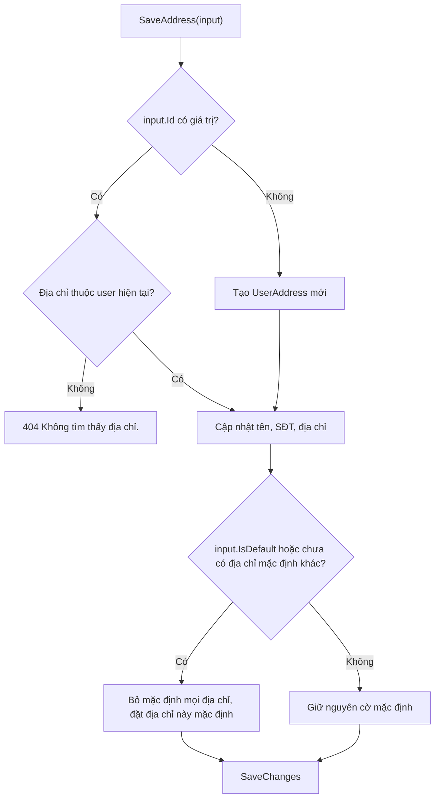

# Xác thực & tài khoản

Tài liệu mô tả cách người dùng tạo tài khoản, đăng nhập (cửa hàng và quản trị), cách JWT được cấp và thu hồi, quên/đặt lại/đổi mật khẩu, hồ sơ cá nhân và sổ địa chỉ giao hàng của hệ thống Hồn Sừng Việt.

> Liên quan: [Tổng quan](00-tong-quan.md) · [Phân quyền & quản lý người dùng](02-phan-quyen-nguoi-dung.md) · [Đặt hàng & đơn hàng](06-dat-hang-don-hang.md) · [Giao diện frontend](09-giao-dien-frontend.md) · [Cơ sở dữ liệu](10-co-so-du-lieu.md) · [Cấu hình & triển khai](11-cau-hinh-trien-khai.md) · [Tài liệu API](../API.md)

---

## 1. Mục đích & phạm vi

| Chức năng | Ai dùng | Ở đâu |
|---|---|---|
| Đăng ký tài khoản | Khách vãng lai | Cửa hàng `/register` |
| Đăng nhập cửa hàng (`TokenAuth/Authenticate`) | Khách hàng | Cửa hàng `/login` |
| Đăng nhập quản trị (`TokenAuth/AuthenticateAdmin`) | Nhân viên, Quản trị viên | Quản trị `/login` |
| Đăng xuất | Mọi người dùng đã đăng nhập | Menu tài khoản (cửa hàng), thanh bên (quản trị) |
| Quên mật khẩu → email → đặt lại mật khẩu | Mọi tài khoản đang hoạt động | `/forgot-password`, `/reset-password` ở cả hai frontend |
| Đổi mật khẩu | Người dùng đã đăng nhập | Cửa hàng: Hồ sơ → tab "Đổi mật khẩu". Quản trị: nút "Đổi mật khẩu" ở thanh bên |
| Hồ sơ cá nhân (họ tên, số điện thoại) | Khách hàng | Cửa hàng `/account/profile` |
| Sổ địa chỉ giao hàng | Khách hàng | Cửa hàng `/account/profile?tab=addr` |

Ngoài phạm vi: quản lý tài khoản của người khác (tạo nhân viên, khóa, đổi vai trò, Admin đặt lại mật khẩu hộ) — xem [02-phan-quyen-nguoi-dung.md](02-phan-quyen-nguoi-dung.md).

## 2. Vai trò & quyền

| API / chức năng | Khách vãng lai | Customer | Staff | Admin |
|---|:-:|:-:|:-:|:-:|
| `Account/Register`, `Account/ForgotPassword`, `Account/ResetPassword` | ✔ | ✔ | ✔ | ✔ |
| `TokenAuth/Authenticate` (backend cấp token cho mọi vai trò) | ✔ | ✔ | ✔ (*) | ✔ (*) |
| `TokenAuth/AuthenticateAdmin` | — | ✘ 400 | ✔ | ✔ |
| `Profile/*` (hồ sơ, đổi mật khẩu, sổ địa chỉ) — `[Authorize]` | ✘ 401 | ✔ | ✔ | ✔ |

(*) Backend vẫn cấp token, nhưng frontend cửa hàng (`HornViet_customer/contexts/auth-context.tsx`) **không lưu phiên** của tài khoản có vai trò `Staff`/`Admin` và hiển thị hướng dẫn đăng nhập ở trang quản trị. Ngược lại, frontend quản trị chỉ lưu phiên có vai trò `Staff`/`Admin`.

Tài khoản tự đăng ký luôn chỉ có vai trò `Customer`. Chi tiết vai trò và policy: [02-phan-quyen-nguoi-dung.md](02-phan-quyen-nguoi-dung.md).

## 3. Khái niệm & quy tắc nghiệp vụ

### 3.1 Tài khoản

- Định danh đăng nhập: **tên đăng nhập** hoặc **email** (cùng một ô nhập).
- Khi đăng ký/tạo tài khoản, email được `Trim()` và chuyển chữ thường; nếu không nhập tên đăng nhập thì **tên đăng nhập = email**. Form đăng ký ở cửa hàng không có ô tên đăng nhập nên khách hàng luôn có tên đăng nhập = email.
- Email và tên đăng nhập là duy nhất (chỉ một trong hai trùng là đủ để báo "Tài khoản này đã được sử dụng."). CSDL có unique index có lọc `[IsDeleted] = 0` trên `UserName` và `EmailAddress`.
- Mật khẩu chỉ lưu dạng băm bằng `PasswordHasher<User>` của ASP.NET Core Identity, không bao giờ lưu văn bản thường.
- Email **không đổi được** qua hồ sơ cá nhân (là định danh đăng nhập).

### 3.2 Quy tắc mật khẩu và validate

| Quy tắc | Backend | Frontend (kiểm tra sớm) |
|---|---|---|
| Mật khẩu ≥ 6 ký tự, có cả chữ và số | `PasswordPolicy.Validate` (`HornViet.Application/Accounts/AccountAppService.cs`) dùng `char.IsLetter` / `char.IsDigit` → lỗi "Mật khẩu phải có ít nhất 6 ký tự, gồm cả chữ và số." | `isStrongPassword` (`lib/hsv/validation.ts`) — chữ chỉ tính `a-z`, `A-Z` |
| Số điện thoại di động VN | Regex `AppConsts.PhoneRegex` = `^(0\|\+84)(3\|5\|7\|8\|9)\d{8}$` | `PHONE_RE` = `^(0\|\+84)\d{9}$` (lỏng hơn, sau khi bỏ khoảng trắng) |
| Email | `[EmailAddress]` | `EMAIL_RE` = `^[^@\s]+@[^@\s]+\.[^@\s]+$` |
| Họ tên | Bắt buộc, tối đa 64 ký tự | Bắt buộc |
| Địa chỉ giao hàng | Tên người nhận ≤ 255, địa chỉ ≤ 500 ký tự, SĐT theo regex | Bắt buộc, SĐT theo `PHONE_RE` |

`PasswordPolicy.Validate` dùng chung cho: Đăng ký, Đặt lại mật khẩu qua email, Đổi mật khẩu, Admin tạo tài khoản và Admin đặt lại mật khẩu hộ.

Lỗi DataAnnotations (`[Required]`, `[EmailAddress]`, `[RegularExpression]`...) bị ASP.NET Core chặn trước khi vào service và trả HTTP 400 với `error.message = "Dữ liệu không hợp lệ."` cùng `error.validationErrors[]` (mỗi phần tử có `members` là tên trường camelCase) — xem `ValidationResponse` trong `HornViet.Api/Middlewares/ResponseHandling.cs`. Frontend gom lỗi theo trường bằng `ApiError.fieldErrors()`.

### 3.3 JWT

Token được tạo trong `TokenService.CreateToken` (`HornViet.Api/Authorization/Authentication.cs`), ký HMAC-SHA256 bằng `Jwt:SecurityKey` (bắt buộc ≥ 32 ký tự, nếu thiếu ứng dụng không khởi động).

| Claim | Giá trị |
|---|---|
| `sub` | Id người dùng |
| `http://schemas.xmlsoap.org/ws/2005/05/identity/claims/nameidentifier` (`ClaimTypes.NameIdentifier`) | Id người dùng — `IAppSession.UserId` đọc claim này |
| `http://schemas.xmlsoap.org/ws/2005/05/identity/claims/name` (`ClaimTypes.Name`) | Tên đăng nhập |
| `jti` | GUID ngẫu nhiên |
| `sstamp` | `AbpUsers.SecurityStamp` tại thời điểm đăng nhập |
| `http://schemas.microsoft.com/ws/2008/06/identity/claims/role` (`ClaimTypes.Role`) | Mỗi vai trò một claim: `Customer` / `Staff` / `Admin` |
| `iss`, `aud`, `exp` | `Jwt:Issuer`, `Jwt:Audience` (mặc định `HonSungViet`), hết hạn sau `Jwt:ExpirationHours` (mặc định **24 giờ**) |

Do `MapInboundClaims = false`, tên claim được giữ nguyên khi đọc. Khi xác thực token: kiểm tra issuer, audience, chữ ký, thời hạn (`ClockSkew` 1 phút).

### 3.4 SecurityStamp — thu hồi phiên

JWT không lưu trạng thái ở server, nên hệ thống thu hồi phiên bằng **dấu bảo mật** `AbpUsers.SecurityStamp` (GUID dạng 32 ký tự hex):

1. Khi đăng nhập, dấu hiện tại được nhúng vào claim `sstamp`.
2. **Mỗi request** có token, sự kiện `JwtBearerEvents.OnTokenValidated` truy vấn CSDL: token chỉ hợp lệ khi tồn tại user có `Id` = claim Id, `IsActive = true`, `SecurityStamp` = claim `sstamp` (và chưa bị xóa mềm — bộ lọc toàn cục `IsDeleted`). Ngược lại → `ctx.Fail(...)` → HTTP **401**. Token cũ không có claim `sstamp` cũng bị từ chối.
3. Các thao tác gọi `User.RotateSecurityStamp()` (tạo dấu mới) làm **mọi token cũ** của tài khoản mất hiệu lực ngay:

| Thao tác | Hàm | Đổi dấu? |
|---|---|---|
| Đổi mật khẩu (kể cả phiên đang dùng) | `ProfileAppService.ChangePasswordAsync` | Có |
| Đặt lại mật khẩu qua email | `AccountAppService.ResetPasswordAsync` | Có |
| Admin đặt lại mật khẩu hộ | `UserAppService.ResetPasswordAsync` | Có |
| Admin đổi vai trò (khi có thay đổi thực sự) | `UserAppService.SetRolesAsync` | Có |
| Admin khóa tài khoản | `UserAppService.SetActiveAsync` | **Không** đổi dấu — token bị từ chối nhờ điều kiện `IsActive` ở bước 2 |

Lưu ý: vì khóa tài khoản không đổi dấu, nếu Admin **mở khóa** lại trong lúc token cũ chưa hết hạn (24 giờ) thì token cũ đó dùng lại được.

### 3.5 Quên mật khẩu / đặt lại mật khẩu

| Quy tắc | Giá trị / cách làm |
|---|---|
| Mã (token) | 32 byte ngẫu nhiên (`RandomNumberGenerator`) → chuỗi hex 64 ký tự, chỉ nằm trong link email |
| Lưu trữ | Chỉ lưu **SHA-256** của mã (hex 64 ký tự, cột `TokenHash`). Khi băm, mã được `Trim()` và chuyển chữ hoa |
| Hạn dùng | `AppConsts.PasswordResetTokenLifetimeMinutes` = **30 phút** |
| Dùng một lần | `UsedTime` được ghi khi dùng; mã có `UsedTime` khác null không dùng được nữa |
| Chống spam | Trong `AppConsts.PasswordResetResendSeconds` = **60 giây** sau lần gửi, yêu cầu lặp lại cho cùng tài khoản không gửi thêm email |
| Chỉ link mới nhất có hiệu lực | Khi phát hành mã mới, các mã còn hiệu lực trước đó bị thu hồi (`Revoke`) |
| Không lộ email tồn tại | `ForgotPassword` **luôn trả thành công**: email chưa đăng ký, tài khoản bị khóa, đang trong 60 giây chờ, hay gửi email lỗi đều trả `success: true` |
| Link theo vai trò | Staff/Admin → `{App:AdminRootAddress}/reset-password?token=...`; còn lại → `{App:ClientRootAddress}/reset-password?token=...`. Tên miền lấy từ cấu hình, không lấy từ request |
| Thông báo lỗi chung | Mã sai / đã dùng / hết hạn / tài khoản bị khóa đều báo cùng một câu `PasswordResetToken.InvalidMessage` |
| Mật khẩu yếu không làm mất link | `PasswordPolicy.Validate` chạy **trước** `MarkUsed`, nên nhập lại được mà không cần xin link mới |
| Sau khi đặt lại | Đổi `SecurityStamp` (đăng xuất mọi phiên) và thu hồi mọi mã chưa dùng khác của tài khoản |

### 3.6 Gửi email (SMTP)

`IEmailSender` (`HornViet.Application/Common/Interfaces/IEmailSender.cs`) được cài đặt bởi `SmtpEmailSender` (`HornViet.Infrastructure/Services/SmtpEmailSender.cs`), cấu hình ở mục `Smtp` (`SmtpOptions`):

| Trường hợp | Hành vi |
|---|---|
| `Smtp:Host` trống (mặc định dev) | Không gửi thật; email được ghi thành file `.eml` trong `Smtp:PickupDirectory` (mặc định `App_Data/mails`), log cảnh báo "Smtp:Host chưa cấu hình — email ... được lưu thành file .eml ..." |
| Có `Smtp:Host` | Gửi qua SMTP (`Port` mặc định 587, `EnableSsl` mặc định true), đăng nhập bằng `UserName`/`Password` |
| Người gửi | `FromAddress`, nếu trống thì `UserName` (nếu có `@`), cuối cùng là `no-reply@honsungviet.local`. Tên hiển thị `FromName` = "Hồn Sừng Việt" |

Lúc khởi động, `Program.cs` gọi `SmtpOptions.GetConfigurationProblems()` và ghi **cảnh báo** "Cấu hình email: ..." khi đã đặt `Smtp:Host` nhưng thiếu `Smtp:UserName`, thiếu `Smtp:Password`, hoặc địa chỉ người gửi có đuôi `.local`. Chi tiết cấu hình: [11-cau-hinh-trien-khai.md](11-cau-hinh-trien-khai.md).

Nếu gửi email lỗi (hoặc thiếu cấu hình `App:ClientRootAddress`/`App:AdminRootAddress`), `ForgotPasswordAsync` **không báo lỗi ra ngoài**, ghi log lỗi "Không gửi được email đặt lại mật khẩu cho người dùng {UserId}..." và thu hồi mã vừa tạo để người dùng có thể yêu cầu lại ngay.

### 3.7 Sổ địa chỉ

- Mỗi khách hàng có nhiều địa chỉ; luôn có **đúng một** địa chỉ mặc định (nếu có ít nhất một địa chỉ).
- Lưu với `isDefault = true` → bỏ cờ mặc định của mọi địa chỉ khác. Địa chỉ đầu tiên (chưa có địa chỉ mặc định nào) tự động thành mặc định.
- Xóa địa chỉ mặc định → địa chỉ được tạo gần nhất còn lại trở thành mặc định.
- Danh sách trả về: địa chỉ mặc định đứng đầu, sau đó mới nhất trước.
- Chỉ thao tác được trên địa chỉ của chính mình (lọc theo `UserId` lấy từ token); địa chỉ của người khác → 404 "Không tìm thấy địa chỉ.".

## 4. Flow logic

### 4.1 Đăng ký

1. `HornViet_customer/app/(store)/register/page.tsx` — hàm `validate()` kiểm tra phía client, sau đó gọi `authApi.register` (`lib/api/services.ts`). Không gửi `userName`.
2. `AccountController.Register` → `AccountAppService.RegisterAsync`: validate mật khẩu, chuẩn hóa email, kiểm tra trùng, lấy vai trò `Customer`, băm mật khẩu, lưu.
3. Thành công: frontend thông báo "Đăng ký thành công. Vui lòng đăng nhập." và chuyển sang `/login?email=...`. Lỗi "Tài khoản này đã được sử dụng." (không có `members`) được gắn vào ô Email.

### 4.2 Đăng nhập (cửa hàng và quản trị)

1. `ValidateCredentialsAsync` (`HornViet.Application/Accounts/AccountAppService.cs`) tìm user theo `UserName == login` hoặc `EmailAddress == login.ToLower()`, kèm vai trò. Sai tên đăng nhập và sai mật khẩu dùng **cùng một thông báo** để không lộ tài khoản nào tồn tại. Kiểm tra `IsActive` được thực hiện **sau** khi mật khẩu đúng.
2. `TokenAuthController.Authenticate` cấp token cho mọi vai trò. `AuthenticateAdmin` từ chối (400) nếu không có `Admin` hoặc `Staff`.
3. Kết quả `AuthenticateResultModel` (`HornViet.Api/Models/Account/AuthenticateResultModel.cs`): `accessToken, expireInSeconds, userId, userName, name, roles`.
4. Frontend `login()` trong `contexts/auth-context.tsx`:
   - Cửa hàng: nếu `roles` có `Admin`/`Staff` → ném `ApiError(403, STAFF_ACCOUNT_MESSAGE)`, **không lưu** token; trang `/login` hiện hướng dẫn sang trang quản trị (link từ `NEXT_PUBLIC_ADMIN_URL` nếu có).
   - Quản trị: nếu không có `Admin`/`Staff` → `ApiError(403, NOT_STAFF_MESSAGE)` (kiểm tra lặp lại cho chắc chắn).
   - Hợp lệ: `tokenStore.set(accessToken)`, lưu `Session { userId, userName, name, roles, expiresAt }` với `expiresAt = Date.now() + expireInSeconds * 1000`.
5. Chuyển trang: cửa hàng về `returnUrl` (chỉ chấp nhận đường dẫn nội bộ bắt đầu bằng `/`, không phải `//`) hoặc `/`; quản trị về `returnUrl` (không cho `/login`) hoặc `/`.

### 4.3 Lưu token, gửi kèm request và xử lý 401

| Thành phần | Cửa hàng | Quản trị |
|---|---|---|
| Khóa token (`lib/api/http.ts` – `tokenStore`) | `localStorage["hsv-access-token"]` | `localStorage["hsv-access-token"]` (khác origin nên tách biệt) |
| Khóa phiên (`contexts/auth-context.tsx`) | `localStorage["hsv-session"]` | `localStorage["hsv-admin-session"]` |

- `tokenStore` giữ thêm một bản trong bộ nhớ (`memoryToken`); nếu trình duyệt chặn `localStorage` thì phiên chỉ sống trong bộ nhớ.
- `request()` gắn header `Authorization: Bearer <token>` cho mọi request khi có token.
- Khi nạp trang, `loadSession()` bỏ phiên nếu: không có token, `expiresAt` đã qua, hoặc sai loại vai trò với cổng (cửa hàng bỏ phiên Staff/Admin, quản trị bỏ phiên không phải Staff/Admin).
- Tự đăng xuất đúng lúc hết hạn: `setTimeout(logout, expiresAt - now)`.
- Khi response là **401** hoặc có `unauthorizedRequest: true`: `http.ts` xóa token và gọi `unauthorizedHandler` (do `AuthProvider` đăng ký qua `setUnauthorizedHandler`) → phiên bị xóa → `RequireCustomer` (`HornViet_customer/components/hsv/guards.tsx`) hoặc layout quản trị (`HornViet_admin/app/(panel)/layout.tsx`) chuyển về `/login?returnUrl=...`.

### 4.4 Đăng xuất

Không có API đăng xuất. `logout()` trong `contexts/auth-context.tsx` chỉ `tokenStore.clear()` và xóa session ở `localStorage`. Token cũ (nếu bị sao chép) vẫn hợp lệ đến khi hết hạn, trừ khi `SecurityStamp` bị đổi hoặc tài khoản bị khóa.

### 4.5 Quên mật khẩu → email → đặt lại mật khẩu

Từng bước:

1. **Form quên mật khẩu** — `ForgotPasswordForm` trong `components/hsv/password-reset-forms.tsx` (file giống hệt nhau ở hai repo). Kiểm tra email bằng `isValidEmail`, gọi `authApi.forgotPassword`. Thành công: hiện thông báo trung tính "Nếu {email} đã đăng ký tài khoản, chúng tôi vừa gửi email…", khóa nút "Gửi lại email" 60 giây (`RESEND_SECONDS`), có nút "Dùng email khác".
2. **Backend** — `AccountAppService.ForgotPasswordAsync`:
   - Tìm user theo email (chữ thường). Không có hoặc `IsActive = false` → kết thúc.
   - Lấy các mã còn hiệu lực; nếu có mã tạo trong 60 giây gần nhất → kết thúc (chống spam).
   - Thu hồi các mã còn hiệu lực, `PasswordResetToken.Issue(...)` tạo mã mới (hạn 30 phút), lưu.
   - Chọn `AdminRootAddress` nếu user có vai trò Staff/Admin (và cấu hình không trống), ngược lại `ClientRootAddress`; tạo link `{base}/reset-password?token={mã gốc}`.
   - Gửi email tiêu đề "Đặt lại mật khẩu – Hồn Sừng Việt", nội dung HTML do `BuildResetEmail` tạo (tên và link được `HtmlEncode`).
   - Lỗi gửi → ghi log, thu hồi mã, vẫn trả thành công.
3. **Form đặt lại mật khẩu** — `ResetPasswordForm` đọc `token` từ query. Không có token → hiện ngay thông báo link không hợp lệ và nút "Yêu cầu liên kết mới". Kiểm tra `isStrongPassword` và ô nhập lại khớp, gọi `authApi.resetPassword`.
4. **Backend** — `AccountAppService.ResetPasswordAsync`: băm mã → tìm theo `TokenHash` → `IsUsable(now)` → user còn hoạt động → `PasswordPolicy.Validate` → băm mật khẩu mới → `RotateSecurityStamp()` → `MarkUsed(now)` → thu hồi các mã chưa dùng khác → lưu.
5. Frontend thông báo "Đã đặt lại mật khẩu. Vui lòng đăng nhập bằng mật khẩu mới." và `router.replace("/login")`.

### 4.6 Đổi mật khẩu

1. Cửa hàng: `PasswordTab` trong `HornViet_customer/app/(store)/account/profile/page.tsx`. Quản trị: `ChangePasswordDrawer` (`HornViet_admin/components/hsv/change-password-drawer.tsx`), mở từ nút "Đổi mật khẩu" ở thanh bên.
2. Kiểm tra phía client: có mật khẩu hiện tại, mật khẩu mới đủ mạnh, nhập lại khớp.
3. `POST Profile/ChangePassword` → `ProfileAppService.ChangePasswordAsync`: so khớp mật khẩu hiện tại (sai → 400 "Mật khẩu hiện tại không đúng."), `PasswordPolicy.Validate`, băm mật khẩu mới, `RotateSecurityStamp()`.
4. Vì token hiện tại cũng bị thu hồi, frontend tự `logout()`, báo "Đã đổi mật khẩu. Vui lòng đăng nhập lại bằng mật khẩu mới." và chuyển về `/login` (cửa hàng kèm `returnUrl=/account/profile`).

### 4.7 Hồ sơ cá nhân và sổ địa chỉ

- `GetMyProfile` / `UpdateMyProfile` (`ProfileAppService`): chỉ cập nhật `Name` và `PhoneNumber` của người dùng lấy từ `IAppSession` (không nhận Id từ frontend). Sau khi lưu, cửa hàng cập nhật tên trong phiên (`setName`) để header hiển thị đúng.
- `SaveAddressAsync`: không có `id` → thêm mới, có `id` → sửa (địa chỉ phải thuộc user, nếu không → 404). Áp dụng quy tắc mặc định ở mục 3.7.
- `DeleteAddressAsync`: xóa cứng bản ghi; nếu là địa chỉ mặc định thì chọn địa chỉ mới nhất còn lại làm mặc định.

## 5. Hướng dẫn sử dụng

### 5.1 Cửa hàng (http://localhost:3000)

**Đăng ký**
1. Bấm biểu tượng Tài khoản ở header → trang Đăng nhập → "Đăng ký" (hoặc vào `/register`).
2. Nhập Họ và tên (VD "Khách hàng A"), Số điện thoại (VD `09xx xxx xxx`), Email (VD `khach@example.com`), Mật khẩu (≥ 6 ký tự, có chữ và số).
3. Bấm **Đăng ký** → hệ thống chuyển sang trang Đăng nhập với email đã điền sẵn.

**Đăng nhập / đăng xuất**
1. Vào `/login`, nhập email hoặc tên đăng nhập và mật khẩu, bấm **Đăng nhập**.
2. Nếu là tài khoản Nhân viên/Quản trị viên, trang hiện hướng dẫn đăng nhập tại trang quản trị.
3. Đăng xuất: bấm avatar ở header → **Đăng xuất**.

**Quên mật khẩu**
1. Ở trang Đăng nhập bấm **Quên mật khẩu?**, nhập email đã đăng ký, bấm **Gửi liên kết đặt lại**.
2. Mở email "Đặt lại mật khẩu – Hồn Sừng Việt" (kiểm tra cả thư mục Spam; môi trường dev chưa cấu hình SMTP thì mở file `.eml` trong `App_Data/mails`), bấm **Đặt lại mật khẩu**.
3. Nhập mật khẩu mới hai lần, bấm **Đặt mật khẩu mới** → đăng nhập lại bằng mật khẩu mới.
4. Không thấy email: chờ hết 60 giây rồi bấm **Gửi lại email**.

**Hồ sơ, sổ địa chỉ, đổi mật khẩu** (`/account/profile`, avatar → "Hồ sơ cá nhân")
1. Tab **Thông tin cá nhân**: sửa họ tên, số điện thoại → **Lưu thay đổi** (email chỉ hiển thị, không sửa được).
2. Tab **Sổ địa chỉ**: **+ Thêm địa chỉ** (tự điền sẵn tên và SĐT từ hồ sơ), **Sửa**, **Đặt mặc định**, **Xóa** (có hộp xác nhận).
3. Tab **Đổi mật khẩu**: nhập mật khẩu hiện tại, mật khẩu mới, nhập lại → **Đổi mật khẩu** → hệ thống đăng xuất, đăng nhập lại bằng mật khẩu mới.

### 5.2 Trang quản trị (http://localhost:3001)

1. **Đăng nhập**: vào `/login`, nhập tên đăng nhập hoặc email (tài khoản demo seed ở môi trường dev: `admin / 123qwe`, `staff / 123qwe`). Tài khoản Khách hàng bị từ chối với thông báo "Tài khoản không có quyền truy cập trang quản trị.".
2. **Quên mật khẩu**: link **Quên mật khẩu?** dưới form đăng nhập; link trong email của Nhân viên/Quản trị viên trỏ về trang quản trị.
3. **Đổi mật khẩu**: thanh bên trái (dưới tên người dùng) → **Đổi mật khẩu** → nhập 3 ô → **Đổi mật khẩu**. Mọi phiên của tài khoản (kể cả máy khác) bị đăng xuất.
4. **Đăng xuất**: thanh bên → **Đăng xuất**.

## 6. API liên quan

Chi tiết body/response: [Tài liệu API – mục 2.1](../API.md#21-tài-khoản-uc-đăng-nhập-đăng-ký-đăng-xuất-quên-mật-khẩu-hồ-sơ-cá-nhân).

| Method | Endpoint | Quyền | Controller → Service |
|---|---|---|---|
| POST | `/api/TokenAuth/Authenticate` | Công khai | `TokenAuthController.Authenticate` → `AccountAppService.ValidateCredentialsAsync` |
| POST | `/api/TokenAuth/AuthenticateAdmin` | Công khai (chỉ cấp token cho Staff/Admin) | `TokenAuthController.AuthenticateAdmin` |
| POST | `/api/services/app/Account/Register` | Công khai | `AccountController.Register` → `RegisterAsync` |
| POST | `/api/services/app/Account/ForgotPassword` | Công khai | `AccountController.ForgotPassword` → `ForgotPasswordAsync` |
| POST | `/api/services/app/Account/ResetPassword` | Công khai | `AccountController.ResetPassword` → `ResetPasswordAsync` |
| GET | `/api/services/app/Profile/GetMyProfile` | Đã đăng nhập | `ProfileController` → `ProfileAppService.GetMyProfileAsync` |
| PUT | `/api/services/app/Profile/UpdateMyProfile` | Đã đăng nhập | `UpdateMyProfileAsync` |
| POST | `/api/services/app/Profile/ChangePassword` | Đã đăng nhập | `ChangePasswordAsync` |
| GET | `/api/services/app/Profile/GetMyAddresses` | Đã đăng nhập | `GetMyAddressesAsync` |
| POST | `/api/services/app/Profile/SaveAddress` | Đã đăng nhập | `SaveAddressAsync` |
| DELETE | `/api/services/app/Profile/DeleteAddress?id=` | Đã đăng nhập | `DeleteAddressAsync` |

Mọi response được bọc theo định dạng ABP `{ result, success, error, unauthorizedRequest, __abp }` (xem [API.md mục 1.1](../API.md#11-vỏ-bọc-response-mọi-api)).

## 7. Dữ liệu

Chi tiết toàn bộ lược đồ: [10-co-so-du-lieu.md](10-co-so-du-lieu.md). Cấu hình EF Core trong `HornViet.Infrastructure/Persistence/HornVietDbContext.cs`.

**`AbpUsers`** (thực thể `User`, có xóa mềm)

| Cột | Kiểu / ràng buộc | Ghi chú |
|---|---|---|
| `Id` | bigint, PK | |
| `UserName` | nvarchar(256), bắt buộc, unique (lọc `IsDeleted = 0`) | Mặc định = email |
| `Name` | nvarchar(64), bắt buộc | Họ tên |
| `EmailAddress` | nvarchar(256), bắt buộc, unique (lọc `IsDeleted = 0`) | Lưu chữ thường |
| `Password` | nvarchar(128), bắt buộc | Chuỗi băm |
| `PhoneNumber` | nvarchar(32), null | |
| `IsActive` | bit, mặc định 1 | 0 = bị khóa |
| `SecurityStamp` | varchar(32), bắt buộc, mặc định `REPLACE(CONVERT(char(36), NEWID()), '-', '')` | So với claim `sstamp` |
| `CreationTime` | datetime2 | Giờ địa phương |
| `IsDeleted` | bit | Xóa mềm |

**`UserAddresses`** (thực thể `UserAddress`, xóa cứng, FK `UserId` → `AbpUsers` cascade)

| Cột | Kiểu | Ghi chú |
|---|---|---|
| `Id` | int, PK | |
| `UserId` | bigint, FK | |
| `ReceiverName` | nvarchar(255), bắt buộc | |
| `PhoneNumber` | varchar(20), bắt buộc | |
| `Address` | nvarchar(500), bắt buộc | |
| `IsDefault` | bit | Đúng một địa chỉ mặc định mỗi user |
| `CreationTime` | datetime2 | |

**`PasswordResetTokens`** (thực thể `PasswordResetToken`, FK `UserId` → `AbpUsers` cascade; migration `20261006103643_AddPasswordResetTokens`)

| Cột | Kiểu | Ghi chú |
|---|---|---|
| `Id` | bigint, PK | |
| `UserId` | bigint, FK | Index `(UserId, CreationTime)` |
| `TokenHash` | char(64), bắt buộc, unique | SHA-256 hex của mã gốc |
| `ExpirationTime` | datetime2 | Tạo + 30 phút |
| `UsedTime` | datetime2, null | Thời điểm dùng hoặc bị thu hồi; null = còn dùng được nếu chưa hết hạn |
| `CreationTime` | datetime2 | Dùng để chặn gửi lặp trong 60 giây |

Vai trò của tài khoản nằm ở `AbpRoles` / `AbpUserRoles` — xem [02-phan-quyen-nguoi-dung.md](02-phan-quyen-nguoi-dung.md#7-dữ-liệu).

## 8. Lỗi thường gặp & cách xử lý

| HTTP | Thông báo (nguyên văn trong code) | Nguyên nhân | Cách xử lý |
|---|---|---|---|
| 400 | "Dữ liệu không hợp lệ." + `validationErrors` (VD "Vui lòng nhập email.", "Email không hợp lệ.", "Số điện thoại không hợp lệ.", "Vui lòng nhập tên đăng nhập hoặc email.") | Vi phạm DataAnnotations của input | Sửa trường được chỉ ra trong `members` |
| 400 | "Mật khẩu phải có ít nhất 6 ký tự, gồm cả chữ và số." | `PasswordPolicy.Validate` | Đặt mật khẩu mạnh hơn |
| 400 | "Tài khoản này đã được sử dụng." | Đăng ký với email hoặc tên đăng nhập đã có | Dùng email khác hoặc đăng nhập / quên mật khẩu |
| 400 | "Tên đăng nhập hoặc mật khẩu không chính xác." | Sai tên đăng nhập/email hoặc mật khẩu | Kiểm tra lại, hoặc dùng Quên mật khẩu |
| 400 | "Tài khoản của bạn đã bị khóa. Vui lòng liên hệ cửa hàng." | `IsActive = false` | Liên hệ Quản trị viên mở khóa |
| 400 | "Tài khoản không có quyền truy cập trang quản trị." | Khách hàng đăng nhập qua `AuthenticateAdmin` | Đăng nhập ở trang cửa hàng |
| (frontend) | "Tài khoản Nhân viên / Quản trị viên vui lòng đăng nhập tại trang quản trị." | Staff/Admin đăng nhập ở cửa hàng — lỗi 403 do frontend tự tạo, server vẫn trả 200 | Dùng trang quản trị |
| 400 | "Liên kết đặt lại mật khẩu không hợp lệ hoặc đã hết hạn. Vui lòng yêu cầu liên kết mới." | Mã sai, đã dùng, đã bị thu hồi (do yêu cầu link mới), quá 30 phút, hoặc tài khoản bị khóa | Yêu cầu link mới ở `/forgot-password`, dùng link **mới nhất** |
| 400 | "Mật khẩu hiện tại không đúng." | Đổi mật khẩu với mật khẩu hiện tại sai | Nhập đúng, hoặc dùng Quên mật khẩu |
| 400 | "Bạn cần đăng nhập để thực hiện thao tác này." | `IAppSession.GetUserId()` không có Id (lớp bảo vệ thứ hai) | Đăng nhập lại |
| 401 | "Bạn chưa đăng nhập hoặc phiên đăng nhập đã hết hạn." (`unauthorizedRequest: true`) | Không có token, token hết hạn, tài khoản bị khóa/xóa, hoặc `SecurityStamp` đã đổi | Frontend tự xóa phiên và chuyển `/login` |
| 404 | "Không tìm thấy địa chỉ." / "Không tìm thấy tài khoản." | Địa chỉ không thuộc user, hoặc user không còn | Tải lại danh sách |
| — | Không nhận được email quên mật khẩu | Email chưa đăng ký / bị khóa / đang trong 60 giây / SMTP lỗi (API vẫn trả thành công) | Xem log backend: "Smtp:Host chưa cấu hình..." (file `.eml` trong `App_Data/mails`) hoặc "Không gửi được email đặt lại mật khẩu..."; kiểm tra cảnh báo "Cấu hình email: ..." lúc khởi động |
| (khởi động) | "Jwt:SecurityKey phải có tối thiểu 32 ký tự." | Thiếu/ngắn khóa JWT | Đặt `Jwt__SecurityKey` qua biến môi trường hoặc user-secrets |

## 9. Mã nguồn liên quan

**Backend** (`HornViet.Api`)

| File | Nội dung |
|---|---|
| `HornViet.Application/Accounts/AccountAppService.cs` | `RegisterInput`, `AuthenticateModel`, `ForgotPasswordInput`, `ResetPasswordInput`, `AuthenticatedUser`, `AccountAppService`, `PasswordPolicy` |
| `HornViet.Application/Profiles/ProfileAppService.cs` | Hồ sơ, đổi mật khẩu, sổ địa chỉ |
| `HornViet.Application/Common/Interfaces/IAppSession.cs` | `IAppSession`, `GetUserId()`, `IsManagement()` |
| `HornViet.Application/Common/Interfaces/IEmailSender.cs` | Interface gửi email |
| `HornViet.Application/Common/AppUrlOptions.cs` | `App:ClientRootAddress`, `App:AdminRootAddress` |
| `HornViet.Domain/AppConsts.cs` | `PhoneRegex`, `PasswordResetTokenLifetimeMinutes`, `PasswordResetResendSeconds` |
| `HornViet.Domain/Users/Entities/User.cs` | `User` (`SecurityStamp`, `RotateSecurityStamp`), `Role`, `UserRole`, `UserAddress` |
| `HornViet.Domain/Users/Entities/PasswordResetToken.cs` | `Issue`, `Hash`, `IsUsable`, `MarkUsed`, `Revoke`, `InvalidMessage` |
| `HornViet.Api/Authorization/Authentication.cs` | `JwtOptions`, `TokenService`, `HttpContextAppSession`, cấu hình JwtBearer (`OnTokenValidated`, `OnChallenge`, `OnForbidden`), policy |
| `HornViet.Api/Controllers/Account/TokenAuthController.cs` | `Authenticate`, `AuthenticateAdmin` |
| `HornViet.Api/Controllers/Account/AccountController.cs` | `Register`, `ForgotPassword`, `ResetPassword` |
| `HornViet.Api/Controllers/Account/ProfileController.cs` | API hồ sơ và sổ địa chỉ |
| `HornViet.Api/Models/Account/AuthenticateResultModel.cs` | Kết quả đăng nhập |
| `HornViet.Api/Middlewares/ResponseHandling.cs` | `BusinessErrors`, `ExceptionHandlingMiddleware`, `ValidationResponse` |
| `HornViet.Infrastructure/Services/SmtpEmailSender.cs` | `SmtpOptions`, `SmtpEmailSender` |
| `HornViet.Infrastructure/Persistence/HornVietDbContext.cs` | Ánh xạ bảng `AbpUsers`, `UserAddresses`, `PasswordResetTokens` |
| `HornViet.Api/Program.cs` | Đăng ký `AppUrlOptions`, JWT, cảnh báo cấu hình SMTP |
| `tests/HornViet.Domain.UnitTests/Users/PasswordResetTokenTests.cs`, `UserTests.cs` | Kiểm thử domain |

**Frontend**

| File | Nội dung |
|---|---|
| `HornViet_customer/lib/api/http.ts`, `HornViet_admin/lib/api/http.ts` | `tokenStore`, `request()`, `ApiError`, xử lý 401 |
| `HornViet_customer/lib/api/services.ts`, `HornViet_admin/lib/api/services.ts` | `authApi`, `profileApi` |
| `HornViet_customer/contexts/auth-context.tsx`, `HornViet_admin/contexts/auth-context.tsx` | Phiên đăng nhập, `login`, `logout`, hết hạn tự động |
| `HornViet_customer/lib/hsv/validation.ts`, `HornViet_admin/lib/hsv/validation.ts` | `isStrongPassword`, `isValidPhone`, `isValidEmail` |
| `HornViet_customer/app/(store)/login/page.tsx` | Đăng nhập cửa hàng |
| `HornViet_customer/app/(store)/register/page.tsx` | Đăng ký |
| `HornViet_customer/app/(store)/forgot-password/page.tsx`, `reset-password/page.tsx` | Quên / đặt lại mật khẩu (cửa hàng) |
| `HornViet_customer/app/(store)/account/profile/page.tsx` | Hồ sơ, sổ địa chỉ, đổi mật khẩu |
| `HornViet_customer/components/hsv/guards.tsx` | `RequireCustomer` |
| `HornViet_customer/components/hsv/store-header.tsx` | Menu tài khoản, đăng xuất |
| `HornViet_customer/components/hsv/password-reset-forms.tsx`, `HornViet_admin/components/hsv/password-reset-forms.tsx` | `ForgotPasswordForm`, `ResetPasswordForm` |
| `HornViet_admin/app/login/page.tsx` | Đăng nhập quản trị |
| `HornViet_admin/app/forgot-password/page.tsx`, `HornViet_admin/app/reset-password/page.tsx` | Quên / đặt lại mật khẩu (quản trị) |
| `HornViet_admin/components/hsv/change-password-drawer.tsx` | Đổi mật khẩu (quản trị) |
| `HornViet_admin/app/(panel)/layout.tsx` | Chuyển về `/login` khi mất phiên, nút Đổi mật khẩu / Đăng xuất |
