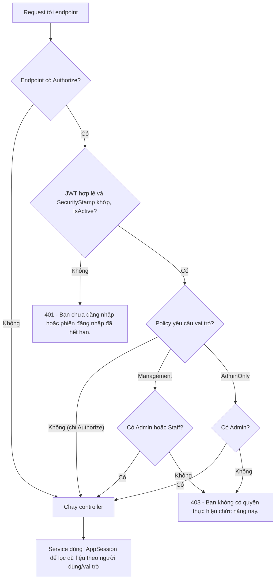
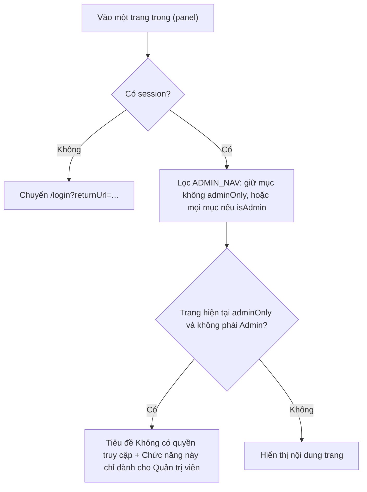
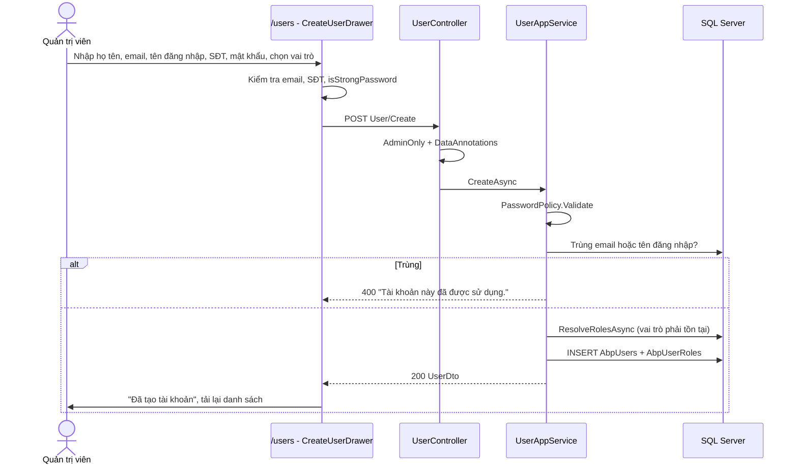
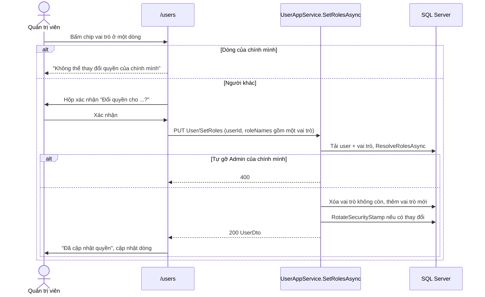
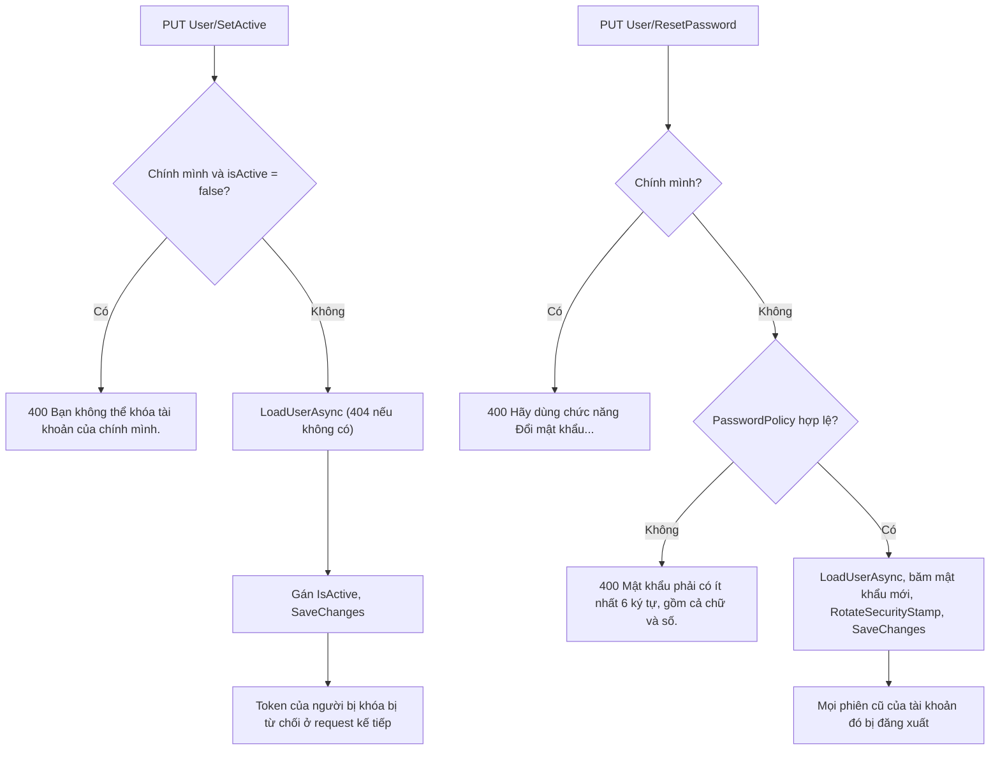

# Phân quyền & quản lý người dùng

Tài liệu mô tả ba vai trò của hệ thống (Khách hàng, Nhân viên, Quản trị viên), cách backend kiểm tra quyền bằng policy `Management` / `AdminOnly` và `IAppSession`, ma trận quyền theo API và màn hình, cùng chức năng Quản lý người dùng chỉ dành cho Quản trị viên.

> Liên quan: [Tổng quan](00-tong-quan.md) · [Xác thực & tài khoản](01-xac-thuc-tai-khoan.md) · [Nhập kho & giá vốn](07-nhap-kho-gia-von.md) · [Thống kê báo cáo](08-thong-ke-bao-cao.md) · [Giao diện frontend](09-giao-dien-frontend.md) · [Cơ sở dữ liệu](10-co-so-du-lieu.md) · [Tài liệu API](../API.md)

---

## 1. Mục đích & phạm vi

- **Phân quyền**: quy định vai trò nào được gọi API nào, được thấy màn hình/menu nào ở trang quản trị.
- **Quản lý người dùng** (UC Quản lý người dùng — chỉ Quản trị viên): xem danh sách và lọc tài khoản, tạo tài khoản (thường là Nhân viên), đổi vai trò, khóa/mở khóa, đặt lại mật khẩu cho người khác.

Ngoài phạm vi: đăng nhập, JWT, SecurityStamp, đổi mật khẩu của chính mình — xem [01-xac-thuc-tai-khoan.md](01-xac-thuc-tai-khoan.md).

## 2. Vai trò & quyền

### 2.1 Ba vai trò cố định

Enum `RoleName` (`HornViet.Domain/Users/Enums/RoleName.cs`). Tên enum chính là giá trị lưu ở `AbpRoles.Name`, giá trị claim Role trong JWT và chuỗi frontend so sánh — **không được đổi tên** (có test `tests/HornViet.Domain.UnitTests/Users/RoleNameTests.cs` giữ cố định đúng ba tên `Admin`, `Staff`, `Customer`).

| `RoleName` | `AbpRoles.DisplayName` (seed) | Mô tả |
|---|---|---|
| `Admin` | Quản trị viên | Toàn quyền, kể cả quản lý người dùng, thống kê doanh thu/lợi nhuận, nhập kho & giá vốn |
| `Staff` | Nhân viên | Quản lý danh mục, nguyên liệu, sản phẩm/biến thể/tồn kho, đơn hàng, xem dashboard (không có số liệu doanh thu) |
| `Customer` | Khách hàng | Giỏ hàng, đặt hàng, đơn của tôi, hồ sơ. Tài khoản tự đăng ký luôn có vai trò này |

Ba vai trò được tạo bởi `DataSeeder.SeedRolesAsync` (`HornViet.Application/DataSeeder.cs`), cùng hai tài khoản demo chỉ dùng cho môi trường dev: `admin / 123qwe` (Admin) và `staff / 123qwe` (Staff). Mật khẩu demo đổi được qua `Seed:AdminPassword`, `Seed:StaffPassword`.

### 2.2 Policy phân quyền

Khai báo trong `AuthorizationPolicies` và `AddJwtAuthentication` (`HornViet.Api/Authorization/Authentication.cs`):

| Policy / attribute | Điều kiện | Dùng cho |
|---|---|---|
| (không có `[Authorize]`) | Ai cũng gọi được | Đăng ký, đăng nhập, quên mật khẩu, xem danh mục/nguyên liệu/sản phẩm |
| `[Authorize]` | Có JWT hợp lệ (mọi vai trò) | Hồ sơ, giỏ hàng, đặt hàng, đơn của tôi |
| `[Authorize(Policy = AuthorizationPolicies.Management)]` | `RequireRole("Admin", "Staff")` — có **một trong hai** vai trò | Các chức năng quản trị chung |
| `[Authorize(Policy = AuthorizationPolicies.AdminOnly)]` | `RequireRole("Admin")` | Quản lý người dùng, nhập kho, báo cáo doanh thu |

Vai trò được đọc từ claim `ClaimTypes.Role` trong JWT (`RoleClaimType = ClaimTypes.Role`). Vì mỗi request đều đối chiếu `SecurityStamp` (xem [01 – mục 3.4](01-xac-thuc-tai-khoan.md#34-securitystamp--thu-hồi-phiên)), khi Admin đổi vai trò thì token cũ mang vai trò cũ bị từ chối ngay (401), người dùng phải đăng nhập lại để nhận quyền mới.

### 2.3 IAppSession — kiểm tra quyền ở tầng Application

`IAppSession` (`HornViet.Application/Common/Interfaces/IAppSession.cs`) cho tầng Application biết ai đang đăng nhập mà không phụ thuộc HttpContext; cài đặt là `HttpContextAppSession` (`HornViet.Api/Authorization/Authentication.cs`) đọc claim từ JWT.

| Thành viên | Ý nghĩa |
|---|---|
| `UserId` | Id từ claim `NameIdentifier`; `null` nếu chưa đăng nhập |
| `IsInRole(string)` / `IsInRole(RoleName)` | Kiểm tra claim Role |
| `GetUserId()` | Bắt buộc đăng nhập, nếu không ném lỗi 400 "Bạn cần đăng nhập để thực hiện thao tác này." |
| `IsManagement()` | `Admin` hoặc `Staff` |

Các chỗ dùng để phân biệt dữ liệu theo vai trò (ngoài policy ở controller):

| Service | Quy tắc |
|---|---|
| `OrderAppService.GetAsync` | Nhân viên/Quản trị viên xem mọi đơn (kèm tên đăng nhập người đặt); khách hàng chỉ xem đơn của mình, đơn người khác → 404 "Không tìm thấy đơn hàng." |
| `OrderAppService.CancelAsync` | Chỉ chủ đơn hủy được (kể cả Admin cũng không hủy hộ qua API này) |
| `ProductAppService.GetAsync` | Sản phẩm đang ẩn chỉ người quản lý xem được |
| `StatisticAppService.GetDashboardAsync` | Chỉ `Admin` nhận `todayRevenue`, `monthRevenue`, `monthProfit`; với Nhân viên các trường này là `null` |
| `UserAppService` | Dùng `GetUserId()` để chặn tự khóa, tự gỡ quyền Admin, tự đặt lại mật khẩu |
| `ProfileAppService`, `CartAppService`, `OrderAppService` | Luôn lấy Id người dùng từ token, không tin Id do frontend gửi |

### 2.4 Ma trận quyền theo API

Ký hiệu: ✔ được phép · ✘ bị từ chối (401 nếu chưa đăng nhập, 403 nếu thiếu vai trò).

| Nhóm API (controller) | Khách vãng lai | Customer | Staff | Admin |
|---|:-:|:-:|:-:|:-:|
| `TokenAuth/Authenticate`, `Account/*` | ✔ | ✔ | ✔ | ✔ |
| `TokenAuth/AuthenticateAdmin` | — | ✘ (400) | ✔ | ✔ |
| `Category/GetAll, Get`, `Material/GetAll, Get`, `Product/GetAll, Get` | ✔ | ✔ | ✔ | ✔ |
| `Profile/*`, `Cart/*` | ✘ | ✔ | ✔ | ✔ |
| `Order/Create, GetMyOrders, Get, Cancel` | ✘ | ✔ | ✔ | ✔ |
| `Category/Create, Update, Delete`, `Material/Create, Update, Delete` | ✘ | ✘ | ✔ | ✔ |
| `Product/GetAdminList, Create, Update, SetActive, Delete` | ✘ | ✘ | ✔ | ✔ |
| `File/UploadImage` | ✘ | ✘ | ✔ | ✔ |
| `Order/GetAll, UpdateStatus` | ✘ | ✘ | ✔ | ✔ |
| `Statistic/GetDashboard` | ✘ | ✘ | ✔ (không có doanh thu) | ✔ |
| `Statistic/GetRevenue, GetTopProducts` | ✘ | ✘ | ✘ | ✔ |
| `StockReceipt/*` | ✘ | ✘ | ✘ | ✔ |
| `User/*` | ✘ | ✘ | ✘ | ✔ |

Nguồn: các attribute `[Authorize]` trong `HornViet.Api/Controllers/**`. Chi tiết từng endpoint: [API.md mục 1.3 và 2](../API.md#13-vai-trò-và-quyền).

### 2.5 Ma trận quyền theo màn hình

| Màn hình | Repo / đường dẫn | Customer | Staff | Admin |
|---|---|:-:|:-:|:-:|
| Cửa hàng: duyệt sản phẩm | `HornViet_customer` `/`, `/products` | ✔ | ✔ (*) | ✔ (*) |
| Cửa hàng: giỏ hàng, đặt hàng, hồ sơ, đơn của tôi | `HornViet_customer` | ✔ | ✘ (*) | ✘ (*) |
| Quản trị: đăng nhập | `HornViet_admin` `/login` | ✘ | ✔ | ✔ |
| Tổng quan | `HornViet_admin` `/` | ✘ | ✔ (ẩn ô doanh thu) | ✔ |
| Danh mục, Nguyên liệu, Sản phẩm, Đơn hàng | `/categories`, `/materials`, `/products`, `/orders` | ✘ | ✔ | ✔ |
| Nhập kho | `/inventory` | ✘ | ✘ | ✔ |
| Người dùng | `/users` | ✘ | ✘ | ✔ |
| Thống kê | `/statistics` | ✘ | ✘ | ✔ |

(*) Frontend cửa hàng không lưu phiên của tài khoản Staff/Admin (xem [01 – mục 4.2](01-xac-thuc-tai-khoan.md#42-đăng-nhập-cửa-hàng-và-quản-trị)), nên Nhân viên/Quản trị viên chỉ duyệt cửa hàng như khách vãng lai.

## 3. Khái niệm & quy tắc nghiệp vụ

### 3.1 Quan hệ người dùng – vai trò

- Quan hệ nhiều – nhiều qua bảng `AbpUserRoles`; backend cho phép một người có **nhiều** vai trò. Giao diện quản trị hiện chỉ gán **một** vai trò mỗi lần (bấm chip → `SetRoles` với một phần tử).
- Tên vai trò truyền vào API (`roleNames`) được `Trim()`, loại trùng không phân biệt hoa thường; tên không tồn tại → 400 `Vai trò "X" không tồn tại.`.
- Không có API xóa người dùng; thay vào đó dùng **khóa tài khoản** (`IsActive = false`).

### 3.2 Ràng buộc khi quản lý người dùng

| Ràng buộc | Backend (`UserAppService`) | Frontend (`HornViet_admin/app/(panel)/users/page.tsx`) |
|---|---|---|
| Không tự gỡ quyền Admin | `SetRolesAsync`: nếu là chính mình và danh sách vai trò mới không có `Admin` → 400 "Bạn không thể tự gỡ quyền Quản trị viên của chính mình." | Chặn **mọi** thay đổi vai trò của chính mình: "Không thể thay đổi quyền của chính mình" |
| Không tự khóa | `SetActiveAsync`: chính mình + `isActive = false` → 400 "Bạn không thể khóa tài khoản của chính mình." | Nút Khóa bị vô hiệu ở dòng "(bạn)" |
| Không tự đặt lại mật khẩu qua API này | `ResetPasswordAsync`: chính mình → 400 "Hãy dùng chức năng Đổi mật khẩu để đổi mật khẩu của chính bạn." | Nút "Đặt lại mật khẩu" bị vô hiệu ở dòng "(bạn)" |
| Mật khẩu mới/khởi tạo đủ mạnh | `PasswordPolicy.Validate` (≥ 6 ký tự, có chữ và số) | `isStrongPassword` |
| Email/tên đăng nhập không trùng | `CreateAsync` → 400 "Tài khoản này đã được sử dụng." | Gắn lỗi vào ô Email |
| Ít nhất một vai trò | `[MinLength(1)]` → "Chọn ít nhất một vai trò." | Luôn gửi đúng một vai trò |

### 3.3 Hiệu lực tức thì lên phiên đăng nhập

| Thao tác của Admin | Ảnh hưởng tới phiên của người bị tác động |
|---|---|
| Đổi vai trò (có thêm hoặc bớt vai trò) | `RotateSecurityStamp()` → mọi token cũ nhận 401, phải đăng nhập lại để nhận quyền mới. Gửi lại đúng tập vai trò hiện có thì không đổi dấu |
| Khóa tài khoản | Không đổi dấu, nhưng `OnTokenValidated` kiểm tra `IsActive` → token bị từ chối (401) ngay ở request kế tiếp. Đăng nhập lại báo "Tài khoản của bạn đã bị khóa..." |
| Mở khóa | Đăng nhập lại được. Token cũ chưa hết hạn (24 giờ) cũng dùng lại được vì dấu không đổi |
| Đặt lại mật khẩu hộ | `RotateSecurityStamp()` → mọi phiên cũ bị đăng xuất |
| Tạo tài khoản | Tài khoản mới `IsActive = true`, đăng nhập được ngay |

### 3.4 Danh sách và lọc

`UserAppService.GetAllAsync` (input `GetUsersInput` kế thừa `PagedInput`):

| Tham số | Ý nghĩa |
|---|---|
| `keyword` | Tìm "chứa" trong tên đăng nhập, họ tên, email hoặc số điện thoại (collation `Latin1_General_100_CI_AI` nên không phân biệt hoa thường/dấu) |
| `roleName` | Chỉ người có vai trò này |
| `isActive` | `true` = đang hoạt động, `false` = đã khóa (giao diện hiện chưa có bộ lọc này) |
| `skipCount`, `maxResultCount` | Phân trang (mặc định 0 và 12, tối đa 100) |

Sắp xếp: mới tạo trước (`CreationTime` giảm dần, rồi `Id` giảm dần). Tài khoản đã xóa mềm không xuất hiện.

## 4. Flow logic

### 4.1 Kiểm tra quyền cho một request

1. `UseAuthentication` / `UseAuthorization` trong `HornViet.Api/Program.cs`.
2. Xác thực JWT và đối chiếu `SecurityStamp` trong `JwtBearerEvents.OnTokenValidated`; thất bại → `OnChallenge` trả 401 với `unauthorizedRequest: true`.
3. Policy `Management` / `AdminOnly`; thiếu vai trò → `OnForbidden` trả 403.
4. Trong service, `IAppSession` quyết định phạm vi dữ liệu (đơn của ai, có thấy doanh thu không...).

### 4.2 Menu trang quản trị theo quyền

`HornViet_admin/app/(panel)/layout.tsx` khai báo mảng `ADMIN_NAV`, mỗi mục có cờ `adminOnly`:

| Mục menu | Đường dẫn | `adminOnly` |
|---|---|:-:|
| Tổng quan | `/` | |
| Danh mục | `/categories` | |
| Nguyên liệu | `/materials` | |
| Sản phẩm | `/products` | |
| Đơn hàng (kèm badge số đơn Chờ xử lý) | `/orders` | |
| Nhập kho | `/inventory` | ✔ |
| Người dùng | `/users` | ✔ |
| Thống kê | `/statistics` | ✔ |

- `isAdmin` lấy từ `HornViet_admin/contexts/auth-context.tsx` (`session.roles.includes("Admin")`).
- Nhân viên gõ thẳng URL `/users` sẽ thấy màn hình "Không có quyền truy cập"; kể cả khi vượt qua giao diện, API `User/*` vẫn trả 403. **Quyền thật luôn do backend quyết định**, menu chỉ là lớp hiển thị.

### 4.3 Tạo tài khoản

- Email chuyển chữ thường; tên đăng nhập bỏ trống → dùng email (giống đăng ký).
- Vai trò mặc định trên giao diện là **Nhân viên**; có thể chọn Khách hàng hoặc Quản trị viên.
- Admin báo mật khẩu ban đầu cho người dùng qua kênh riêng; người dùng nên tự đổi mật khẩu sau lần đăng nhập đầu.

### 4.4 Đổi vai trò

### 4.5 Khóa/mở khóa và đặt lại mật khẩu hộ

- `SetActiveAsync` trả về `UserDto` đã cập nhật; giao diện thay dòng tương ứng mà không tải lại cả trang.
- `ResetPasswordAsync` không trả dữ liệu (`result: null`); giao diện báo "Đã đặt lại mật khẩu cho {tên}".

## 5. Hướng dẫn sử dụng (trang quản trị, tài khoản Admin)

Vào **Người dùng** ở thanh bên (chỉ hiện với Quản trị viên).

**Tìm và lọc**
1. Gõ vào ô "Tên, email, tên đăng nhập, số điện thoại" — danh sách tự lọc sau khi ngừng gõ.
2. Bấm chip **Mọi vai trò / Khách hàng / Nhân viên / Quản trị viên** để lọc theo vai trò.
3. Dùng phân trang ở cuối bảng (12 dòng/trang). Dòng của chính bạn có nhãn "(bạn)".

**Thêm tài khoản nhân viên**
1. Bấm **+ Thêm tài khoản**.
2. Nhập Họ và tên (VD "Nhân viên B"), Email (VD `nhanvien@example.com`), Tên đăng nhập (bỏ trống để dùng email), Số điện thoại (không bắt buộc, VD `09xx xxx xxx`), Mật khẩu (≥ 6 ký tự, có chữ và số).
3. Chọn vai trò (mặc định **Nhân viên**), bấm **Tạo tài khoản**.

**Đổi vai trò**
1. Ở cột Vai trò của dòng cần đổi, bấm chip vai trò mới.
2. Xác nhận hộp thoại "Đổi quyền cho …?". Người dùng đó sẽ bị đăng xuất và cần đăng nhập lại.

**Khóa / mở khóa**
1. Bấm **Khóa** (hoặc **Mở khóa**) ở cột Thao tác, xác nhận hộp thoại.
2. Trạng thái đổi thành "Đã khóa" / "Hoạt động". Người bị khóa mất phiên ngay ở thao tác kế tiếp.

**Đặt lại mật khẩu cho người khác**
1. Bấm **Đặt lại mật khẩu** ở dòng cần đặt lại.
2. Nhập mật khẩu mới hai lần, bấm **Đặt lại mật khẩu**.
3. Báo mật khẩu mới cho người dùng qua kênh riêng. Để đổi mật khẩu của chính mình, dùng nút **Đổi mật khẩu** ở thanh bên (xem [01 – mục 4.6](01-xac-thuc-tai-khoan.md#46-đổi-mật-khẩu)).

## 6. API liên quan

Tất cả thuộc `UserController` (`[Authorize(Policy = AuthorizationPolicies.AdminOnly)]`). Chi tiết: [API.md mục 2.8](../API.md#28-quản-lý-người-dùng-).

| Method | Endpoint | Input | Kết quả | Service |
|---|---|---|---|---|
| GET | `/api/services/app/User/GetAll` | `keyword?, roleName?, isActive?, skipCount, maxResultCount` | `PagedResultDto<UserDto>` | `GetAllAsync` |
| GET | `/api/services/app/User/Get?id=` | `id` | `UserDto` | `GetAsync` |
| GET | `/api/services/app/User/GetRoles` | — | `{ items: RoleDto[] }` | `GetRolesAsync` |
| POST | `/api/services/app/User/Create` | `{ name, emailAddress, userName?, phoneNumber?, password, roleNames }` | `UserDto` | `CreateAsync` |
| PUT | `/api/services/app/User/SetRoles` | `{ userId, roleNames }` | `UserDto` | `SetRolesAsync` |
| PUT | `/api/services/app/User/SetActive` | `{ userId, isActive }` | `UserDto` | `SetActiveAsync` |
| PUT | `/api/services/app/User/ResetPassword` | `{ userId, newPassword }` | `null` | `ResetPasswordAsync` |

`UserDto`: `{ id, userName, name, emailAddress, phoneNumber, isActive, creationTime, roleNames[] }`. `RoleDto`: `{ id, name, displayName }`.

Phía frontend: `userApi` trong `HornViet_admin/lib/api/services.ts`. Trang Người dùng dùng danh sách vai trò cố định `["Customer", "Staff", "Admin"]` thay vì gọi `GetRoles`.

## 7. Dữ liệu

Ánh xạ trong `HornViet.Infrastructure/Persistence/HornVietDbContext.cs`; tên bảng giữ theo quy ước ABP. Bảng `AbpUsers` mô tả ở [01 – mục 7](01-xac-thuc-tai-khoan.md#7-dữ-liệu); toàn bộ lược đồ ở [10-co-so-du-lieu.md](10-co-so-du-lieu.md).

**`AbpRoles`** (thực thể `Role`, có xóa mềm)

| Cột | Kiểu / ràng buộc | Ghi chú |
|---|---|---|
| `Id` | int, PK | |
| `Name` | nvarchar(32), bắt buộc, unique (lọc `IsDeleted = 0`) | `Admin` / `Staff` / `Customer` |
| `DisplayName` | nvarchar(64), bắt buộc | Tên hiển thị tiếng Việt |
| `CreationTime` | datetime2 | |
| `IsDeleted` | bit | |

**`AbpUserRoles`** (thực thể `UserRole`)

| Cột | Kiểu / ràng buộc | Ghi chú |
|---|---|---|
| `Id` | bigint, PK | |
| `UserId` | bigint, FK → `AbpUsers` (cascade) | |
| `RoleId` | int, FK → `AbpRoles` (restrict) | |
| `CreationTime` | datetime2 | |
| — | Unique index `(UserId, RoleId)` | Một vai trò chỉ gán một lần cho một người |

Các cột của `AbpUsers` liên quan đến chức năng này: `IsActive` (khóa/mở khóa), `SecurityStamp` (thu hồi phiên), `Password` (đặt lại mật khẩu hộ), `IsDeleted` (xóa mềm — không có API xóa).

## 8. Lỗi thường gặp & cách xử lý

| HTTP | Thông báo (nguyên văn trong code) | Nguyên nhân | Cách xử lý |
|---|---|---|---|
| 401 | "Bạn chưa đăng nhập hoặc phiên đăng nhập đã hết hạn." | Token hết hạn, tài khoản bị khóa, hoặc vừa bị đổi vai trò / đặt lại mật khẩu | Đăng nhập lại |
| 403 | "Bạn không có quyền thực hiện chức năng này." | Gọi API thiếu vai trò (VD Nhân viên gọi `User/*`, `StockReceipt/*`, `Statistic/GetRevenue`) | Dùng tài khoản Admin |
| (giao diện) | "Không có quyền truy cập" / "Chức năng này chỉ dành cho Quản trị viên" | Nhân viên mở trang `adminOnly` | Về Tổng quan |
| 400 | "Bạn không thể tự gỡ quyền Quản trị viên của chính mình." | `SetRoles` cho chính mình không còn `Admin` | Nhờ Admin khác thực hiện |
| 400 | "Bạn không thể khóa tài khoản của chính mình." | `SetActive(false)` cho chính mình | Nhờ Admin khác thực hiện |
| 400 | "Hãy dùng chức năng Đổi mật khẩu để đổi mật khẩu của chính bạn." | `User/ResetPassword` cho chính mình | Dùng `Profile/ChangePassword` |
| 400 | "Tài khoản này đã được sử dụng." | Tạo tài khoản trùng email hoặc tên đăng nhập | Dùng email/tên đăng nhập khác |
| 400 | `Vai trò "X" không tồn tại.` | `roleNames` có tên không có trong `AbpRoles` | Dùng `Admin` / `Staff` / `Customer` |
| 400 | "Chọn ít nhất một vai trò." | `roleNames` rỗng | Chọn một vai trò |
| 400 | "Mật khẩu phải có ít nhất 6 ký tự, gồm cả chữ và số." | Mật khẩu yếu khi tạo / đặt lại | Đặt mật khẩu mạnh hơn |
| 400 | "Vui lòng nhập mật khẩu mới." | `User/ResetPassword` thiếu `newPassword` | Nhập mật khẩu |
| 400 | "Dữ liệu không hợp lệ." + `validationErrors` | Vi phạm DataAnnotations của `CreateUserInput` (VD "Số điện thoại không hợp lệ."). Lưu ý: `[Required]`, `[EmailAddress]` của `Name`, `EmailAddress`, `Password` không khai báo `ErrorMessage` nên thông báo là câu mặc định tiếng Anh của ASP.NET Core | Sửa trường được chỉ ra |
| 404 | "Không tìm thấy người dùng." | `userId` không tồn tại hoặc đã xóa mềm | Tải lại danh sách |

## 9. Mã nguồn liên quan

**Backend** (`HornViet.Api`)

| File | Nội dung |
|---|---|
| `HornViet.Domain/Users/Enums/RoleName.cs` | Enum vai trò |
| `HornViet.Domain/Users/Entities/User.cs` | `User`, `Role`, `UserRole` |
| `HornViet.Application/Users/UserAppService.cs` | DTO và `UserAppService` (danh sách, tạo, đổi vai trò, khóa, đặt lại mật khẩu) |
| `HornViet.Application/Common/Interfaces/IAppSession.cs` | `IAppSession`, `AppSessionExtensions` |
| `HornViet.Application/DataSeeder.cs` | Seed vai trò và tài khoản demo |
| `HornViet.Api/Authorization/Authentication.cs` | `AuthorizationPolicies`, `HttpContextAppSession`, đăng ký policy, `OnForbidden` |
| `HornViet.Api/Controllers/Admin/UserController.cs` | API quản lý người dùng |
| `HornViet.Api/Controllers/**` | Attribute `[Authorize]` làm nguồn cho ma trận quyền |
| `HornViet.Application/Orders/OrderAppService.cs`, `HornViet.Application/Catalog/ProductAppService.cs`, `HornViet.Application/Statistics/StatisticAppService.cs` | Phân biệt dữ liệu theo vai trò qua `IAppSession` |
| `HornViet.Infrastructure/Persistence/HornVietDbContext.cs` | Ánh xạ `AbpRoles`, `AbpUserRoles` |
| `tests/HornViet.Domain.UnitTests/Users/RoleNameTests.cs` | Giữ cố định tên vai trò |

**Frontend**

| File | Nội dung |
|---|---|
| `HornViet_admin/app/(panel)/layout.tsx` | `ADMIN_NAV`, lọc menu theo `isAdmin`, màn hình "Không có quyền truy cập" |
| `HornViet_admin/app/(panel)/users/page.tsx` | Trang Người dùng: `CreateUserDrawer`, `ResetPasswordDrawer`, đổi vai trò, khóa/mở khóa |
| `HornViet_admin/contexts/auth-context.tsx` | `session`, `isAdmin`, `isStaffRoles` |
| `HornViet_admin/lib/api/services.ts` | `userApi` |
| `HornViet_admin/lib/hsv/format.ts` | `ROLE_LABEL`, `roleLabel` |
| `HornViet_customer/contexts/auth-context.tsx` | Chặn phiên Staff/Admin ở cửa hàng |
