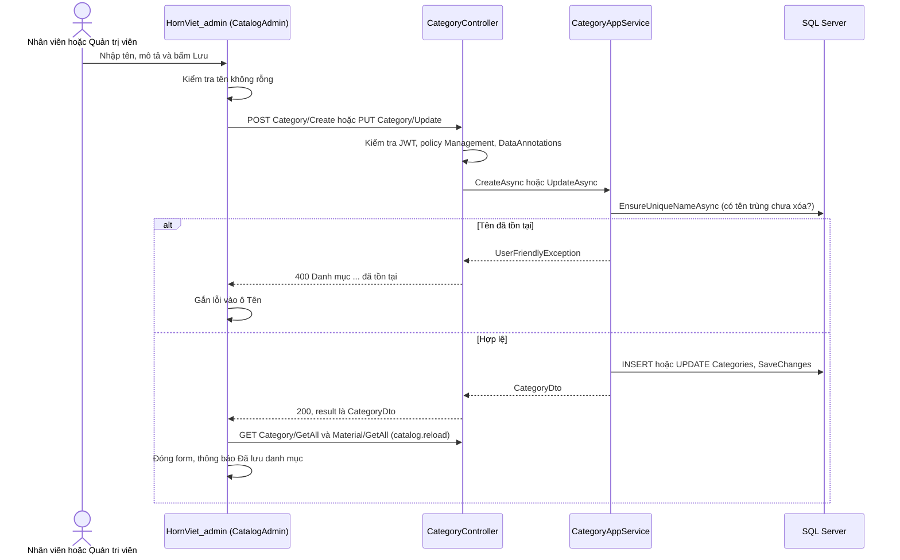
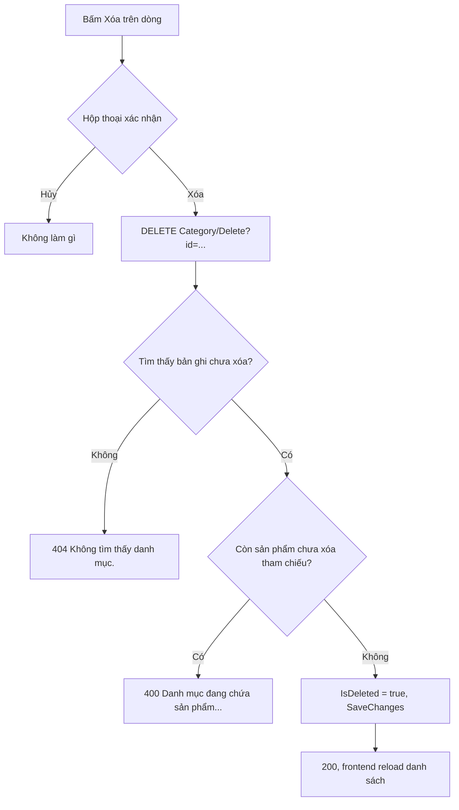
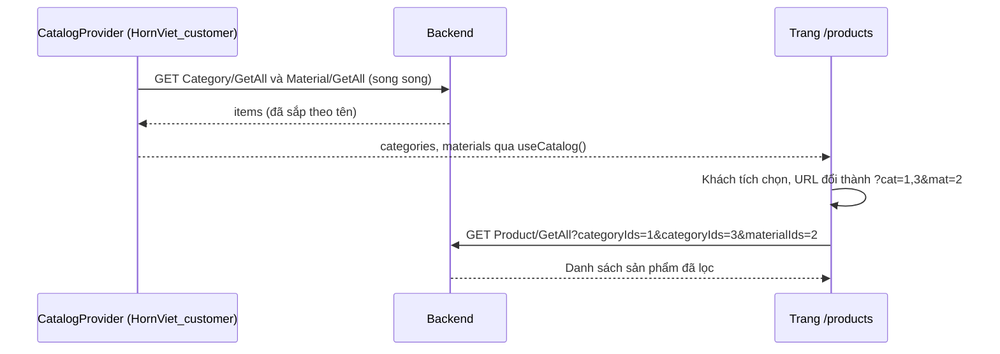

# Danh mục & nguyên liệu

Danh mục (Category) dùng để phân loại sản phẩm, nguyên liệu (Material) mô tả chất liệu và nguồn gốc làng nghề của sản phẩm. Cả hai đều được đọc công khai (menu, bộ lọc ở cửa hàng) và được Nhân viên / Quản trị viên thêm, sửa, xóa mềm ở trang quản trị.

---

## 1. Mục đích & phạm vi

| Đối tượng | Mục đích | Ví dụ |
|---|---|---|
| **Danh mục** | Phân loại sản phẩm, hiện trên menu đầu trang, trang chủ ("Danh mục nổi bật") và bộ lọc trang Sản phẩm | Lược sừng, Trâm cài, Đồ trang trí |
| **Nguyên liệu** | Cho biết sản phẩm làm từ chất liệu gì, nguồn gốc ở đâu. Hiện ở bộ lọc "Chất liệu", trang chủ và tab "Nguồn gốc nguyên liệu" của trang chi tiết sản phẩm | Sừng trâu — Làng nghề Thụy Ứng, Hà Nội |

Mỗi sản phẩm thuộc **đúng một** danh mục và **đúng một** nguyên liệu (khóa ngoại `Products.CategoryId`, `Products.MaterialId`). Chi tiết về sản phẩm xem [Sản phẩm, biến thể & tồn kho](04-san-pham-bien-the-ton-kho.md).

Tài liệu này gồm: mô hình dữ liệu, quy tắc nghiệp vụ, CRUD ở trang quản trị (`HornViet_admin`), cách cửa hàng (`HornViet_customer`) dùng danh mục / nguyên liệu để lọc sản phẩm.

## 2. Vai trò & quyền

| Thao tác | Khách vãng lai / Khách hàng | Nhân viên (`Staff`) | Quản trị viên (`Admin`) |
|---|---|---|---|
| Xem danh sách, xem chi tiết (`GetAll`, `Get`) | Có | Có | Có |
| Thêm, sửa, xóa (`Create`, `Update`, `Delete`) | Không (401 / 403) | Có | Có |

- Quyền ghi được khai báo bằng `[Authorize(Policy = AuthorizationPolicies.Management)]` trong `CategoryController` và `MaterialController`. Policy `Management` yêu cầu vai trò `Admin` hoặc `Staff` (`Website.Api/Authorization/Authentication.cs`).
- Ở trang quản trị, menu "Danh mục" và "Nguyên liệu" hiện cho cả Nhân viên và Quản trị viên (`adminOnly: false` trong `HornViet_admin/app/(panel)/layout.tsx`).

Xem thêm: [Phân quyền người dùng](02-phan-quyen-nguoi-dung.md).

## 3. Khái niệm & quy tắc nghiệp vụ

### 3.1 Trường dữ liệu

**Danh mục** — entity `Category` (`Website.Domain/Catalog/Entities/Catalog.cs`)

| Trường | Kiểu | Bắt buộc | Ghi chú |
|---|---|---|---|
| `Id` | int | Tự sinh | Khóa chính |
| `Name` | string, tối đa 255 | Có | Duy nhất trong các bản ghi chưa xóa |
| `Description` | string | Không | Mô tả |
| `CreationTime` | DateTime | Tự gán | `WebsiteDbContext.ApplyAuditConcepts` gán `DateTime.Now` khi thêm |
| `IsDeleted` | bool | — | Cờ xóa mềm |

DTO trả về (`CategoryDto`) có thêm **`ProductCount`** = số sản phẩm **đang bán** (`IsActive = true`, chưa xóa) thuộc danh mục (`CategoryAppService.Project`).

**Nguyên liệu** — entity `Material`

| Trường | Kiểu | Bắt buộc | Ghi chú |
|---|---|---|---|
| `Id` | int | Tự sinh | Khóa chính |
| `Name` | string, tối đa 255 | Có | Duy nhất trong các bản ghi chưa xóa |
| `Origin` | string, tối đa 255 | Không | Nguồn gốc / làng nghề |
| `Description` | string | Không | Mô tả đặc điểm, tính hợp pháp |
| `CreationTime` | DateTime | Tự gán | |
| `IsDeleted` | bool | — | Cờ xóa mềm |

`MaterialDto` gồm `Id, Name, Origin, Description` (không có `ProductCount`, không có `CreationTime`).

### 3.2 Quy tắc

| # | Quy tắc | Nơi thực hiện |
|---|---|---|
| R1 | Tên bắt buộc, tối đa 255 ký tự. Tên được cắt khoảng trắng đầu/cuối (`Trim`) trước khi lưu. | DataAnnotations trong `CreateOrUpdateCategoryInput` / `CreateOrUpdateMaterialInput`; `CreateAsync`, `UpdateAsync` |
| R2 | **Tên duy nhất trong các bản ghi chưa xóa.** Khi tạo / sửa, service kiểm tra có bản ghi khác (khác `Id`) cùng tên hay không. Bản ghi đã xóa mềm không tính, nên có thể tạo lại danh mục trùng tên với danh mục đã xóa. | `EnsureUniqueNameAsync` (service) + chỉ mục duy nhất có lọc `[IsDeleted] = 0` trên cột `Name` (`WebsiteDbContext.OnModelCreating`) |
| R3 | So sánh tên dùng collation của CSDL `Latin1_General_100_CI_AI` (không phân biệt hoa/thường và dấu). Vì vậy "Sừng Trâu", "sung trau" được coi là **trùng** với "Sừng trâu". | `b.UseCollation("Latin1_General_100_CI_AI")` trong `WebsiteDbContext` |
| R4 | **Xóa là xóa mềm** (`IsDeleted = true`), bản ghi vẫn còn trong CSDL. Bộ lọc toàn cục `!x.IsDeleted` khiến bản ghi đã xóa không còn xuất hiện trong mọi truy vấn. | `Repository.Delete`, `WebsiteDbContext` (bộ lọc xóa mềm) |
| R5 | **Không xóa được danh mục còn sản phẩm** — tính cả sản phẩm đang ẩn (`IsActive = false`); sản phẩm đã xóa mềm không tính. | `CategoryAppService.DeleteAsync` |
| R6 | **Không xóa được nguyên liệu đang được sản phẩm dùng** (cùng cách tính như R5). | `MaterialAppService.DeleteAsync` |
| R7 | Ở mức CSDL, khóa ngoại `Products → Categories` và `Products → Materials` là `Restrict` (không xóa dây chuyền). | `WebsiteDbContext.OnModelCreating` |
| R8 | Danh sách luôn sắp theo tên tăng dần, không phân trang. | `GetAllAsync` (`OrderBy(c => c.Name)`) |

> Lưu ý: cột "Đang bán" ở trang quản trị hiển thị `productCount` (chỉ đếm sản phẩm đang bán). Một danh mục hiện "0 sản phẩm" vẫn có thể **không xóa được** nếu còn sản phẩm đang ẩn (R5). Dòng gợi ý trên trang quản trị đã nói rõ điều này.

## 4. Flow logic

### 4.1 Thêm / sửa danh mục (nguyên liệu tương tự)



| Bước | Mô tả | File / hàm |
|---|---|---|
| 1 | Form bên phải trang kiểm tra tên rỗng phía client ("Vui lòng nhập tên danh mục"). | `HornViet_admin/components/hsv/catalog-admin.tsx` → `save` |
| 2 | Gọi `categoryApi.create` (không có `id`) hoặc `categoryApi.update` (có `id`). Với nguyên liệu gửi thêm `origin`. | `HornViet_admin/lib/api/services.ts` |
| 3 | Controller bọc lời gọi trong `Run(...)`, lỗi nghiệp vụ được đổi thành 400 / 404. | `Website.Api/Controllers/Catalog/CategoryController.cs`, `Website.Api/Controllers/WebsiteBaseController.cs` |
| 4 | `UpdateAsync` báo lỗi nếu thiếu `id` hoặc không tìm thấy bản ghi; sau đó kiểm tra trùng tên. | `Website.Application/Catalog/CategoryMaterialAppServices.cs` → `CreateAsync`, `UpdateAsync`, `EnsureUniqueNameAsync` |
| 5 | Lưu thành công → frontend gọi `catalog.reload()` để cập nhật danh sách dùng chung (bộ lọc, form sản phẩm). | `HornViet_admin/contexts/catalog-context.tsx` |

### 4.2 Xóa danh mục / nguyên liệu



| Bước | Mô tả | File / hàm |
|---|---|---|
| 1 | `useConfirm` hiện hộp thoại "Xóa danh mục “…”?". | `catalog-admin.tsx` → `remove` |
| 2 | Service tìm bản ghi (bộ lọc xóa mềm đang bật), nếu không có → `EntityNotFoundException` (404). | `CategoryAppService.DeleteAsync` / `MaterialAppService.DeleteAsync` |
| 3 | Kiểm tra `Products` có bản ghi nào với `CategoryId` (hoặc `MaterialId`) bằng `id`. Có → `UserFriendlyException` (400). | như trên |
| 4 | `Repository.Delete` đặt `IsDeleted = true` (xóa mềm), `SaveChanges`. | `Website.Infrastructure/Persistence/Repositories/Repository.cs` |
| 5 | Lỗi được hiển thị bằng thông báo nổi (`notify`). | `catalog-admin.tsx` |

### 4.3 Hiển thị ở cửa hàng



- `CatalogProvider` tải danh mục và nguyên liệu một lần khi mở trang (dùng `Promise.allSettled`, lỗi một bên không làm hỏng bên kia). File giống hệt nhau ở hai repo: `HornViet_customer/contexts/catalog-context.tsx`, `HornViet_admin/contexts/catalog-context.tsx`.
- Trang `/products` lưu lựa chọn trên URL dạng `cat=1,3`, `mat=2` (phân tách bằng dấu phẩy). Khi gọi API, `buildQuery` trong `lib/api/http.ts` chuyển mảng thành tham số lặp `categoryIds=1&categoryIds=3`.
- Backend lọc: sản phẩm thuộc **một trong** các danh mục đã chọn **và** thuộc **một trong** các nguyên liệu đã chọn (`ProductAppService.GetAllAsync`).

## 5. Hướng dẫn sử dụng

### 5.1 Trang quản trị (`http://localhost:3001`)

**Thêm danh mục**
1. Đăng nhập bằng tài khoản Nhân viên hoặc Quản trị viên.
2. Chọn menu **Danh mục** (`/categories`).
3. Bấm **+ Thêm danh mục**. Form "Thêm danh mục" mở ở cột bên phải.
4. Nhập **Tên danh mục** (VD: `Trâm cài`) và **Mô tả** (không bắt buộc).
5. Bấm **Lưu** (hoặc nhấn Enter trong ô tên). Thông báo "Đã lưu danh mục" hiện lên, danh sách tự cập nhật.

**Sửa danh mục**
1. Trên dòng cần sửa, bấm **Sửa**. Form "Sửa danh mục" mở với dữ liệu hiện tại.
2. Chỉnh tên / mô tả, bấm **Lưu**.

**Xóa danh mục**
1. Bấm **Xóa** trên dòng tương ứng.
2. Xác nhận trong hộp thoại. Nếu danh mục còn sản phẩm (kể cả sản phẩm đang ẩn), hệ thống báo lỗi và không xóa. Hãy chuyển sản phẩm sang danh mục khác (sửa sản phẩm) hoặc xóa các sản phẩm đó trước.

**Nguyên liệu** (menu **Nguyên liệu**, `/materials`): thao tác giống danh mục; form có thêm ô **Xuất xứ** (VD: `Làng nghề Thụy Ứng, Hà Nội`) và ô **Mô tả đặc điểm, tính hợp pháp**. Bảng nguyên liệu hiển thị cột Tên, Xuất xứ, Mô tả (không có cột số sản phẩm).

### 5.2 Trang cửa hàng (`http://localhost:3000`)

| Vị trí | Cách dùng | File |
|---|---|---|
| Thanh menu dưới header | Hiện tối đa 5 danh mục đầu tiên (theo tên), bấm để mở `/products?cat={id}` | `HornViet_customer/components/hsv/store-header.tsx` |
| Trang chủ — "Danh mục nổi bật" | Mỗi ô hiện tên và "`productCount` sản phẩm", bấm để lọc theo danh mục | `HornViet_customer/app/(store)/page.tsx` |
| Trang chủ — "Sừng thật, nguồn gốc rõ ràng" | Mỗi thẻ nguyên liệu hiện tên và xuất xứ, bấm mở `/products?mat={id}` | `HornViet_customer/app/(store)/page.tsx` |
| Trang Sản phẩm — cột lọc trái | Tích chọn nhiều **Danh mục** (kèm số sản phẩm đang bán) và nhiều **Chất liệu**; bấm **Xóa bộ lọc** để bỏ hết | `HornViet_customer/app/(store)/products/page.tsx` |
| Chi tiết sản phẩm — tab "Nguồn gốc nguyên liệu" | Hiện tên nguyên liệu, xuất xứ ("Đang cập nhật" nếu trống) và mô tả | `HornViet_customer/app/(store)/products/[id]/page.tsx` |

## 6. API liên quan

Chi tiết định dạng request / response: [Tài liệu API](../API.md) (mục 2.2). Mọi response được bọc trong `{ result, success, error, ... }`.

| Method | Endpoint | Quyền | Input | Output (`result`) |
|---|---|---|---|---|
| GET | `/api/services/app/Category/GetAll` | Công khai | — | `{ items: [{ id, name, description, productCount, creationTime }] }` |
| GET | `/api/services/app/Category/Get?id=` | Công khai | `id` | `CategoryDto` |
| POST | `/api/services/app/Category/Create` | Management | `{ name, description? }` | `CategoryDto` |
| PUT | `/api/services/app/Category/Update` | Management | `{ id, name, description? }` | `CategoryDto` |
| DELETE | `/api/services/app/Category/Delete?id=` | Management | `id` | `null` |
| GET | `/api/services/app/Material/GetAll` | Công khai | — | `{ items: [{ id, name, origin, description }] }` |
| GET | `/api/services/app/Material/Get?id=` | Công khai | `id` | `MaterialDto` |
| POST | `/api/services/app/Material/Create` | Management | `{ name, origin?, description? }` | `MaterialDto` |
| PUT | `/api/services/app/Material/Update` | Management | `{ id, name, origin?, description? }` | `MaterialDto` |
| DELETE | `/api/services/app/Material/Delete?id=` | Management | `id` | `null` |

Ví dụ (dữ liệu minh họa):

```json
// POST /api/services/app/Material/Create
{ "name": "Sừng bò", "origin": "Làng nghề ví dụ, tỉnh X", "description": "Mô tả minh họa" }
```

## 7. Dữ liệu

| Bảng | Cột | Ghi chú |
|---|---|---|
| `Categories` | `Id` (PK), `Name` nvarchar(255) NOT NULL, `Description`, `CreationTime`, `IsDeleted` | Chỉ mục duy nhất trên `Name` có lọc `[IsDeleted] = 0` |
| `Materials` | `Id` (PK), `Name` nvarchar(255) NOT NULL, `Origin` nvarchar(255), `Description`, `CreationTime`, `IsDeleted` | Chỉ mục duy nhất trên `Name` có lọc `[IsDeleted] = 0` |
| `Products` | `CategoryId` (FK → `Categories`, Restrict), `MaterialId` (FK → `Materials`, Restrict) | Có chỉ mục `(IsActive, CategoryId)` |

Cấu hình trong `Website.Infrastructure/Persistence/WebsiteDbContext.cs`. Toàn bộ mô hình CSDL: [Cơ sở dữ liệu](10-co-so-du-lieu.md).

## 8. Lỗi thường gặp & cách xử lý

| HTTP | Thông báo (`error.message`) | Nguyên nhân | Cách xử lý |
|---|---|---|---|
| 400 | `Dữ liệu không hợp lệ.` — chi tiết `Vui lòng nhập tên danh mục.` / `Vui lòng nhập tên nguyên liệu.` | Gửi tên rỗng hoặc quá 255 ký tự (DataAnnotations) | Nhập tên hợp lệ |
| 400 | `Danh mục "…" đã tồn tại. Vui lòng nhập tên khác.` | Trùng tên với danh mục chưa xóa (không phân biệt hoa/thường, dấu) | Đổi tên khác. Trang quản trị gắn lỗi này vào ô Tên |
| 400 | `Nguyên liệu "…" đã tồn tại.` | Trùng tên nguyên liệu | Như trên |
| 400 | `Thiếu mã danh mục.` / `Thiếu mã nguyên liệu.` | Gọi `Update` không có `id` | Gửi kèm `id` |
| 400 | `Danh mục đang chứa sản phẩm. Hãy chuyển hoặc ẩn các sản phẩm trước khi xóa.` | Còn sản phẩm chưa xóa thuộc danh mục | Chuyển sản phẩm sang danh mục khác hoặc xóa sản phẩm. **Lưu ý:** chỉ "ẩn" sản phẩm là **chưa đủ** — sản phẩm ẩn vẫn chặn việc xóa (xem mục "Điểm cần lưu ý" bên dưới) |
| 400 | `Nguyên liệu đang được dùng cho sản phẩm, không thể xóa.` | Còn sản phẩm chưa xóa dùng nguyên liệu | Đổi nguyên liệu của sản phẩm hoặc xóa sản phẩm |
| 404 | `Không tìm thấy danh mục.` / `Không tìm thấy nguyên liệu.` | `id` không tồn tại hoặc đã xóa mềm | Tải lại danh sách |
| 401 / 403 | — | Chưa đăng nhập / tài khoản không phải Nhân viên, Quản trị viên | Đăng nhập đúng tài khoản ([Xác thực tài khoản](01-xac-thuc-tai-khoan.md)) |

**Điểm cần lưu ý:** thông báo lỗi khi xóa danh mục gợi ý "chuyển hoặc **ẩn** các sản phẩm", nhưng code (`CategoryAppService.DeleteAsync`) kiểm tra mọi sản phẩm chưa xóa mềm, kể cả sản phẩm đang ẩn. Vì vậy ẩn sản phẩm không giúp xóa được danh mục.

## 9. Mã nguồn liên quan

**Backend (`Website.Api`)**

| File | Nội dung |
|---|---|
| `Website.Domain/Catalog/Entities/Catalog.cs` | Entity `Category`, `Material` |
| `Website.Application/Catalog/CategoryMaterialAppServices.cs` | DTO, input, `CategoryAppService`, `MaterialAppService` |
| `Website.Api/Controllers/Catalog/CategoryController.cs` | API danh mục |
| `Website.Api/Controllers/Catalog/MaterialController.cs` | API nguyên liệu |
| `Website.Api/Controllers/WebsiteBaseController.cs` | `Run(...)` đổi lỗi nghiệp vụ thành HTTP 400 / 404 / 409 |
| `Website.Api/Middlewares/ResponseHandling.cs` | `BusinessErrors.TryMap`, định dạng lỗi validation |
| `Website.Infrastructure/Persistence/WebsiteDbContext.cs` | Cấu hình bảng, chỉ mục duy nhất, collation, bộ lọc xóa mềm |
| `Website.Infrastructure/Persistence/Repositories/Repository.cs` | `Delete` = xóa mềm với entity `ISoftDelete` |

**Trang quản trị (`HornViet_admin`)**

| File | Nội dung |
|---|---|
| `HornViet_admin/app/(panel)/categories/page.tsx` | Trang `/categories` (dùng `CatalogAdmin kind="category"`) |
| `HornViet_admin/app/(panel)/materials/page.tsx` | Trang `/materials` (dùng `CatalogAdmin kind="material"`) |
| `HornViet_admin/components/hsv/catalog-admin.tsx` | Bảng + form thêm/sửa/xóa dùng chung |
| `HornViet_admin/contexts/catalog-context.tsx` | `CatalogProvider`, `useCatalog`, `reload()` |
| `HornViet_admin/lib/api/services.ts` | `categoryApi`, `materialApi` |

**Trang cửa hàng (`HornViet_customer`)**

| File | Nội dung |
|---|---|
| `HornViet_customer/contexts/catalog-context.tsx` | Tải danh mục, nguyên liệu dùng chung |
| `HornViet_customer/components/hsv/store-header.tsx` | Menu danh mục |
| `HornViet_customer/app/(store)/page.tsx` | Danh mục nổi bật, thẻ nguyên liệu |
| `HornViet_customer/app/(store)/products/page.tsx` | Bộ lọc danh mục / chất liệu |
| `HornViet_customer/app/(store)/products/[id]/page.tsx` | Tab "Nguồn gốc nguyên liệu" |

Tài liệu liên quan: [Tổng quan](00-tong-quan.md) · [Sản phẩm, biến thể & tồn kho](04-san-pham-bien-the-ton-kho.md) · [Giao diện frontend](09-giao-dien-frontend.md)
