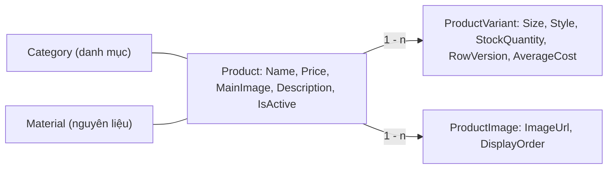
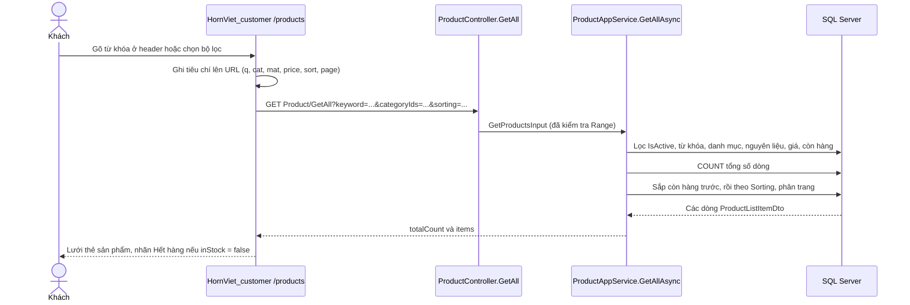
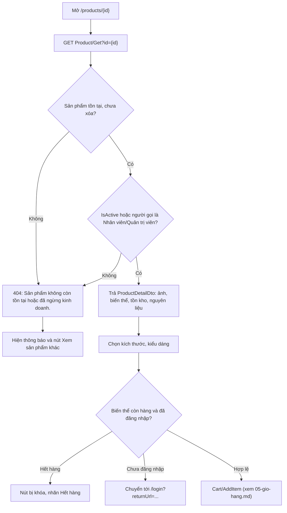
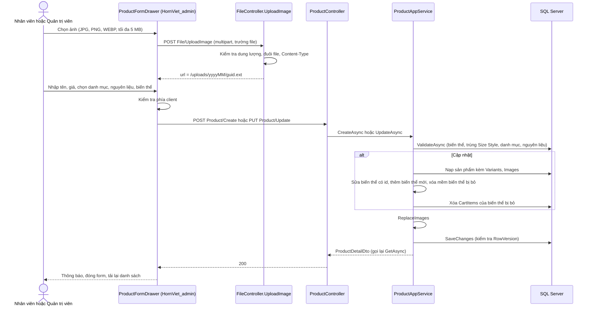
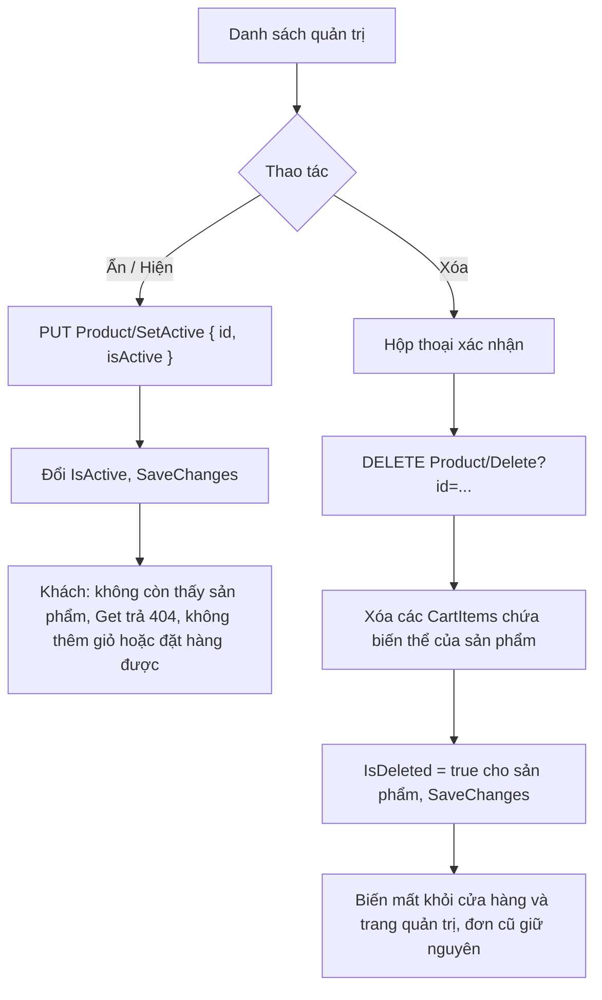

# Sản phẩm, biến thể & tồn kho

Sản phẩm (Product) là gốc tổng hợp sở hữu các biến thể (ProductVariant — kích thước / kiểu dáng) và bộ ảnh. Tồn kho được quản lý **theo từng biến thể**. Khách xem, tìm kiếm, lọc sản phẩm ở cửa hàng. Nhân viên / Quản trị viên tạo, sửa, ẩn/hiện, xóa mềm sản phẩm ở trang quản trị.

---

## 1. Mục đích & phạm vi

Tài liệu mô tả:

- Mô hình **Sản phẩm → Biến thể → Tồn kho** và ảnh sản phẩm (upload qua `File/UploadImage`).
- Phía khách (`HornViet_customer`): trang chủ, danh sách sản phẩm, tìm kiếm không dấu, lọc, sắp xếp, trang chi tiết.
- Phía quản trị (`HornViet_admin`): danh sách quản trị (lọc, sắp hết hàng), form tạo/sửa sản phẩm kèm biến thể, ẩn/hiện, xóa mềm.
- Quy tắc tồn kho và cơ chế chống bán vượt tồn (RowVersion).

Ngoài phạm vi (chỉ liên kết): giỏ hàng — [Giỏ hàng](05-gio-hang.md); trừ / hoàn kho khi đặt và hủy đơn — [Đặt hàng & đơn hàng](06-dat-hang-don-hang.md); giá vốn bình quân và phiếu nhập — [Nhập kho & giá vốn](07-nhap-kho-gia-von.md); danh mục, nguyên liệu — [Danh mục & nguyên liệu](03-danh-muc-nguyen-lieu.md).

## 2. Vai trò & quyền

| Thao tác | Khách vãng lai / Khách hàng | Nhân viên | Quản trị viên |
|---|---|---|---|
| Xem danh sách (`Product/GetAll`), chỉ sản phẩm đang bán | Có | Có | Có |
| Xem chi tiết (`Product/Get`) sản phẩm **đang bán** | Có | Có | Có |
| Xem chi tiết sản phẩm **đang ẩn** | Không (404) | Có | Có |
| Danh sách quản trị, tạo, sửa, ẩn/hiện, xóa | Không | Có | Có |
| Upload ảnh (`File/UploadImage`) | Không | Có | Có |
| Xem / nhập giá vốn (`AverageCost`) | Không | Không | Có (xem [07](07-nhap-kho-gia-von.md)) |

- Các action quản trị gắn `[Authorize(Policy = AuthorizationPolicies.Management)]` (vai trò `Admin` hoặc `Staff`). `FileController` gắn policy này ở cấp class.
- Quyền xem sản phẩm ẩn được kiểm tra trong `ProductAppService.GetAsync` bằng `_session.IsManagement()`.

Chi tiết vai trò: [Phân quyền người dùng](02-phan-quyen-nguoi-dung.md).

## 3. Khái niệm & quy tắc nghiệp vụ

### 3.1 Mô hình



| Khái niệm | Mô tả | Code |
|---|---|---|
| **Sản phẩm** | Có tên, **giá bán ở cấp sản phẩm** (mọi biến thể chung một giá), ảnh đại diện `MainImage` (bắt buộc), mô tả, cờ `IsActive`. Thuộc đúng một danh mục và một nguyên liệu. | `Product` |
| **Biến thể** | Đơn vị quản lý tồn kho và đặt mua. Gồm `Size` (kích thước) và `Style` (kiểu dáng), đều không bắt buộc, tối đa 100 ký tự. | `ProductVariant` |
| **DisplayName** | Tên hiển thị của biến thể: ghép `Size` và `Style` không rỗng bằng `" / "`. Cả hai trống → `"Mặc định"`. Không lưu CSDL (`e.Ignore(x => x.DisplayName)`). | `ProductVariant.DisplayName` |
| **Tồn kho** | `StockQuantity` của từng biến thể, setter `private` — chỉ đổi qua các phương thức nghiệp vụ (mục 3.3). Tổng tồn kho của sản phẩm = tổng tồn của các biến thể chưa xóa. | `ProductVariant` |
| **Ảnh** | `MainImage` (ảnh đại diện, 1 URL) + `Images` (bộ ảnh chi tiết, bảng `ProductImages`, sắp theo `DisplayOrder`). | `Product`, `ProductImage` |
| **Ẩn / hiện** | `IsActive = false`: không hiện ở cửa hàng, khách gọi `Product/Get` nhận 404, không thêm vào giỏ / đặt hàng được; vẫn quản lý được ở trang quản trị. | `ProductAppService`, `CartAppService`, `OrderAppService` |
| **Xóa mềm** | `IsDeleted = true` cho sản phẩm hoặc biến thể. Bộ lọc toàn cục loại bản ghi đã xóa khỏi mọi truy vấn (cả trang quản trị). Lịch sử đơn vẫn giữ vì `OrderItems` lưu tên sản phẩm, tên biến thể, đơn giá lúc mua. | `HornVietDbContext`, `Repository.Delete` |
| **Giá vốn bình quân** | `AverageCost` (decimal(18,4), null nếu chưa có phiếu nhập). Chỉ phiếu nhập kho làm đổi giá trị này. | Xem [Nhập kho & giá vốn](07-nhap-kho-gia-von.md) |

### 3.2 Quy tắc sản phẩm & biến thể

| # | Quy tắc | Nơi thực hiện |
|---|---|---|
| P1 | Bắt buộc: danh mục (`categoryId ≥ 1`), nguyên liệu (`materialId ≥ 1`), tên (≤ 255 ký tự), ảnh đại diện (≤ 500 ký tự). Giá trong khoảng 0 – 999.999.999. | DataAnnotations trong `CreateOrUpdateProductInput` (`ProductDtos.cs`) |
| P2 | Danh mục và nguyên liệu phải tồn tại (chưa xóa). | `ProductAppService.ValidateAsync` |
| P3 | **Sản phẩm phải có ít nhất một biến thể.** | `ValidateAsync` |
| P4 | **Không có hai biến thể trùng cặp (Size, Style)** — so sánh sau khi cắt khoảng trắng, không phân biệt hoa thường. Chuỗi rỗng được coi là `null`. | `ValidateAsync`, `Clean` |
| P5 | Khi **cập nhật**, đồng bộ biến thể theo `id`: có `id` → sửa (Size, Style, tồn kho); không có `id` → thêm mới; biến thể cũ không gửi lên → **xóa mềm** và gỡ khỏi mọi giỏ hàng. `id` không thuộc sản phẩm → lỗi. | `ProductAppService.UpdateAsync` |
| P6 | `images` là danh sách đầy đủ, **ghi đè** danh sách cũ: bỏ URL rỗng, bỏ trùng, đánh `DisplayOrder` 0, 1, 2… theo thứ tự gửi lên. | `ProductAppService.ReplaceImages` |
| P7 | **Xóa sản phẩm** = xóa mềm sản phẩm + xóa các dòng giỏ hàng chứa biến thể của nó. | `ProductAppService.DeleteAsync` |
| P8 | Khách chỉ thấy sản phẩm `IsActive = true` và chưa xóa. Sản phẩm ẩn hoặc đã xóa → 404 `Sản phẩm không còn tồn tại hoặc đã ngừng kinh doanh.` (Nhân viên/Quản trị viên vẫn xem được sản phẩm ẩn, nhưng không xem được sản phẩm đã xóa.) | `ProductAppService.GetAsync` |

### 3.3 Quy tắc tồn kho

| Phương thức (`ProductVariant`) | Dùng ở đâu | Quy tắc |
|---|---|---|
| Hàm tạo `ProductVariant(size, style, stockQuantity)` | Tạo sản phẩm, thêm biến thể mới khi sửa | Gọi `SetStock` → tồn kho không âm |
| `SetStock(quantity)` | Sửa biến thể trong form sản phẩm (`UpdateAsync`) — điều chỉnh / kiểm kê thủ công | `quantity < 0` → `Tồn kho không được âm.`. Không đổi `AverageCost` |
| `DecreaseStock(quantity)` | Đặt hàng (`OrderAppService.CreateAsync`) | `quantity ≤ 0` → `Số lượng phải lớn hơn 0.`; `quantity > StockQuantity` → `Biến thể "…" chỉ còn N sản phẩm, không đủ số lượng yêu cầu.` |
| `IncreaseStock(quantity)` | Hủy đơn — hoàn kho (`OrderAppService.RestockAsync`, kể cả biến thể đã xóa mềm) | `quantity ≤ 0` thì bỏ qua (không báo lỗi) |
| `ReceiveStock(quantity, unitCost)` | Phiếu nhập kho (chỉ Quản trị viên) | Cộng tồn và tính lại giá vốn bình quân — xem [07](07-nhap-kho-gia-von.md) |

**Chống bán vượt tồn (RowVersion).** Cột `ProductVariants.RowVersion` là `rowversion` (`IsRowVersion()`), SQL Server tự đổi mỗi khi dòng bị cập nhật. EF Core thêm điều kiện `WHERE RowVersion = <giá trị đã đọc>` vào lệnh `UPDATE`. Nếu hai giao dịch cùng đọc một biến thể rồi cùng trừ kho, giao dịch lưu sau không cập nhật được dòng nào → `DbUpdateConcurrencyException` → **HTTP 409** `Dữ liệu (tồn kho) vừa được cập nhật bởi giao dịch khác. Vui lòng tải lại và thử lại.` (`BusinessErrors.TryMap` trong `HornViet.Api/Middlewares/ResponseHandling.cs`). Lỗi này cũng có thể xảy ra khi lưu form sản phẩm đúng lúc có đơn hàng trừ kho cùng biến thể.

**Sắp hết hàng.** `AppConsts.LowStockThreshold = 5` (`HornViet.Domain/AppConsts.cs`): biến thể có `StockQuantity ≤ 5` được gắn `isLowStock = true` (kể cả khi bằng 0). Trang quản trị dùng hằng số trùng giá trị `LOW_STOCK_THRESHOLD = 5` (`HornViet_admin/lib/hsv/format.ts`).

## 4. Flow logic

### 4.1 Khách xem danh sách, tìm kiếm, lọc, sắp xếp



| Bước | Mô tả | File / hàm |
|---|---|---|
| 1 | Ô tìm kiếm ở header chuyển tới `/products?q=<từ khóa>`. Bộ lọc lưu trên URL: `cat=1,3`, `mat=2`, `price=lt200 / 200to500 / gt500`, `sort=asc / desc / best`, `page`. | `HornViet_customer/components/hsv/store-header.tsx`, `HornViet_customer/app/(store)/products/page.tsx` |
| 2 | Mỗi khi URL đổi, gọi `productApi.getAll` với `maxResultCount = 9`. | `products/page.tsx` |
| 3 | Chỉ lấy `IsActive = true` (sản phẩm đã xóa bị bộ lọc toàn cục loại). | `GetAllAsync` |
| 4 | **Từ khóa**: tìm chuỗi con (`Contains` → `LIKE`) trong tên sản phẩm, tên danh mục, tên nguyên liệu. CSDL dùng collation `Latin1_General_100_CI_AI` nên **không phân biệt hoa thường và dấu** (gõ "luoc sung" vẫn ra "Lược sừng"). | `GetAllAsync`; `HornVietDbContext.OnModelCreating` (`UseCollation`) |
| 5 | **Lọc**: `categoryIds` (thuộc một trong các danh mục), `materialIds`, `minPrice` / `maxPrice` (bao gồm hai đầu), `inStockOnly` (có ít nhất một biến thể tồn > 0). | `GetAllAsync` |
| 6 | **Sắp xếp**: luôn xếp sản phẩm còn hàng trước, sau đó theo `ProductSorting`, cuối cùng theo `Id`. | `GetAllAsync`, `HornViet.Application/Catalog/Enums/ProductSorting.cs` |
| 7 | Trả `ProductListItemDto`: `totalStock`, `inStock`, tên danh mục / nguyên liệu. | `ProductDtos.cs` |

Các kiểu sắp xếp `ProductSorting`:

| Giá trị | Tên | Tiêu chí (sau "còn hàng trước") | Có trên giao diện cửa hàng |
|---|---|---|---|
| 0 | `Newest` (mặc định) | `CreationTime` giảm dần | Có — "Mới nhất" |
| 1 | `PriceAsc` | Giá tăng dần | Có — "Giá tăng dần" |
| 2 | `PriceDesc` | Giá giảm dần | Có — "Giá giảm dần" |
| 3 | `NameAsc` | Tên A → Z | Không (chỉ có ở API) |
| 4 | `BestSelling` | Tổng số lượng đã bán trong các đơn **Hoàn thành**, giảm dần | Có — "Bán chạy" |

Khoảng giá trên giao diện (`PRICE_RANGES`): "Dưới 200.000₫" (`maxPrice = 199999`), "200.000₫ – 500.000₫" (`200000 – 500000`), "Trên 500.000₫" (`minPrice = 500001`). Giao diện hiện **không** có nút "chỉ còn hàng" (`inStockOnly`) dù API hỗ trợ.

### 4.2 Khách xem chi tiết sản phẩm



| Bước | Mô tả | File / hàm |
|---|---|---|
| 1 | Nạp sản phẩm kèm `Category`, `Material`, `Variants`, `Images` (`AsNoTracking`). Biến thể đã xóa mềm không được nạp. | `ProductAppService.GetAsync` |
| 2 | Không thấy, hoặc đang ẩn mà người gọi không phải Nhân viên/Quản trị viên → `EntityNotFoundException` → 404. | `GetAsync` |
| 3 | `ToDetailDto`: ảnh sắp theo `DisplayOrder`, biến thể sắp theo `Id`, mỗi biến thể có `displayName`, `inStock`, `isLowStock`. | `ProductAppService.ToDetailDto`, `ToVariantDto` |
| 4 | Giao diện: thư viện ảnh = `mainImage` + `images` (bỏ trùng); nút kích thước, kiểu dáng (lựa chọn hết hàng bị gạch ngang, làm mờ); tự chọn sẵn biến thể còn hàng đầu tiên. | `HornViet_customer/app/(store)/products/[id]/page.tsx` |
| 5 | Số lượng chọn tối đa = tồn kho − số lượng đã có trong giỏ. Bảng "Biến thể / Tồn kho" ở tab "Mô tả sản phẩm". Tab "Nguồn gốc nguyên liệu" lấy từ `material`. | như trên |
| 6 | "Sản phẩm liên quan": gọi `GetAll` cùng danh mục (`maxResultCount = 5`), bỏ sản phẩm hiện tại, hiện tối đa 4. | như trên |

### 4.3 Quản trị tạo / sửa sản phẩm kèm biến thể và ảnh



| Bước | Mô tả | File / hàm |
|---|---|---|
| 1 | Mở form: `/products?edit=new` (thêm) hoặc `/products?edit={id}` (sửa, gọi `Product/Get` để nạp dữ liệu). | `HornViet_admin/app/(panel)/products/page.tsx`, `HornViet_admin/components/hsv/product-form-drawer.tsx` |
| 2 | Upload từng ảnh: client kiểm tra định dạng (`image/jpeg`, `image/png`, `image/webp`) và ≤ 5 MB, tối đa **6 ảnh** mỗi sản phẩm (giới hạn ở frontend). | `product-form-drawer.tsx` → `onFiles`; `fileApi.uploadImage` |
| 3 | Server kiểm tra lại: file không rỗng, ≤ 5 MB, đuôi `.jpg/.jpeg/.png/.webp` **và** `Content-Type` bắt đầu bằng `image/`. Lưu vào `wwwroot/uploads/{yyyyMM}/{GUID}{đuôi}` (tên do server sinh để tránh ghi đè và path traversal), trả URL tương đối. Request bị giới hạn `5 MB + 64 KB`. | `HornViet.Api/Controllers/Admin/FileController.cs` |
| 4 | Ảnh đầu tiên trong form là **ảnh đại diện** (`mainImage`), các ảnh còn lại gửi trong `images`. Có thể bấm "Làm đại diện" để đổi, "×" để gỡ. | `product-form-drawer.tsx` → `makeMain`, `save` |
| 5 | Kiểm tra phía client trước khi gửi: tên, danh mục, nguyên liệu, **giá > 0**, ít nhất 1 ảnh, ít nhất 1 biến thể, tồn kho mỗi biến thể ≥ 0, không trùng (kích thước, kiểu dáng). | `product-form-drawer.tsx` → `save` |
| 6 | Backend kiểm tra DataAnnotations rồi `ValidateAsync`. | `ProductDtos.cs`, `ProductAppService.ValidateAsync` |
| 7 | Tạo: gán trường, thêm biến thể qua hàm tạo `ProductVariant`, thêm ảnh. Sửa: đồng bộ biến thể (P5), biến thể giữ lại gọi `SetStock`. | `CreateAsync`, `UpdateAsync`, `MapScalarFields` |
| 8 | Lưu một lần (`SaveChangesAsync`) rồi trả chi tiết mới nhất. | `UpdateAsync` → `GetAsync` |

Ảnh được phục vụ tĩnh qua `app.UseStaticFiles()` (`HornViet.Api/Program.cs`). Frontend ghép URL tương đối với `NEXT_PUBLIC_API_BASE_URL` khi hiển thị (`assetUrl` trong `lib/api/http.ts`, dùng bởi component `ProductImage`). Gỡ ảnh khỏi sản phẩm chỉ xóa dòng trong `ProductImages`; **file trên đĩa không bị xóa** (không có code xóa file).

### 4.4 Ẩn / hiện và xóa sản phẩm



- Ẩn/hiện: `ProductAppService.SetActiveAsync`. Sản phẩm ẩn vẫn còn trong giỏ của khách, nhưng `OrderAppService.CreateAsync` từ chối với dòng "`<tên sản phẩm>` đã ngừng kinh doanh." và `CartAppService.AddItemAsync` báo `Sản phẩm đã ngừng kinh doanh.` (xem [05](05-gio-hang.md), [06](06-dat-hang-don-hang.md)).
- Xóa: `ProductAppService.DeleteAsync`. Không có thao tác khôi phục trên giao diện.

### 4.5 Danh sách quản trị và sắp hết hàng

- `GetAdminListAsync` lấy mọi sản phẩm chưa xóa (cả đang ẩn). Lọc: `keyword` (**chỉ theo tên sản phẩm**), `categoryId` (một danh mục), `isActive` (`true` / `false` / bỏ trống = cả hai), `lowStockOnly` (có ít nhất một biến thể tồn ≤ 5). Sắp mới nhất trước (`CreationTime`, rồi `Id` giảm dần).
- Mỗi dòng trả `variantCount`, `totalStock`, `isLowStock`, `isActive`.
- Giao diện: nhãn "Hết hàng" (đỏ) khi `isLowStock` và `totalStock = 0`, "Sắp hết" (vàng) khi `isLowStock` và `totalStock > 0`. Chip "Sắp hết hàng" đặt `?warn=1` trên URL. Trang Tổng quan có liên kết tới `/products?warn=1` và `/products?edit={productId}` từ danh sách biến thể sắp hết (`HornViet_admin/app/(panel)/page.tsx`, dữ liệu từ `Statistic/GetDashboard` — xem [Thống kê & báo cáo](08-thong-ke-bao-cao.md)).

## 5. Hướng dẫn sử dụng

### 5.1 Cửa hàng (`http://localhost:3000`)

**Trang chủ** (`HornViet_customer/app/(store)/page.tsx`)
- "Sản phẩm mới": 8 sản phẩm, `sorting = Newest`.
- "Bán chạy nhất": 4 sản phẩm, `sorting = BestSelling`.
- "Danh mục nổi bật" và các thẻ nguyên liệu dẫn tới trang Sản phẩm đã lọc sẵn (xem [03](03-danh-muc-nguyen-lieu.md)).

**Tìm kiếm và lọc**
1. Gõ từ khóa vào ô "Tìm lược sừng, vòng tay, trâm cài…" ở header, bấm **Tìm kiếm** (có thể gõ không dấu).
2. Ở trang **Sản phẩm**, tích chọn **Danh mục**, **Chất liệu**, chọn **Khoảng giá** ở cột trái.
3. Chọn **Sắp xếp**: Mới nhất / Giá tăng dần / Giá giảm dần / Bán chạy.
4. Bấm **Xóa bộ lọc** để bỏ toàn bộ tiêu chí. Không có kết quả → thông báo "Rất tiếc, không tìm thấy sản phẩm phù hợp với tiêu chí của bạn".
5. Mỗi trang hiện 9 sản phẩm, chuyển trang bằng thanh phân trang.

**Xem chi tiết và chọn biến thể**
1. Bấm vào thẻ sản phẩm để mở `/products/{id}`.
2. Chọn **Kích thước**, sau đó **Kiểu dáng** (chỉ hiện nếu sản phẩm có). Lựa chọn hết hàng bị gạch ngang.
3. Dòng trạng thái cho biết "Còn N sản phẩm" hoặc "Hết hàng".
4. Chọn số lượng, bấm **Thêm vào giỏ** (cần đăng nhập — nút hiện "Đăng nhập để mua" nếu chưa đăng nhập).

### 5.2 Trang quản trị (`http://localhost:3001`, menu **Sản phẩm**)

**Xem và lọc danh sách**
1. Gõ vào ô "Tìm theo tên sản phẩm".
2. Chọn chip trạng thái **Tất cả / Đang bán / Tạm ẩn**, chip **Sắp hết hàng**, và chip danh mục.
3. Mỗi trang 10 sản phẩm.

**Thêm sản phẩm**
1. Bấm **+ Thêm sản phẩm** → form "Thêm sản phẩm mới" mở bên phải.
2. Nhập **Tên sản phẩm**, chọn **Danh mục**, **Nguyên liệu**, nhập **Giá bán (₫)**, bật/tắt **Đang bán / Tạm ẩn**, nhập **Mô tả**.
3. Ở **Hình ảnh**, bấm **+ Tải ảnh** (chọn được nhiều file). Ảnh đầu tiên là ảnh đại diện.
4. Ở **Biến thể & tồn kho**, nhập Kích thước, Kiểu dáng, Tồn kho cho từng dòng; bấm **+ Thêm biến thể** để thêm dòng. Để trống cả kích thước và kiểu dáng → biến thể "Mặc định".
5. Bấm **Lưu sản phẩm**. Nút bị khóa khi đang tải ảnh.

**Sửa sản phẩm / biến thể / tồn kho**
1. Bấm **Sửa** trên dòng sản phẩm.
2. Sửa thông tin; sửa số **Tồn kho** của biến thể để điều chỉnh kiểm kê (không đổi giá vốn). Bấm **×** ở cuối dòng để bỏ biến thể (biến thể bị xóa mềm và gỡ khỏi giỏ của khách khi lưu).
3. Bấm **Lưu sản phẩm**.

> Nhập hàng có giá nhập nên làm ở menu **Nhập kho** (chỉ Quản trị viên) để giá vốn được tính đúng — xem [Nhập kho & giá vốn](07-nhap-kho-gia-von.md).

**Ẩn / hiện**: bấm **Ẩn** (hoặc **Hiện**) trên dòng sản phẩm. Thông báo "Đã tạm ẩn sản phẩm" / "Sản phẩm đã hiển thị lại".

**Xóa**: bấm **Xóa** → xác nhận "Xóa sản phẩm". Sản phẩm biến mất khỏi cửa hàng và trang quản trị, được gỡ khỏi giỏ hàng; lịch sử đơn và thống kê giữ nguyên.

## 6. API liên quan

Chi tiết request / response: [Tài liệu API](../API.md) (mục 2.3 và 2.6).

| Method | Endpoint | Quyền | Input | Output (`result`) |
|---|---|---|---|---|
| GET | `/api/services/app/Product/GetAll` | Công khai | `keyword?, categoryIds[]?, materialIds[]?, minPrice?, maxPrice?, inStockOnly?, sorting?, skipCount, maxResultCount` | `{ totalCount, items: ProductListItemDto[] }` |
| GET | `/api/services/app/Product/Get?id=` | Công khai (sản phẩm ẩn: Management) | `id` | `ProductDetailDto` |
| GET | `/api/services/app/Product/GetAdminList` | Management | `keyword?, categoryId?, isActive?, lowStockOnly?, skipCount, maxResultCount` | `{ totalCount, items: ProductAdminListItemDto[] }` |
| POST | `/api/services/app/Product/Create` | Management | `CreateOrUpdateProductInput` (không có `id`) | `ProductDetailDto` |
| PUT | `/api/services/app/Product/Update` | Management | `CreateOrUpdateProductInput` (có `id`) | `ProductDetailDto` |
| PUT | `/api/services/app/Product/SetActive` | Management | `{ id, isActive }` | `null` |
| DELETE | `/api/services/app/Product/Delete?id=` | Management | `id` | `null` |
| POST | `/api/services/app/File/UploadImage` | Management | `multipart/form-data`, trường `file` | `{ url }` |

Phân trang: `skipCount` mặc định 0, `maxResultCount` mặc định 12, tối đa 100 (`PagedInput`, `AppConsts.DefaultPageSize`, `AppConsts.MaxPageSize`).

Ví dụ `CreateOrUpdateProductInput` (dữ liệu minh họa):

```json
{
  "id": 10,
  "categoryId": 1, "materialId": 2,
  "name": "Lược sừng mẫu thử", "price": 150000,
  "mainImage": "/uploads/202610/anh-dai-dien.jpg",
  "images": ["/uploads/202610/anh-1.jpg", "/uploads/202610/anh-2.jpg"],
  "description": "Mô tả minh họa", "isActive": true,
  "variants": [
    { "id": 21, "size": "Nhỏ", "style": null, "stockQuantity": 8 },
    { "size": "Lớn", "style": null, "stockQuantity": 3 }
  ]
}
```

Ở ví dụ trên: biến thể `21` được sửa, biến thể "Lớn" được thêm mới, các biến thể cũ khác của sản phẩm `10` (nếu có) bị xóa mềm.

## 7. Dữ liệu

| Bảng | Cột chính | Ghi chú |
|---|---|---|
| `Products` | `Id`, `CategoryId` (FK, Restrict), `MaterialId` (FK, Restrict), `Name` nvarchar(255), `Price` decimal(18,2), `MainImage` nvarchar(500), `Description`, `IsActive` (mặc định `true`), `CreationTime`, `IsDeleted` | Chỉ mục `(IsActive, CategoryId)` |
| `ProductVariants` | `Id`, `ProductId` (FK, Cascade), `Size` nvarchar(100), `Style` nvarchar(100), `StockQuantity` int, `RowVersion` rowversion, `AverageCost` decimal(18,4) null, `IsDeleted` | `DisplayName` không lưu |
| `ProductImages` | `Id`, `ProductId` (FK, Cascade), `ImageUrl` nvarchar(500), `DisplayOrder` int | Không có xóa mềm |
| `CartItems` | `ProductVariantId` (FK, Restrict) | Bị xóa khi biến thể / sản phẩm bị xóa |
| `OrderItems` | `ProductVariantId` (FK, Restrict), `ProductName`, `VariantName`, `UnitPrice`, `UnitCost` | Ảnh chụp lúc mua — không bị ảnh hưởng khi sửa / xóa sản phẩm |
| `StockReceipts` | `ProductVariantId` (FK, Restrict) | Phiếu nhập kho — xem [07](07-nhap-kho-gia-von.md) |

Thư mục ảnh: `HornViet.Api/wwwroot/uploads/{yyyyMM}/` (được `.gitignore` bỏ qua, trừ `uploads/sample/`). Cấu hình bảng: `HornViet.Infrastructure/Persistence/HornVietDbContext.cs`. Toàn bộ mô hình: [Cơ sở dữ liệu](10-co-so-du-lieu.md).

## 8. Lỗi thường gặp & cách xử lý

| HTTP | Thông báo (`error.message` / chi tiết) | Nguyên nhân | Cách xử lý |
|---|---|---|---|
| 404 | `Sản phẩm không còn tồn tại hoặc đã ngừng kinh doanh.` | Khách mở sản phẩm đang ẩn hoặc đã xóa; hoặc `id` sai | Cửa hàng hiện thông báo và nút "Xem sản phẩm khác" |
| 404 | `Không tìm thấy sản phẩm.` | Update / SetActive / Delete với `id` không tồn tại hoặc đã xóa | Tải lại danh sách quản trị |
| 400 | `Dữ liệu không hợp lệ.` kèm `Vui lòng chọn danh mục.`, `Vui lòng chọn nguyên liệu.`, `Vui lòng nhập tên sản phẩm.`, `Giá bán không hợp lệ.`, `Vui lòng chọn ảnh đại diện.`, `Tồn kho không được âm.` | Vi phạm DataAnnotations | Sửa trường tương ứng (`validationErrors[].members`) |
| 400 | `Thiếu mã sản phẩm.` | Gọi Update không có `id` | Gửi kèm `id` |
| 400 | `Sản phẩm phải có ít nhất một biến thể.` | `variants` rỗng | Thêm ít nhất một biến thể |
| 400 | `Có hai biến thể trùng kích thước và kiểu dáng.` | Trùng cặp (Size, Style) | Đổi kích thước / kiểu dáng |
| 400 | `Danh mục không tồn tại.` / `Nguyên liệu không tồn tại.` | Id sai hoặc đã xóa mềm | Chọn lại |
| 400 | `Biến thể #N không thuộc sản phẩm này.` | Gửi `id` biến thể của sản phẩm khác hoặc đã xóa | Tải lại form sửa |
| 400 | `Tồn kho không được âm.` | `SetStock` với số âm (domain) | Nhập số ≥ 0 |
| 400 | `Vui lòng chọn ảnh.` / `Ảnh không được vượt quá 5 MB.` / `Chỉ chấp nhận ảnh JPG, PNG hoặc WEBP.` | Upload không hợp lệ | Chọn đúng định dạng, dung lượng |
| 400 | `Biến thể "…" chỉ còn N sản phẩm, không đủ số lượng yêu cầu.` | `DecreaseStock` vượt tồn (khi đặt hàng) | Giảm số lượng — xem [06](06-dat-hang-don-hang.md) |
| 409 | `Dữ liệu (tồn kho) vừa được cập nhật bởi giao dịch khác. Vui lòng tải lại và thử lại.` | Xung đột RowVersion trên `ProductVariants` | Tải lại dữ liệu rồi thử lại |
| 401 / 403 | — | Chưa đăng nhập / không phải Nhân viên, Quản trị viên | Đăng nhập đúng vai trò |

Lỗi phía client của form quản trị (chưa gọi API): "Vui lòng nhập tên sản phẩm", "Chọn danh mục", "Chọn nguyên liệu", "Giá bán phải lớn hơn 0", "Tải lên ít nhất một ảnh làm ảnh đại diện", "Mỗi biến thể cần số tồn kho ≥ 0", "Có biến thể bị trùng kích thước và kiểu dáng"; khi chọn ảnh: "“tên file”: chỉ nhận ảnh JPG, PNG, WEBP", "“tên file” vượt quá 5 MB".

**Điểm cần lưu ý (theo code hiện tại)**
- Frontend quản trị bắt buộc giá > 0, còn backend chấp nhận giá 0 (`[Range(0, 999_999_999)]`).
- Form sửa gửi số tồn kho đã nạp lúc mở form. Nếu trong lúc form đang mở có đơn hàng trừ kho, khi lưu `SetStock` sẽ ghi đè bằng số cũ (RowVersion không được gửi từ client nên không phát hiện được trường hợp này; 409 chỉ xảy ra khi đơn hàng lưu đúng lúc trong một request).
- Ảnh đã upload nhưng bị gỡ hoặc không lưu sản phẩm vẫn nằm trên đĩa.

## 9. Mã nguồn liên quan

**Backend (`HornViet.Api`)**

| File | Nội dung |
|---|---|
| `HornViet.Domain/Catalog/Entities/Catalog.cs` | `Product`, `ProductVariant` (`DisplayName`, `SetStock`, `DecreaseStock`, `IncreaseStock`, `ReceiveStock`), `ProductImage` |
| `HornViet.Domain/AppConsts.cs` | `LowStockThreshold`, `DefaultPageSize`, `MaxPageSize` |
| `HornViet.Application/Catalog/ProductAppService.cs` | Logic khách và quản trị |
| `HornViet.Application/Catalog/ProductDtos.cs` | Input / DTO, ràng buộc DataAnnotations |
| `HornViet.Application/Catalog/Enums/ProductSorting.cs` | Kiểu sắp xếp |
| `HornViet.Api/Controllers/Catalog/ProductController.cs` | API sản phẩm |
| `HornViet.Api/Controllers/Admin/FileController.cs` | Upload ảnh |
| `HornViet.Api/Middlewares/ResponseHandling.cs` | Ánh xạ lỗi 400 / 404 / 409 |
| `HornViet.Infrastructure/Persistence/HornVietDbContext.cs` | Cấu hình bảng, RowVersion, collation, xóa mềm |
| `HornViet.Application/Orders/OrderAppService.cs` | Gọi `DecreaseStock` / `IncreaseStock` |
| `HornViet.Application/Carts/CartAppService.cs` | Kiểm tra `IsActive`, tồn kho khi thêm giỏ |
| `tests/HornViet.Domain.UnitTests/Catalog/ProductVariantTests.cs` | Kiểm thử quy tắc tồn kho, `DisplayName` |

**Trang quản trị (`HornViet_admin`)**

| File | Nội dung |
|---|---|
| `HornViet_admin/app/(panel)/products/page.tsx` | Danh sách quản trị, lọc, ẩn/hiện, xóa |
| `HornViet_admin/components/hsv/product-form-drawer.tsx` | Form tạo / sửa sản phẩm, ảnh, biến thể |
| `HornViet_admin/app/(panel)/page.tsx` | Tổng quan: liên kết sắp hết hàng |
| `HornViet_admin/lib/api/services.ts` | `productApi`, `fileApi` |
| `HornViet_admin/lib/hsv/format.ts` | `LOW_STOCK_THRESHOLD` |

**Trang cửa hàng (`HornViet_customer`)**

| File | Nội dung |
|---|---|
| `HornViet_customer/app/(store)/page.tsx` | Trang chủ: sản phẩm mới, bán chạy |
| `HornViet_customer/app/(store)/products/page.tsx` | Danh sách, lọc, sắp xếp, phân trang |
| `HornViet_customer/app/(store)/products/[id]/page.tsx` | Chi tiết, chọn biến thể, sản phẩm liên quan |
| `HornViet_customer/components/hsv/product-card.tsx` | Thẻ sản phẩm, nhãn "Hết hàng" |
| `HornViet_customer/components/hsv/store-header.tsx` | Ô tìm kiếm |
| `HornViet_customer/lib/api/http.ts` | `buildQuery` (tham số mảng lặp), `assetUrl` |

Tài liệu liên quan: [Tổng quan](00-tong-quan.md) · [Danh mục & nguyên liệu](03-danh-muc-nguyen-lieu.md) · [Giỏ hàng](05-gio-hang.md) · [Đặt hàng & đơn hàng](06-dat-hang-don-hang.md) · [Nhập kho & giá vốn](07-nhap-kho-gia-von.md) · [Giao diện frontend](09-giao-dien-frontend.md)
