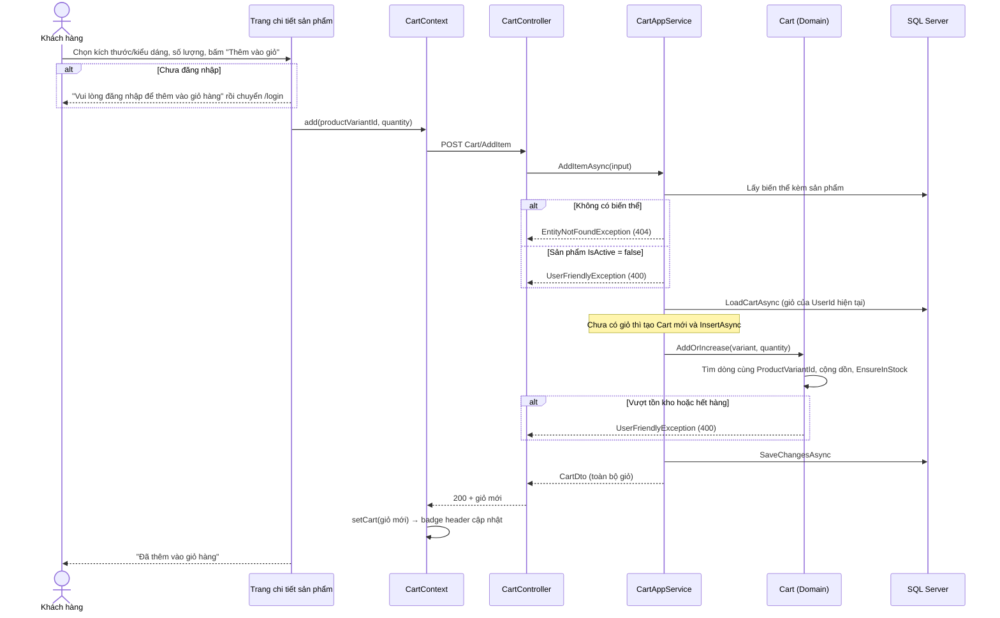
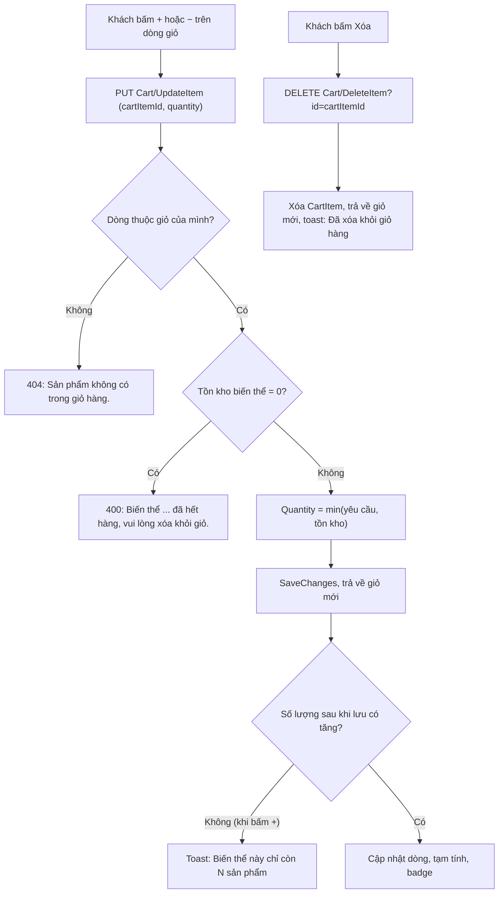
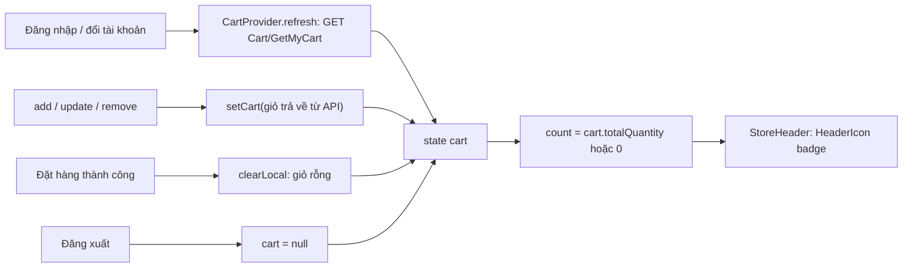

# Giỏ hàng

Mỗi khách hàng đã đăng nhập có một giỏ hàng lưu trên máy chủ, gồm các dòng theo **biến thể** sản phẩm. Giỏ kiểm tra tồn kho khi thêm/cập nhật, luôn tính tiền theo giá hiện tại của sản phẩm và là đầu vào duy nhất của chức năng [Đặt hàng](06-dat-hang-don-hang.md).

---

## 1. Mục đích & phạm vi

| Nội dung | Có trong tài liệu này |
|---|---|
| Xem giỏ, thêm biến thể vào giỏ, tăng/giảm số lượng, xóa dòng | Có |
| Gộp dòng khi thêm lại cùng một biến thể | Có |
| Kiểm tra tồn kho khi thêm và cập nhật | Có |
| Cách tính đơn giá, tạm tính, cờ `isAvailable` / `canCheckout` | Có |
| Sản phẩm bị ẩn / xóa / hết hàng khi đang nằm trong giỏ | Có |
| Đồng bộ số lượng trên biểu tượng giỏ ở header cửa hàng | Có |
| Đặt hàng từ giỏ (form giao hàng, thanh toán, tạo đơn) | Xem [06-dat-hang-don-hang.md](06-dat-hang-don-hang.md) |
| Quản lý sản phẩm, biến thể, tồn kho | Xem [04-san-pham-bien-the-ton-kho.md](04-san-pham-bien-the-ton-kho.md) |

Giỏ hàng chỉ có ở trang cửa hàng (`HornViet_customer`, cổng 3000). Không có giỏ cho khách vãng lai (không lưu giỏ trong trình duyệt).

## 2. Vai trò & quyền

| Vai trò | Quyền với giỏ hàng |
|---|---|
| Khách vãng lai (chưa đăng nhập) | Không có giỏ. Bấm biểu tượng giỏ hoặc "Thêm vào giỏ" sẽ được chuyển tới trang đăng nhập (`/login?returnUrl=...`). |
| Khách hàng (`Customer`) | Toàn quyền với giỏ **của chính mình**: xem, thêm, sửa số lượng, xóa. |
| Nhân viên / Quản trị viên | Phía backend, `CartController` chỉ yêu cầu `[Authorize]` (mọi tài khoản đã đăng nhập). Tuy nhiên trang cửa hàng không cho tài khoản Nhân viên/Quản trị viên đăng nhập (thông báo `STAFF_ACCOUNT_MESSAGE` trong `HornViet_customer/contexts/auth-context.tsx`), nên thực tế chỉ khách hàng dùng giỏ. Xem [02-phan-quyen-nguoi-dung.md](02-phan-quyen-nguoi-dung.md). |

Không có API nào cho phép xem/sửa giỏ của người khác: mọi thao tác đều lấy `UserId` từ token (`_session.GetUserId()` trong `CartAppService.LoadCartAsync`).

## 3. Khái niệm & quy tắc nghiệp vụ

### 3.1 Cấu trúc giỏ

| Khái niệm | Mô tả | Code |
|---|---|---|
| Giỏ (`Cart`) | Mỗi người dùng **đúng một** giỏ (chỉ mục duy nhất trên `Carts.UserId`). Giỏ chỉ được tạo (INSERT) khi thêm sản phẩm lần đầu; trước đó API trả về giỏ rỗng chưa lưu (`Id = 0`). | `Website.Domain/Carts/Entities/Cart.cs`, `CartAppService.LoadCartAsync` |
| Dòng giỏ (`CartItem`) | Một biến thể + số lượng. Không lưu giá. | `Website.Domain/Carts/Entities/Cart.cs` |
| Đơn vị đặt mua | **Biến thể** (`ProductVariant`: kích thước / kiểu dáng), không phải sản phẩm. Hai biến thể của cùng sản phẩm là hai dòng khác nhau. | |

### 3.2 Quy tắc

| # | Quy tắc | Nơi thực hiện |
|---|---|---|
| R1 | **Gộp dòng cùng biến thể**: thêm một biến thể đã có trong giỏ thì cộng dồn số lượng vào dòng cũ, không tạo dòng mới. CSDL cũng chặn trùng bằng chỉ mục duy nhất `(CartId, ProductVariantId)`. | `Cart.AddOrIncrease` |
| R2 | Số lượng mỗi lần thêm / cập nhật phải trong khoảng **1 – 999** (`[Range(1, 999)]`). Thêm số lượng ≤ 0 ở tầng Domain cũng bị chặn. | `AddCartItemInput`, `UpdateCartItemInput`, `Cart.AddOrIncrease` |
| R3 | **Khi thêm**: chỉ thêm được nếu sản phẩm đang bán (`Product.IsActive = true`) và **tổng số lượng sau khi cộng dồn** không vượt tồn kho của biến thể. Vượt → báo lỗi, không thay đổi giỏ. | `CartAppService.AddItemAsync`, `Cart.EnsureInStock` |
| R4 | **Khi cập nhật số lượng**: nếu biến thể đã hết hàng (tồn = 0) → báo lỗi, yêu cầu xóa khỏi giỏ. Nếu số lượng yêu cầu lớn hơn tồn kho → **tự giới hạn** về số còn lại (không báo lỗi). | `CartAppService.UpdateItemAsync` (`Math.Min(input.Quantity, stock)`) |
| R5 | **Giá hiển thị luôn là giá hiện tại** của sản phẩm (`Product.Price`; mọi biến thể chung giá sản phẩm). Giỏ không "chốt" giá: nếu quản trị đổi giá, lần tải giỏ tiếp theo hiển thị giá mới. Giá chỉ được chụp lại vào đơn hàng tại lúc đặt. | `CartAppService.ToDto` (`UnitPrice = v.Product.Price`) |
| R6 | `lineTotal = unitPrice × quantity`, `subTotal = Σ lineTotal`, `totalQuantity = Σ quantity` (tổng số sản phẩm, không phải số dòng). | `CartAppService.ToDto` |
| R7 | `isAvailable = Product.IsActive && StockQuantity >= Quantity`. `canCheckout = có ít nhất 1 dòng && mọi dòng isAvailable`. | `CartAppService.ToDto` |
| R8 | Mọi API giỏ đều **trả về toàn bộ giỏ sau thao tác**, frontend chỉ việc thay state bằng kết quả. | `CartController`, `HornViet_customer/contexts/cart-context.tsx` |
| R9 | Giỏ **không giữ chỗ hàng**: thêm vào giỏ không trừ kho. Kho chỉ bị trừ khi đặt hàng thành công. | `CartAppService` (không gọi `DecreaseStock`) |

### 3.3 Sản phẩm bị ẩn / xóa / hết hàng khi đang nằm trong giỏ

| Tình huống | Điều xảy ra với dòng giỏ | Hiển thị trên trang giỏ | Đặt hàng |
|---|---|---|---|
| Sản phẩm bị **ẩn** (`IsActive = false`, qua `Product/SetActive` hoặc form sửa) | Dòng vẫn còn trong giỏ và vẫn được trả về. | `isAvailable = false`, nhãn đỏ "Sản phẩm đã ngừng kinh doanh" (hoặc "Biến thể đã hết hàng hoặc ngừng kinh doanh" nếu tồn = 0). `canCheckout = false`, nút Đặt hàng bị khóa. | Bị chặn (400, chi tiết "… đã ngừng kinh doanh."). Khách phải xóa dòng. |
| Sản phẩm bị **xóa** (`Product/Delete`, xóa mềm) | `ProductAppService.DeleteAsync` xóa luôn các dòng giỏ chứa biến thể của sản phẩm đó. | Dòng biến mất khỏi giỏ. | Không ảnh hưởng. |
| **Biến thể bị gỡ** khỏi sản phẩm khi sửa (`Product/Update`, biến thể không gửi lên bị xóa mềm) | `ProductAppService.UpdateAsync` xóa các dòng giỏ của biến thể bị gỡ. | Dòng biến mất khỏi giỏ. | Không ảnh hưởng. |
| Biến thể **hết hàng** (tồn = 0) | Dòng vẫn còn. | `isAvailable = false`, nhãn "Biến thể đã hết hàng hoặc ngừng kinh doanh". Bấm "+" / "−" → lỗi "… đã hết hàng, vui lòng xóa khỏi giỏ." | Bị chặn (400, chi tiết "… chỉ còn 0 sản phẩm."). |
| Tồn kho **giảm xuống dưới** số lượng trong giỏ (khách khác vừa mua, quản trị kiểm kê) | Dòng giữ nguyên số lượng cũ (giỏ không tự sửa). | `isAvailable = false`, nhãn "Chỉ còn N sản phẩm". Khách bấm "−" hoặc "+" thì server giới hạn về tồn còn lại. | Bị chặn cho tới khi khách giảm số lượng. |
| **Đổi giá** sản phẩm | Không ảnh hưởng dòng giỏ. | Đơn giá và tạm tính hiển thị giá mới ở lần tải giỏ kế tiếp. | Đơn lưu giá tại thời điểm đặt. |

Ngoài ra `CartAppService.ToDto` còn bỏ qua an toàn mọi dòng mà biến thể hoặc sản phẩm không nạp được (bị bộ lọc xóa mềm toàn cục loại khỏi `Include`), nên giỏ không bao giờ trả về dòng "mồ côi".

## 4. Flow logic

### 4.1 Thêm vào giỏ

| Bước | Mô tả | File / hàm |
|---|---|---|
| 1 | Trang chi tiết tính số còn có thể thêm: `avail = tồn kho − số lượng biến thể này đã có trong giỏ`. Nếu `avail = 0` nút đổi thành "Đã đạt tối đa tồn kho" và bị khóa; hết hàng thì nút "Hết hàng". | `HornViet_customer/app/(store)/products/[id]/page.tsx` |
| 2 | Chưa đăng nhập → thông báo và chuyển `/login?returnUrl=/products/{id}`. | cùng file, `onAdd` |
| 3 | Gọi `add()` của `CartContext` → `cartApi.addItem` → `POST /api/services/app/Cart/AddItem`. | `HornViet_customer/contexts/cart-context.tsx`, `HornViet_customer/lib/api/services.ts` |
| 4 | Server nạp biến thể kèm sản phẩm; kiểm tra tồn tại và `IsActive`. | `Website.Application/Carts/CartAppService.cs` → `AddItemAsync` |
| 5 | Nạp giỏ của người dùng (kèm dòng → biến thể → sản phẩm); chưa có thì tạo mới. | `CartAppService.LoadCartAsync` |
| 6 | `AddOrIncrease`: cộng dồn nếu đã có dòng cùng biến thể (R1), kiểm tra tồn kho trên **tổng mới** (R3). | `Website.Domain/Carts/Entities/Cart.cs` |
| 7 | Lưu và trả về `CartDto`. Frontend thay state → số trên header đổi ngay. Lỗi thì hiện thông báo và tải lại sản phẩm (tồn kho có thể vừa đổi). | `CartAppService.ToDto`, `products/[id]/page.tsx` |

### 4.2 Cập nhật số lượng và xóa dòng

| Bước | Mô tả | File / hàm |
|---|---|---|
| 1 | Nút "−" chỉ gửi khi số lượng > 1 (muốn bỏ hẳn thì bấm "Xóa"). Nút "+" gửi `quantity + 1`. Không có ô nhập số trực tiếp. | `HornViet_customer/app/(store)/cart/page.tsx` → `CartLine` |
| 2 | Server tìm dòng **trong giỏ của chính người dùng** theo `cartItemId`; không thấy → 404. | `CartAppService.UpdateItemAsync`, `DeleteItemAsync` |
| 3 | Cập nhật: tồn = 0 → 400; còn lại thì giới hạn về tồn kho (R4). Cập nhật **không** kiểm tra `Product.IsActive` (dòng của sản phẩm bị ẩn vẫn sửa được số lượng nhưng vẫn `isAvailable = false`). | `CartAppService.UpdateItemAsync` |
| 4 | Khi bấm "+", frontend so số lượng trước/sau; không tăng nghĩa là đã chạm tồn kho → toast "Biến thể này chỉ còn N sản phẩm". | `CartLine.inc` |
| 5 | Xóa: gỡ dòng khỏi giỏ và xóa bản ghi `CartItems` (xóa thật, `CartItem` không có xóa mềm). | `CartAppService.DeleteItemAsync` |

### 4.3 Đồng bộ số lượng trên header cửa hàng

| Điểm | Mô tả | File |
|---|---|---|
| Nguồn dữ liệu duy nhất | `CartProvider` bọc toàn ứng dụng (trong `app/layout.tsx`) và giữ state `cart`. `count = cart?.totalQuantity ?? 0`. | `HornViet_customer/contexts/cart-context.tsx`, `HornViet_customer/app/layout.tsx` |
| Tải giỏ | `refresh()` chạy khi trạng thái đăng nhập hoặc `session.userId` đổi. Chưa đăng nhập → `cart = null`. | `cart-context.tsx` |
| Sau mỗi thao tác | `add` / `update` / `remove` đặt `cart` bằng kết quả API (R8), nên badge đổi ngay mà không cần gọi lại `GetMyCart`. | `cart-context.tsx` → `apply` |
| Sau khi đặt hàng | Server đã làm trống giỏ; frontend gọi `clearLocal()` để đặt giỏ rỗng. | `HornViet_customer/app/(store)/cart/page.tsx` → `submit` |
| Hiển thị | `StoreHeader` đọc `count` và truyền vào `HeaderIcon badge` — badge là **tổng số sản phẩm** (không phải số dòng) và luôn hiển thị, kể cả khi bằng 0. | `HornViet_customer/components/hsv/store-header.tsx` |
| Giới hạn | Không có đồng bộ thời gian thực giữa nhiều tab/thiết bị: tab khác chỉ thấy thay đổi khi tải lại trang hoặc đăng nhập lại. | |

## 5. Hướng dẫn sử dụng (trang cửa hàng)

### 5.1 Thêm sản phẩm vào giỏ

1. Đăng nhập tài khoản khách hàng (xem [01-xac-thuc-tai-khoan.md](01-xac-thuc-tai-khoan.md)).
2. Mở trang chi tiết một sản phẩm (`/products/{id}`).
3. Chọn **kích thước** và **kiểu dáng** (nếu sản phẩm có). Dòng trạng thái tồn kho hiển thị "Còn N sản phẩm" hoặc "Còn N sản phẩm · bạn đã có M trong giỏ".
4. Chọn số lượng (tối đa bằng số còn có thể thêm).
5. Bấm **Thêm vào giỏ**. Thành công → thông báo "Đã thêm vào giỏ hàng" và số trên biểu tượng giỏ ở header tăng.

### 5.2 Xem và chỉnh sửa giỏ

1. Bấm biểu tượng **Giỏ hàng** trên header (chưa đăng nhập sẽ được chuyển sang trang đăng nhập rồi quay lại `/cart`).
2. Trang **Giỏ hàng & thanh toán** hiển thị từng dòng: ảnh, tên sản phẩm, "Biến thể: …", đơn giá hiện tại, bộ tăng/giảm số lượng, thành tiền.
3. Bấm **+** / **−** để đổi số lượng; bấm **Xóa** để bỏ dòng.
4. Chú ý nhãn cảnh báo cạnh số lượng:

| Nhãn | Màu | Ý nghĩa | Cần làm |
|---|---|---|---|
| "Đã đạt tối đa tồn kho" | Cam | Số lượng trong giỏ bằng tồn kho | Không thể tăng thêm |
| "Chỉ còn N sản phẩm" | Đỏ | Số trong giỏ lớn hơn tồn kho hiện tại | Giảm số lượng |
| "Sản phẩm đã ngừng kinh doanh" | Đỏ | Sản phẩm đã bị ẩn | Xóa dòng |
| "Biến thể đã hết hàng hoặc ngừng kinh doanh" | Đỏ | Tồn kho = 0 | Xóa dòng |

5. Phần **Tạm tính (N sản phẩm)** ở cuối danh sách kèm ghi chú "Đơn giá tính theo giá hiện tại của sản phẩm."
6. Khi còn dòng có nhãn đỏ, khung thanh toán hiện cảnh báo "Một số sản phẩm trong giỏ không đủ hàng hoặc đã ngừng kinh doanh…" và nút **Đặt hàng** bị khóa. Phần đặt hàng xem [06-dat-hang-don-hang.md](06-dat-hang-don-hang.md#5-hướng-dẫn-sử-dụng).
7. Giỏ trống → hiển thị "Chưa có sản phẩm nào trong giỏ" và nút **Tiếp tục mua sắm**.

## 6. API liên quan

Tất cả yêu cầu header `Authorization: Bearer <token>` và đều trả về `CartDto` (toàn bộ giỏ). Chi tiết định dạng: [Tài liệu API — mục 2.4 Giỏ hàng](../API.md).

| Method | Endpoint | Body / Query | Ghi chú |
|---|---|---|---|
| GET | `/api/services/app/Cart/GetMyCart` | — | Chưa có giỏ → giỏ rỗng |
| POST | `/api/services/app/Cart/AddItem` | `{ productVariantId, quantity }` | Cộng dồn nếu biến thể đã có; vượt tồn → 400 |
| PUT | `/api/services/app/Cart/UpdateItem` | `{ cartItemId, quantity }` | Vượt tồn → tự giới hạn về tồn còn lại |
| DELETE | `/api/services/app/Cart/DeleteItem?id=` | `id` = `cartItemId` | |

`CartDto`:

| Trường | Kiểu | Ý nghĩa |
|---|---|---|
| `items[]` | `CartItemDto[]` | Các dòng, sắp theo `id` tăng dần |
| `items[].id` | int | `cartItemId` (dùng cho UpdateItem/DeleteItem) |
| `items[].productVariantId`, `productId` | int | |
| `items[].productName`, `mainImage`, `variantName`, `size`, `style` | string | Lấy từ sản phẩm/biến thể hiện tại. `variantName` = "Size / Style" hoặc "Mặc định" |
| `items[].unitPrice` | decimal | Giá hiện tại của sản phẩm |
| `items[].quantity`, `lineTotal` | int, decimal | |
| `items[].stockQuantity` | int | Tồn kho hiện tại của biến thể |
| `items[].isAvailable` | bool | R7 |
| `totalQuantity` | int | Tổng số sản phẩm — dùng cho badge header |
| `subTotal` | decimal | Tạm tính |
| `canCheckout` | bool | Cho phép đặt hàng |

## 7. Dữ liệu

Cấu hình bảng trong `Website.Infrastructure/Persistence/WebsiteDbContext.cs`. Tổng quan CSDL: [10-co-so-du-lieu.md](10-co-so-du-lieu.md).

**Bảng `Carts`**

| Cột | Kiểu | Ràng buộc / ý nghĩa |
|---|---|---|
| `Id` | int | Khóa chính |
| `UserId` | bigint | FK → `AbpUsers.Id` (Restrict), **chỉ mục duy nhất** — mỗi người một giỏ |
| `CreationTime` | datetime2 | Tự gán khi thêm (giờ Việt Nam) |

**Bảng `CartItems`**

| Cột | Kiểu | Ràng buộc / ý nghĩa |
|---|---|---|
| `Id` | int | Khóa chính (`cartItemId`) |
| `CartId` | int | FK → `Carts.Id`, xóa giỏ thì xóa dòng (Cascade) |
| `ProductVariantId` | int | FK → `ProductVariants.Id` (Restrict) |
| `Quantity` | int | Số lượng |
| — | — | Chỉ mục **duy nhất** `(CartId, ProductVariantId)` — bảo đảm R1 |

Bảng liên quan (chỉ đọc khi xử lý giỏ): `ProductVariants` (`StockQuantity`, `Size`, `Style`, `IsDeleted`), `Products` (`Name`, `Price`, `MainImage`, `IsActive`, `IsDeleted`). Giỏ **không** lưu giá; `CartItems` không có cột xóa mềm.

## 8. Lỗi thường gặp & cách xử lý

Định dạng lỗi chung (`error.message`, `error.details`) và cách ánh xạ mã HTTP nằm ở `Website.Api/Middlewares/ResponseHandling.cs` (`BusinessErrors.TryMap`).

| Thông báo (từ code) | HTTP | Khi nào | Cách xử lý |
|---|---|---|---|
| `Biến thể sản phẩm không tồn tại.` | 404 | `AddItem` với biến thể không có hoặc đã bị xóa mềm | Tải lại trang sản phẩm |
| `Sản phẩm đã ngừng kinh doanh.` | 400 | `AddItem` với sản phẩm đang ẩn | Chọn sản phẩm khác |
| `Biến thể "<tên>" đã hết hàng.` | 400 | `AddItem` khi tồn kho = 0 | Chọn biến thể khác |
| `Biến thể "<tên>" chỉ còn N sản phẩm.` | 400 | `AddItem` khi (số trong giỏ + số thêm) > tồn kho | Giảm số lượng thêm |
| `Biến thể "<tên>" đã hết hàng, vui lòng xóa khỏi giỏ.` | 400 | `UpdateItem` khi tồn kho = 0 | Bấm "Xóa" trên dòng |
| `Sản phẩm không có trong giỏ hàng.` | 404 | `UpdateItem` / `DeleteItem` với `cartItemId` không thuộc giỏ của mình (hoặc đã bị xóa ở tab khác) | Tải lại giỏ |
| `Số lượng phải lớn hơn 0.` | 400 | `Cart.AddOrIncrease` nhận số lượng ≤ 0 (thực tế bị chặn trước bởi validation) | — |
| `Dữ liệu không hợp lệ.` + chi tiết `Số lượng không hợp lệ.` | 400 | `quantity` ngoài khoảng 1–999 | Nhập số lượng hợp lệ |
| `Bạn cần đăng nhập để thực hiện thao tác này.` / 401 | 400 / 401 | Không có hoặc hết hạn token | Đăng nhập lại |
| Thông báo frontend `Biến thể này chỉ còn N sản phẩm` | — | Bấm "+" nhưng server đã giới hạn về tồn kho | Không cần xử lý |
| Thông báo frontend `Vui lòng đăng nhập để xem giỏ hàng` / `Vui lòng đăng nhập để thêm vào giỏ hàng` | — | Khách chưa đăng nhập | Đăng nhập |

## 9. Mã nguồn liên quan

**Backend (`Website.Api`)**

| File | Vai trò |
|---|---|
| `Website.Domain/Carts/Entities/Cart.cs` | Thực thể `Cart`, `CartItem`; `AddOrIncrease`, `EnsureInStock` |
| `Website.Domain/Catalog/Entities/Catalog.cs` | `Product.Price`, `Product.IsActive`, `ProductVariant.StockQuantity`, `DisplayName` |
| `Website.Application/Carts/CartAppService.cs` | DTO, `GetMyCartAsync`, `AddItemAsync`, `UpdateItemAsync`, `DeleteItemAsync`, `ToDto` |
| `Website.Api/Controllers/Shopping/CartController.cs` | 4 endpoint, `[Authorize]` |
| `Website.Application/Catalog/ProductAppService.cs` | Xóa dòng giỏ khi xóa sản phẩm / gỡ biến thể |
| `Website.Infrastructure/Persistence/WebsiteDbContext.cs` | Cấu hình bảng `Carts`, `CartItems`, bộ lọc xóa mềm |
| `Website.Api/Middlewares/ResponseHandling.cs` | Ánh xạ lỗi → 400/404/409 |
| `tests/Website.Domain.UnitTests/Carts/CartTests.cs` | Kiểm thử gộp dòng, vượt tồn, hết hàng, số lượng ≤ 0 |

**Frontend cửa hàng (`HornViet_customer`)**

| File | Vai trò |
|---|---|
| `HornViet_customer/contexts/cart-context.tsx` | `CartProvider`, `useCart` (state giỏ, `count`, `add/update/remove/clearLocal`) |
| `HornViet_customer/app/(store)/cart/page.tsx` | Trang giỏ hàng & thanh toán (`CartLine`, `CartView`) |
| `HornViet_customer/app/(store)/products/[id]/page.tsx` | Nút "Thêm vào giỏ", tính số còn có thể thêm |
| `HornViet_customer/components/hsv/store-header.tsx` | Biểu tượng giỏ và badge số lượng |
| `HornViet_customer/components/hsv/guards.tsx` | `RequireCustomer` — chuyển về `/login` nếu chưa đăng nhập |
| `HornViet_customer/lib/api/services.ts` | `cartApi` |
| `HornViet_customer/app/layout.tsx` | Gắn `CartProvider` cho toàn ứng dụng |
