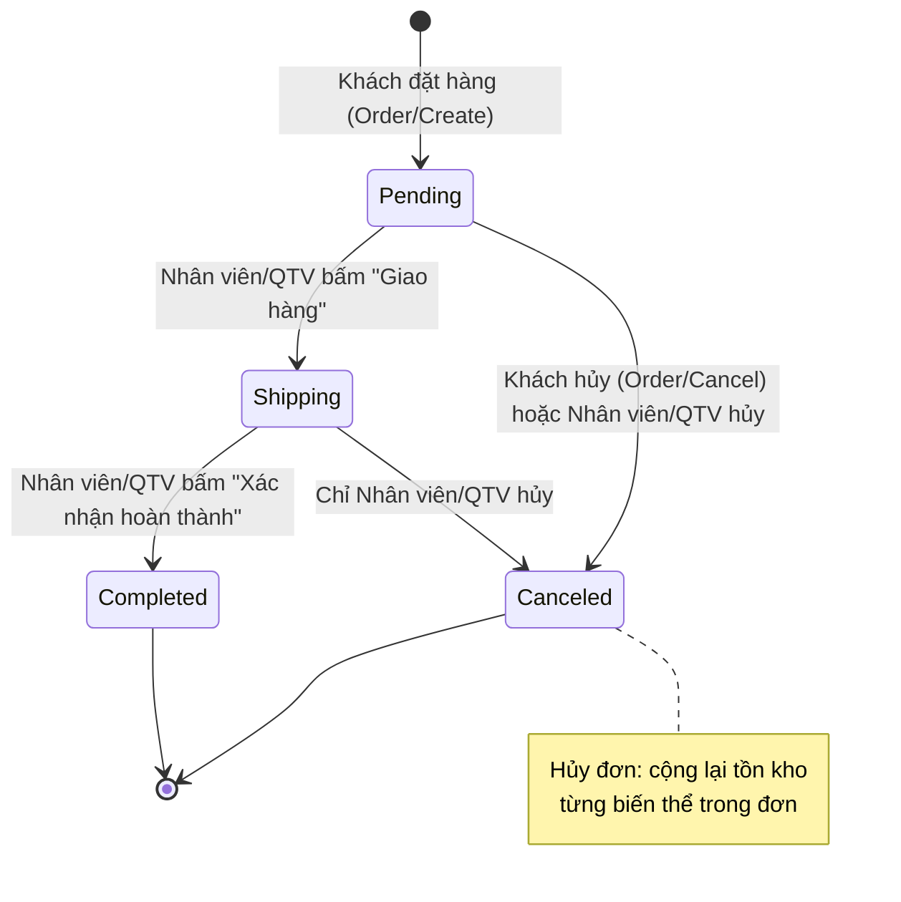
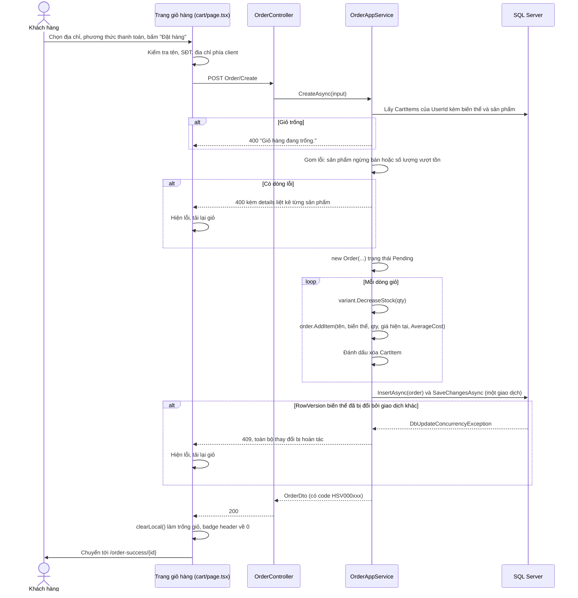
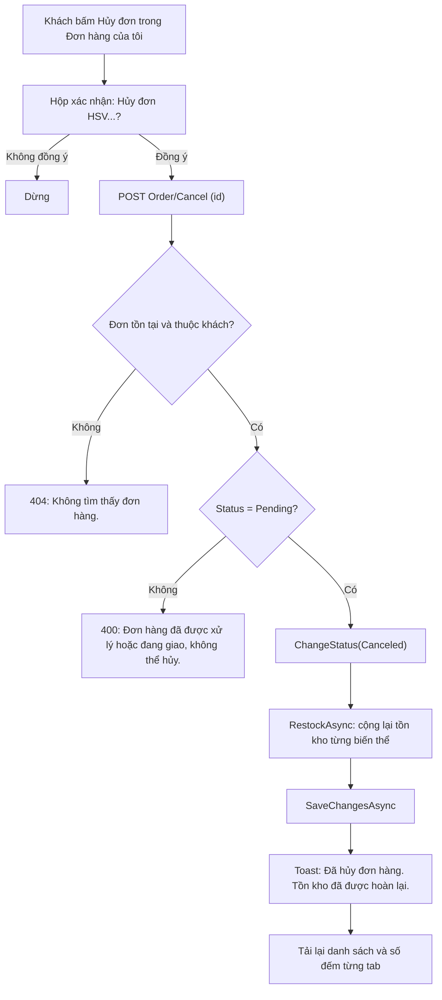
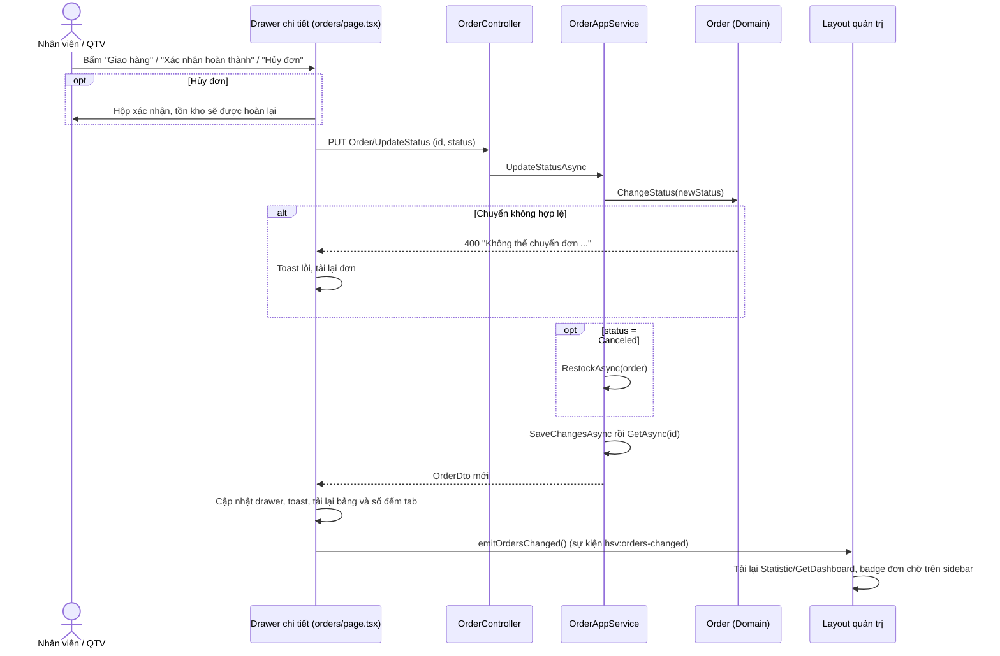

# Đặt hàng & quản lý đơn hàng

Khách hàng đặt toàn bộ giỏ hàng thành một đơn (kiểm tra tồn kho, chụp lại giá, trừ kho, làm trống giỏ trong một giao dịch), sau đó theo dõi hoặc hủy đơn ở mục "Đơn hàng của tôi". Nhân viên và Quản trị viên xử lý đơn theo máy trạng thái Chờ xử lý → Đang giao → Hoàn thành, hoặc hủy đơn (tự hoàn kho).

---

## 1. Mục đích & phạm vi

| Nội dung | Có trong tài liệu này |
|---|---|
| Đặt hàng từ giỏ: thông tin giao hàng, phương thức thanh toán, tạo đơn | Có |
| Kiểm tra tồn kho, trừ kho, chống bán vượt tồn khi nhiều người mua cùng lúc | Có |
| Mã đơn `HSV000001` và tìm đơn theo mã | Có |
| Máy trạng thái đơn, ai được chuyển trạng thái nào, hoàn kho khi hủy | Có |
| "Đơn hàng của tôi" và trang đặt hàng thành công (cửa hàng) | Có |
| Trang Quản lý đơn hàng (quản trị), badge đơn chờ ở sidebar | Có |
| Quản lý giỏ hàng trước khi đặt | Xem [05-gio-hang.md](05-gio-hang.md) |
| Cách tính giá vốn bình quân (`UnitCost`) | Xem [07-nhap-kho-gia-von.md](07-nhap-kho-gia-von.md) |
| Doanh thu, lợi nhuận, dashboard | Xem [08-thong-ke-bao-cao.md](08-thong-ke-bao-cao.md) |

Ngoài phạm vi (hệ thống **chưa** có): cổng thanh toán trực tuyến, theo dõi trạng thái "đã thanh toán", phí vận chuyển, mã giảm giá, sửa nội dung đơn sau khi đặt, trả hàng/hoàn tiền.

## 2. Vai trò & quyền

Phân quyền ở `Website.Api/Controllers/Shopping/OrderController.cs` (chính sách `Management` = vai trò `Admin` hoặc `Staff`, khai báo trong `Website.Api/Authorization/Authentication.cs`). Chi tiết vai trò: [02-phan-quyen-nguoi-dung.md](02-phan-quyen-nguoi-dung.md).

| Thao tác | Khách hàng | Nhân viên | Quản trị viên |
|---|---|---|---|
| Đặt hàng (`Order/Create`) | Có (từ giỏ của mình) | Không dùng (không đăng nhập được trang cửa hàng) | Như Nhân viên |
| Xem danh sách đơn của mình (`Order/GetMyOrders`) | Có | — | — |
| Xem chi tiết đơn (`Order/Get`) | Chỉ đơn của mình (đơn người khác → 404) | Mọi đơn, kèm `userName` | Mọi đơn, kèm `userName` |
| Hủy đơn qua `Order/Cancel` | Chỉ đơn của mình và đang **Chờ xử lý** | — (API kiểm tra chủ đơn) | — |
| Xem tất cả đơn, lọc, tìm (`Order/GetAll`) | Không (403) | Có | Có |
| Chuyển trạng thái (`Order/UpdateStatus`) | Không (403) | Có | Có |
| Xem doanh thu, lợi nhuận | Không | Không | Có (xem [08](08-thong-ke-bao-cao.md)) |

## 3. Khái niệm & quy tắc nghiệp vụ

### 3.1 Đơn hàng và dòng đơn

| Khái niệm | Mô tả | Code |
|---|---|---|
| Đơn hàng (`Order`) | Aggregate root, giữ thông tin giao hàng, phương thức thanh toán, tổng tiền và máy trạng thái. Các thuộc tính có `private set` — chỉ đổi qua constructor, `AddItem`, `ChangeStatus`. | `Website.Domain/Orders/Entities/Order.cs` |
| Dòng đơn (`OrderItem`) | **Ảnh chụp** tại thời điểm mua: `ProductName`, `VariantName`, `UnitPrice` (giá bán), `UnitCost` (giá vốn). Sửa/ẩn/xóa sản phẩm sau này không làm đổi đơn cũ. | `Order.cs` |
| Tổng tiền | `TotalAmount = Σ (UnitPrice × Quantity)`, tính lại mỗi lần `AddItem`. Không có phí vận chuyển hay giảm giá. | `Order.AddItem` |
| Giá vốn lúc bán (`UnitCost`) | Chụp từ `ProductVariant.AverageCost` khi đặt. `null` nếu biến thể chưa có phiếu nhập kho (hoặc đơn tạo trước khi có chức năng nhập kho). Dùng để tính lợi nhuận. | `OrderAppService.CreateAsync` |
| Mã đơn | `Order.FormatCode(id)` = `"HSV"` + Id đệm 6 chữ số, VD Id 1 → `HSV000001`, Id 123 → `HSV000123`. Mã **không lưu** trong CSDL, được tính từ `Id` mỗi lần trả về. | `Order.FormatCode` |

### 3.2 Phương thức thanh toán

| Giá trị (`PaymentMethod`) | Số | Nhãn hiển thị | Ghi chú |
|---|---|---|---|
| `COD` | 0 | Thanh toán khi nhận hàng (COD) | Mặc định |
| `BankTransfer` | 1 | Chuyển khoản ngân hàng | **Chỉ ghi nhận** lựa chọn của khách, chưa tích hợp cổng thanh toán, không có trường "đã thanh toán". Thông tin tài khoản nhận hiển thị trên giao diện lấy từ hằng `BANK_INFO` trong `HornViet_customer/lib/hsv/format.ts`; khách ghi nội dung chuyển khoản là mã đơn. Cửa hàng tự đối soát rồi mới chuyển đơn sang Đang giao. |

Nhãn dùng chung ở `PAYMENT_LABEL` (`lib/hsv/format.ts` của cả hai frontend).

### 3.3 Quy tắc đặt hàng

| # | Quy tắc | Code |
|---|---|---|
| O1 | Đặt hàng = đặt **toàn bộ** giỏ hiện tại của người dùng (không chọn từng dòng). Giỏ trống → lỗi. | `OrderAppService.CreateAsync` |
| O2 | Kiểm tra **mọi** dòng trước khi tạo đơn: sản phẩm phải đang bán (`IsActive`) và `Quantity ≤ StockQuantity` của biến thể. Gom **tất cả** dòng lỗi vào một thông báo để khách sửa giỏ một lần (`error.details`, mỗi dòng một vấn đề). | `CreateAsync` (biến `problems`) |
| O3 | Đơn giá lấy từ `Product.Price` **tại thời điểm đặt**; giá vốn từ `ProductVariant.AverageCost`. | `CreateAsync` → `order.AddItem(...)` |
| O4 | Với mỗi dòng: trừ kho (`ProductVariant.DecreaseStock`), thêm dòng đơn, xóa dòng giỏ. | `CreateAsync` |
| O5 | Tạo đơn + trừ kho + xóa giỏ nằm trong **một lần `SaveChangesAsync`** (một giao dịch): hoặc tất cả thành công, hoặc không có gì được ghi. | `CreateAsync`, `IUnitOfWork` |
| O6 | **Chống bán vượt tồn** khi hai khách mua cùng lúc: `ProductVariants.RowVersion` là khóa lạc quan. Giao dịch đến sau phát hiện tồn kho đã bị đổi → `DbUpdateConcurrencyException` → HTTP **409**. | `ProductVariant.RowVersion`, `WebsiteDbContext` (`IsRowVersion()`), `ResponseHandling.cs` |
| O7 | Thông tin giao hàng bắt buộc: tên người nhận (≤ 255), số điện thoại khớp `^(0\|\+84)(3\|5\|7\|8\|9)\d{8}$` (`AppConsts.PhoneRegex`), địa chỉ (≤ 500). Ghi chú tùy chọn (≤ 500). Các chuỗi được `Trim()` trước khi lưu. | `CreateOrderInput`, `CreateAsync` |
| O8 | Đơn mới luôn ở trạng thái `Pending` (Chờ xử lý). | constructor `Order` |

### 3.4 Máy trạng thái đơn hàng

| Giá trị (`OrderStatus`) | Số | Nhãn | Ý nghĩa |
|---|---|---|---|
| `Pending` | 0 | Chờ xử lý | Đơn vừa đặt, chưa giao |
| `Shipping` | 1 | Đang giao | Cửa hàng đã giao cho đơn vị vận chuyển |
| `Completed` | 2 | Hoàn thành | Khách đã nhận hàng — trạng thái cuối, **được tính doanh thu** |
| `Canceled` | 3 | Đã hủy | Trạng thái cuối, kho đã được hoàn lại |

Lưu ý: trong code enum viết là `Canceled` (một chữ "l").

| Chuyển | Ai được làm | API | Kiểm tra |
|---|---|---|---|
| Pending → Shipping | Nhân viên, Quản trị viên | `Order/UpdateStatus` | `Order.ChangeStatus` |
| Shipping → Completed | Nhân viên, Quản trị viên | `Order/UpdateStatus` | `Order.ChangeStatus` |
| Pending → Canceled | Khách hàng (chủ đơn) | `Order/Cancel` | `OrderAppService.CancelAsync`: đúng chủ đơn + đang `Pending` |
| Pending → Canceled | Nhân viên, Quản trị viên | `Order/UpdateStatus` | `Order.ChangeStatus` |
| Shipping → Canceled | Nhân viên, Quản trị viên | `Order/UpdateStatus` | `Order.ChangeStatus` |
| Mọi chuyển khác (lùi trạng thái, nhảy cóc Pending → Completed, đổi đơn đã Hoàn thành/Đã hủy, chuyển sang chính trạng thái hiện tại) | Không ai | — | 400 |

Quy tắc kèm theo:

- Mỗi lần chuyển thành công, `LastStatusChangeTime` được gán giờ hiện tại (`DateTime.Now`).
- **Hoàn kho khi hủy** (`OrderAppService.RestockAsync`): cộng lại `Quantity` của từng dòng đơn vào `ProductVariant.StockQuantity` (`IncreaseStock`). Truy vấn dùng `IgnoreQueryFilters()` nên biến thể đã bị xóa mềm vẫn được cộng lại cho đúng sổ kho. Hoàn kho **không** đổi giá vốn bình quân (`AverageCost`). Đổi trạng thái và hoàn kho được lưu trong cùng một `SaveChangesAsync`.
- Hoàn thành **không** đụng tới kho (kho đã trừ lúc đặt).
- Trường `canCancel` trả về cho frontend = `status == Pending` — đây là quyền hủy **của khách**. Trang quản trị tự tính nút "Hủy đơn" cho cả `Pending` và `Shipping`.

### 3.5 Tìm đơn theo mã (quản trị)

`Order/GetAll` nhận `keyword` và lọc theo **một trong ba** điều kiện (`OrderAppService.GetAllAsync`, `TryParseOrderCode`):

| Điều kiện | Cách so khớp |
|---|---|
| Mã đơn | Bỏ tiền tố `HSV` (không phân biệt hoa thường), phần còn lại đổi sang số → so sánh **bằng** với `Id`. VD `HSV000123`, `hsv123` hoặc `123` đều tìm ra đơn Id 123. |
| Tên người nhận | `ReceiverName` chứa từ khóa |
| Số điện thoại | `PhoneNumber` chứa từ khóa |

Lọc ngày: `fromDate` lấy từ 00:00 của ngày đó, `toDate` lấy **hết** ngày đó (`< toDate + 1 ngày`), so với `CreationTime` (ngày đặt). Kết quả sắp xếp mới nhất trước (`CreationTime` giảm dần, rồi `Id` giảm dần).

### 3.6 Liên hệ với doanh thu

Doanh thu và lợi nhuận **chỉ tính đơn `Completed`**, lọc theo `CreationTime` (ngày đặt) của đơn — xem `CompletedOrders` trong `Website.Application/Statistics/StatisticAppService.cs`. Lợi nhuận = Σ `(UnitPrice − UnitCost) × Quantity` trên các dòng có `UnitCost`. Đơn Chờ xử lý / Đang giao / Đã hủy không được cộng. Chi tiết: [08-thong-ke-bao-cao.md](08-thong-ke-bao-cao.md).

## 4. Flow logic

### 4.1 Đặt hàng (`Order/Create`)

| Bước | Mô tả | File / hàm |
|---|---|---|
| 1 | Form chỉ cho bấm "Đặt hàng" khi `cart.canCheckout = true` và không đang gửi. Kiểm tra client: tên, SĐT (`isValidPhone`), địa chỉ không rỗng. Nếu chọn địa chỉ trong sổ mà thiếu thông tin → "Địa chỉ đã chọn thiếu thông tin, vui lòng chọn địa chỉ khác." | `HornViet_customer/app/(store)/cart/page.tsx` → `submit` |
| 2 | Gửi `{ receiverName, phoneNumber (đã bỏ khoảng trắng), shippingAddress, paymentMethod, note? }`. | `orderApi.create` (`HornViet_customer/lib/api/services.ts`) |
| 3 | ASP.NET Core kiểm tra DataAnnotations của `CreateOrderInput`; sai → 400 `Dữ liệu không hợp lệ.` kèm `validationErrors` theo trường. | `CreateOrderInput`, `ValidationResponse.Create` |
| 4 | Lấy các dòng giỏ của người dùng (kèm biến thể, sản phẩm), sắp theo `Id`. | `OrderAppService.CreateAsync` |
| 5 | Gom lỗi tồn kho (O2) → `UserFriendlyException(message, details)`. | `CreateAsync` |
| 6 | Tạo `Order`, với mỗi dòng: `DecreaseStock`, `AddItem` (chụp tên, biến thể, giá, giá vốn), xóa dòng giỏ. | `CreateAsync`, `ProductVariant.DecreaseStock`, `Order.AddItem` |
| 7 | `SaveChangesAsync` một lần (O5). `WebsiteDbContext` tự gán `CreationTime`. Xung đột `RowVersion` → 409 (O6). | `Website.Infrastructure/Persistence/WebsiteDbContext.cs` |
| 8 | Thành công: frontend gọi `clearLocal()` rồi chuyển `/order-success/{id}`. Lỗi: hiện `fullMessage` (thông báo + chi tiết); nếu có lỗi theo trường thì chuyển sang chế độ nhập tay và tô đỏ trường; nếu 400/409 thì tải lại giỏ để thấy tồn kho mới nhất. | `cart/page.tsx` → `submit` |

### 4.2 Hủy đơn của khách (`Order/Cancel`)

Mã: `OrderAppService.CancelAsync`, `RestockAsync`; giao diện `HornViet_customer/app/(store)/account/orders/page.tsx` → `OrderDetail.onCancel`. Khi lỗi, trang vẫn tải lại danh sách để hiển thị trạng thái mới nhất.

### 4.3 Chuyển trạng thái phía quản trị (`Order/UpdateStatus`)

| Bước | Mô tả | File / hàm |
|---|---|---|
| 1 | Nút hành động tiếp theo lấy từ bảng `NEXT`: Chờ xử lý → "Giao hàng"; Đang giao → "Xác nhận hoàn thành". Nút "Hủy đơn" hiện khi đơn là Chờ xử lý hoặc Đang giao. Đơn Hoàn thành / Đã hủy không có nút. | `HornViet_admin/app/(panel)/orders/page.tsx` → `OrderDrawer` |
| 2 | Hủy cần xác nhận ("Tồn kho của N biến thể trong đơn sẽ được hoàn lại."). | `OrderDrawer.change` |
| 3 | Backend kiểm tra chuyển hợp lệ ở Domain, hủy thì hoàn kho, lưu, trả chi tiết đơn (kèm `userName`). | `OrderAppService.UpdateStatusAsync`, `Order.ChangeStatus` |
| 4 | Thành công: cập nhật drawer, toast (`Đơn HSV… → <nhãn>` hoặc `Đã hủy đơn và hoàn lại tồn kho`), tải lại danh sách + số đếm tab, phát `ORDERS_CHANGED`. | `AdminOrders.onChanged` |
| 5 | Layout quản trị lắng nghe `ORDERS_CHANGED` → gọi lại `statisticApi.getDashboard()` → badge số đơn **Chờ xử lý** (`pendingOrderCount`) cạnh mục "Đơn hàng" trên sidebar được cập nhật. Badge chỉ hiện khi > 0. Dashboard cũng được tải lại mỗi khi đổi trang. | `HornViet_admin/lib/hsv/events.ts`, `HornViet_admin/app/(panel)/layout.tsx` |

### 4.4 Danh sách đơn quản trị và cột "Sản phẩm"

| Bước | Mô tả | File / hàm |
|---|---|---|
| 1 | Gọi `Order/GetAll` với `status`, `keyword` (đã debounce 350 ms), `fromDate`, `toDate`, phân trang 15 dòng/trang. | `AdminOrders`, `useDebounced` (`HornViet_admin/hooks/use-api.ts`) |
| 2 | Backend trả `OrderListItemDto` kèm `items[]` = `{ productName, variantName, quantity }` của từng dòng đơn. | `OrderAppService.ToPagedListAsync` |
| 3 | Hàm `withItems`: nếu có đơn nào **thiếu** `items` (backend phiên bản cũ chưa trả trường này) thì gọi `Order/Get` cho từng đơn đó để lấy dòng sản phẩm. Backend hiện tại luôn trả `items` nên không phát sinh lời gọi thêm. | `withItems` |
| 4 | Cột "Sản phẩm" (`OrderProducts`) chỉ hiển thị **tên sản phẩm**, gộp trùng (nhiều biến thể cùng sản phẩm chỉ hiện một lần), nối bằng dấu phẩy, cắt một dòng; rê chuột xem đầy đủ. Đang tải thì hiện "…". | `OrderProducts` |
| 5 | Số đếm trên mỗi tab trạng thái: gọi `GetAll` cho từng tab với `maxResultCount = 1` và **cùng bộ lọc** từ khóa/ngày, lấy `totalCount`. | `AdminOrders` (`counts`) |

## 5. Hướng dẫn sử dụng

### 5.1 Khách hàng — đặt hàng (trang `/cart`)

1. Vào **Giỏ hàng** từ header. Bảo đảm không còn dòng có nhãn đỏ (xem [05-gio-hang.md](05-gio-hang.md#5-hướng-dẫn-sử-dụng-trang-cửa-hàng)).
2. Ở khung **Thông tin giao hàng**:
   - Nếu đã có sổ địa chỉ: địa chỉ đầu danh sách (địa chỉ mặc định, có nhãn "Mặc định") được chọn sẵn. Bấm để chọn địa chỉ khác.
   - Hoặc chọn **Giao đến địa chỉ khác** / **Nhập địa chỉ giao hàng** rồi nhập Tên người nhận, Số điện thoại, Địa chỉ nhận hàng chi tiết (tên và SĐT điền sẵn từ hồ sơ). Liên kết "Quản lý sổ địa chỉ →" mở trang hồ sơ.
3. (Tùy chọn) nhập **Ghi chú cho cửa hàng** (tối đa 500 ký tự).
4. Chọn **Phương thức thanh toán**: "Thanh toán khi nhận hàng (COD)" hoặc "Chuyển khoản ngân hàng". Khi chọn chuyển khoản, khung hiển thị thông tin tài khoản (`BANK_INFO`) và lưu ý "Nội dung: mã đơn hàng (hiển thị sau khi đặt)".
5. Kiểm tra **Tổng thanh toán** rồi bấm **Đặt hàng** (nút đổi thành "Đang đặt hàng…").
6. Thành công → trang **Đặt hàng thành công** (`/order-success/{id}`): mã đơn (VD `HSV000001`), tổng thanh toán, phương thức. Nếu chọn chuyển khoản, trang nhắc chuyển khoản với nội dung là mã đơn. Hai nút: **Xem đơn hàng**, **Tiếp tục mua sắm**.
7. Nếu báo lỗi thiếu hàng: đọc danh sách sản phẩm trong thông báo, giảm số lượng hoặc xóa dòng trong giỏ (giỏ đã được tải lại tự động), rồi đặt lại.

### 5.2 Khách hàng — Đơn hàng của tôi (trang `/account/orders`)

1. Mở menu tài khoản trên header → **Đơn hàng của tôi**.
2. Chọn tab lọc: Tất cả · Chờ xử lý · Đang giao · Hoàn thành · Đã hủy (mỗi tab có số đếm). Tab và trang hiện tại lưu trên URL (`?status=0&page=2`), 8 đơn/trang.
3. Mỗi thẻ đơn hiển thị: mã đơn, nhãn trạng thái, người nhận, ngày giờ đặt, số sản phẩm, tổng tiền.
4. Bấm **Xem chi tiết** để mở: thanh tiến trình Chờ xử lý → Đang giao → Hoàn thành, danh sách sản phẩm (tên, biến thể, đơn giá × số lượng, thành tiền), người nhận, ghi chú, phương thức thanh toán, thời điểm cập nhật trạng thái gần nhất.
5. Hủy đơn: chỉ đơn **Chờ xử lý** có nút **Hủy đơn** → xác nhận. Đơn Đang giao hiện dòng "Đơn đang giao, không thể hủy".

### 5.3 Nhân viên / Quản trị viên — Quản lý đơn hàng (trang quản trị `/orders`)

1. Đăng nhập trang quản trị (cổng 3001) → mục **Đơn hàng** trên sidebar (số màu vàng cạnh mục = số đơn Chờ xử lý).
2. Chọn tab trạng thái (Tất cả · Chờ xử lý · Đang giao · Hoàn thành · Đã hủy), mỗi tab có số đếm theo bộ lọc đang áp dụng.
3. Tìm kiếm: gõ vào ô "Mã đơn, tên người nhận, số điện thoại" (VD `HSV000012` hoặc `12`, "Khách hàng A", `09xx`).
4. Lọc ngày đặt: chọn **Từ** … **đến** …. Ngày bắt đầu sau ngày kết thúc → báo "Ngày bắt đầu phải trước ngày kết thúc." và không tải dữ liệu. Bấm **Xóa lọc** để bỏ từ khóa và ngày.
5. Bảng gồm các cột: Mã đơn · Người nhận · Sản phẩm · Ngày đặt · Số SP · Thanh toán (COD / Chuyển khoản) · Trạng thái · Tổng tiền. 15 đơn/trang.
6. Bấm một dòng để mở **drawer chi tiết** (URL thêm `?open={id}`, có thể gửi link cho đồng nghiệp): tiến trình trạng thái, tài khoản đặt hàng, người nhận, SĐT, địa chỉ, ghi chú, phương thức thanh toán, lần đổi trạng thái cuối, danh sách sản phẩm và tổng tiền.
7. Xử lý đơn ở chân drawer:
   - Đơn Chờ xử lý: **Giao hàng** (sang Đang giao) hoặc **Hủy đơn**.
   - Đơn Đang giao: **Xác nhận hoàn thành** hoặc **Hủy đơn**.
   - Với đơn chuyển khoản: tự đối soát tiền về trước khi bấm Giao hàng.
8. Sau mỗi lần chuyển trạng thái, bảng, số đếm tab và badge sidebar tự cập nhật.

## 6. API liên quan

Định dạng chi tiết: [Tài liệu API — mục 2.5 Đặt hàng & Đơn hàng của tôi và 2.7 Quản trị đơn hàng](../API.md).

| Method | Endpoint | Quyền | Body / Query | Kết quả |
|---|---|---|---|---|
| POST | `/api/services/app/Order/Create` | Đã đăng nhập | `{ receiverName, phoneNumber, shippingAddress, paymentMethod, note? }` | `OrderDto` |
| GET | `/api/services/app/Order/GetMyOrders` | Đã đăng nhập | `status?`, `skipCount`, `maxResultCount` | `{ totalCount, items: OrderListItemDto[] }` |
| GET | `/api/services/app/Order/Get?id=` | Đã đăng nhập (khách: chỉ đơn của mình) | `id` | `OrderDto` |
| POST | `/api/services/app/Order/Cancel` | Đã đăng nhập (chủ đơn) | `{ id }` | `OrderDto` |
| GET | `/api/services/app/Order/GetAll` | Nhân viên, Quản trị viên | `status?`, `keyword?`, `fromDate?`, `toDate?` (yyyy-MM-dd), `skipCount`, `maxResultCount` | `{ totalCount, items: OrderListItemDto[] }` |
| PUT | `/api/services/app/Order/UpdateStatus` | Nhân viên, Quản trị viên | `{ id, status }` | `OrderDto` |
| GET | `/api/services/app/Statistic/GetDashboard` | Nhân viên, Quản trị viên | — | Có `pendingOrderCount` cho badge sidebar |

Trường chính:

| DTO | Trường |
|---|---|
| `OrderListItemDto` | `id`, `code`, `creationTime`, `status`, `paymentMethod`, `totalAmount`, `itemCount` (tổng số lượng), `receiverName`, `canCancel`, `items[]` (`productName`, `variantName`, `quantity`) |
| `OrderDto` | Như trên + `userId`, `userName` (chỉ khi người gọi là Nhân viên/QTV), `phoneNumber`, `shippingAddress`, `note`, `lastStatusChangeTime`, `items[]` (`id`, `productVariantId`, `productName`, `variantName`, `quantity`, `unitPrice`, `lineTotal`) |

`UnitCost` **không** được trả ra ở các API đơn hàng; nó chỉ dùng nội bộ cho thống kê lợi nhuận.

## 7. Dữ liệu

Cấu hình trong `Website.Infrastructure/Persistence/WebsiteDbContext.cs`. Tổng quan CSDL: [10-co-so-du-lieu.md](10-co-so-du-lieu.md).

**Bảng `Orders`**

| Cột | Kiểu | Ý nghĩa |
|---|---|---|
| `Id` | int | Khóa chính, nguồn của mã `HSV` + 6 chữ số |
| `UserId` | bigint | FK → `AbpUsers.Id` (Restrict) — người đặt |
| `ReceiverName` | nvarchar(255) | Tên người nhận |
| `PhoneNumber` | varchar(20) | SĐT người nhận |
| `ShippingAddress` | nvarchar(500) | Địa chỉ giao |
| `TotalAmount` | decimal(18,2) | Tổng tiền |
| `PaymentMethod` | int | 0 COD, 1 Chuyển khoản |
| `Note` | nvarchar(500), null | Ghi chú của khách |
| `Status` | int | 0 Chờ xử lý, 1 Đang giao, 2 Hoàn thành, 3 Đã hủy |
| `CreationTime` | datetime2 | Thời điểm đặt (giờ Việt Nam) |
| `LastStatusChangeTime` | datetime2, null | Lần đổi trạng thái gần nhất |

Chỉ mục: `(UserId, CreationTime)` cho "Đơn của tôi", `(Status, CreationTime)` cho lọc quản trị và thống kê.

**Bảng `OrderItems`**

| Cột | Kiểu | Ý nghĩa |
|---|---|---|
| `Id` | int | Khóa chính |
| `OrderId` | int | FK → `Orders.Id` (Cascade) |
| `ProductVariantId` | int | FK → `ProductVariants.Id` (Restrict) — dùng khi hoàn kho |
| `ProductName` | nvarchar(255) | Tên sản phẩm lúc mua |
| `VariantName` | nvarchar(255) | Tên biến thể lúc mua ("Size / Style" hoặc "Mặc định") |
| `Quantity` | int | Số lượng |
| `UnitPrice` | decimal(18,2) | Giá bán lúc mua |
| `UnitCost` | decimal(18,4), null | Giá vốn bình quân lúc bán (xem [07-nhap-kho-gia-von.md](07-nhap-kho-gia-von.md)) |

Bảng bị thay đổi khi đặt/hủy: `ProductVariants.StockQuantity` (trừ khi đặt, cộng khi hủy; `RowVersion` tự đổi mỗi lần cập nhật), `CartItems` (xóa khi đặt).

## 8. Lỗi thường gặp & cách xử lý

| Thông báo (từ code) | HTTP | Khi nào | Cách xử lý |
|---|---|---|---|
| `Giỏ hàng đang trống.` | 400 | Đặt hàng khi giỏ không còn dòng (VD vừa đặt ở tab khác) | Thêm sản phẩm vào giỏ |
| `Một số sản phẩm trong giỏ không đủ hàng, vui lòng cập nhật lại giỏ.` + `details` mỗi dòng dạng `<Tên SP> (<biến thể>) chỉ còn N sản phẩm.` hoặc `<Tên SP> đã ngừng kinh doanh.` | 400 | Có dòng vượt tồn hoặc sản phẩm bị ẩn | Sửa giỏ theo danh sách (frontend đã tải lại giỏ) |
| `Dữ liệu (tồn kho) vừa được cập nhật bởi giao dịch khác. Vui lòng tải lại và thử lại.` | 409 | Hai giao dịch cùng cập nhật một biến thể (RowVersion) | Giỏ được tải lại, kiểm tra và đặt lại |
| `Biến thể "<tên>" chỉ còn N sản phẩm, không đủ số lượng yêu cầu.` | 400 | Kiểm tra phòng vệ trong `ProductVariant.DecreaseStock` | Như dòng trên |
| `Dữ liệu không hợp lệ.` + `Vui lòng nhập tên người nhận.` / `Vui lòng nhập số điện thoại.` / `Số điện thoại không hợp lệ.` / `Vui lòng nhập địa chỉ nhận hàng.` / `Phương thức thanh toán không hợp lệ.` | 400 | Dữ liệu form sai | Trường lỗi được tô đỏ, sửa và gửi lại |
| `Không tìm thấy đơn hàng.` | 404 | Đơn không tồn tại, hoặc khách xem/hủy đơn của người khác | Kiểm tra mã đơn |
| `Đơn hàng đã được xử lý hoặc đang giao, không thể hủy.` | 400 | Khách hủy đơn không còn ở Chờ xử lý | Liên hệ cửa hàng |
| `Không thể chuyển đơn HSV000123 từ trạng thái Completed sang Canceled.` (tên trạng thái in theo tên enum tiếng Anh) | 400 | Chuyển trạng thái không hợp lệ (lùi, nhảy cóc, đổi đơn đã kết thúc) — thường do người khác vừa xử lý cùng đơn | Drawer tự tải lại đơn, kiểm tra trạng thái hiện tại |
| 403 | 403 | Khách gọi `Order/GetAll` hoặc `Order/UpdateStatus` | — |
| `Ngày bắt đầu phải trước ngày kết thúc.` (chỉ frontend quản trị) | — | Chọn "Từ" sau "đến" | Chọn lại khoảng ngày |
| `Địa chỉ đã chọn thiếu thông tin, vui lòng chọn địa chỉ khác.` (chỉ frontend cửa hàng) | — | Địa chỉ trong sổ thiếu tên/SĐT/địa chỉ hoặc SĐT sai định dạng | Chọn địa chỉ khác hoặc nhập tay |

## 9. Mã nguồn liên quan

**Backend (`Website.Api`)**

| File | Vai trò |
|---|---|
| `Website.Domain/Orders/Entities/Order.cs` | `Order`, `OrderItem`, `FormatCode`, `AddItem`, `ChangeStatus` |
| `Website.Domain/Orders/Enums/OrderStatus.cs` | Enum trạng thái |
| `Website.Domain/Orders/Enums/PaymentMethod.cs` | Enum phương thức thanh toán |
| `Website.Domain/Catalog/Entities/Catalog.cs` | `ProductVariant.DecreaseStock`, `IncreaseStock`, `RowVersion`, `AverageCost` |
| `Website.Application/Orders/OrderAppService.cs` | DTO và toàn bộ nghiệp vụ đơn hàng: `CreateAsync`, `GetMyOrdersAsync`, `GetAsync`, `CancelAsync`, `GetAllAsync`, `UpdateStatusAsync`, `RestockAsync`, `TryParseOrderCode` |
| `Website.Api/Controllers/Shopping/OrderController.cs` | 6 endpoint, phân quyền |
| `Website.Api/Middlewares/ResponseHandling.cs` | Ánh xạ lỗi → 400/404/409 |
| `Website.Infrastructure/Persistence/WebsiteDbContext.cs` | Cấu hình `Orders`, `OrderItems`, `RowVersion` |
| `Website.Domain/AppConsts.cs` | `PhoneRegex` |
| `Website.Application/Statistics/StatisticAppService.cs` | `pendingOrderCount`, doanh thu chỉ tính đơn Hoàn thành |
| `tests/Website.Domain.UnitTests/Orders/OrderTests.cs` | Kiểm thử máy trạng thái, tổng tiền, `FormatCode` |

**Frontend cửa hàng (`HornViet_customer`)**

| File | Vai trò |
|---|---|
| `HornViet_customer/app/(store)/cart/page.tsx` | Form giao hàng, thanh toán, nút Đặt hàng (`CartView.submit`) |
| `HornViet_customer/app/(store)/order-success/[id]/page.tsx` | Trang đặt hàng thành công |
| `HornViet_customer/app/(store)/account/orders/page.tsx` | Đơn hàng của tôi, chi tiết, hủy đơn |
| `HornViet_customer/lib/hsv/format.ts` | `BANK_INFO`, `ORDER_STATUS`, `ORDER_TABS`, `PAYMENT_LABEL`, `formatVND` |
| `HornViet_customer/lib/api/services.ts` | `orderApi` |
| `HornViet_customer/lib/api/http.ts` | `ApiError.fullMessage` (thông báo + chi tiết), `fieldErrors()` |
| `HornViet_customer/components/hsv/ui.tsx` | `OrderProgress`, `StatusBadge` |

**Frontend quản trị (`HornViet_admin`)**

| File | Vai trò |
|---|---|
| `HornViet_admin/app/(panel)/orders/page.tsx` | Trang Quản lý đơn hàng: tab, tìm kiếm, lọc ngày, bảng, `withItems`, `OrderProducts`, `OrderDrawer` |
| `HornViet_admin/lib/hsv/events.ts` | `ORDERS_CHANGED`, `emitOrdersChanged` |
| `HornViet_admin/app/(panel)/layout.tsx` | Nghe `ORDERS_CHANGED`, badge đơn chờ ở sidebar |
| `HornViet_admin/lib/hsv/format.ts` | Nhãn trạng thái, tab, phương thức thanh toán, định dạng ngày/tiền |
| `HornViet_admin/lib/api/services.ts` | `orderApi`, `statisticApi` |
