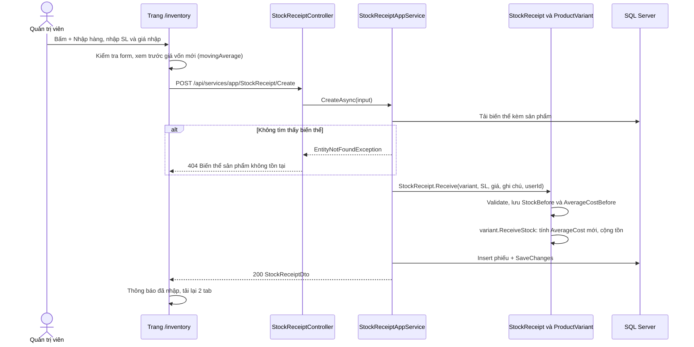
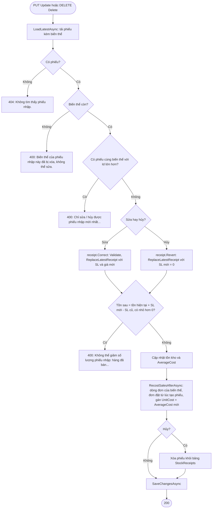
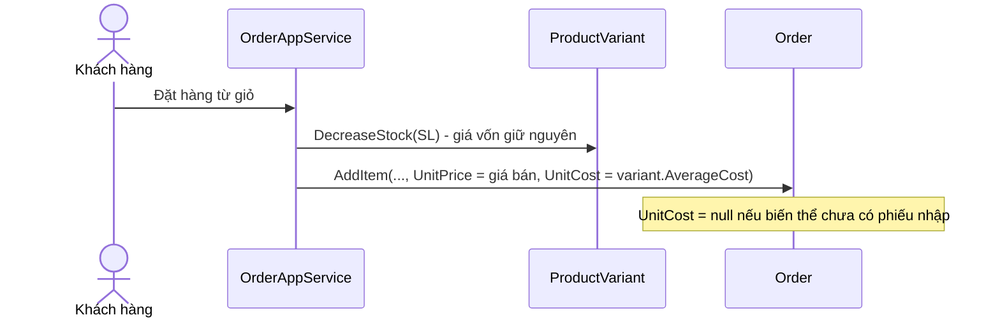

# Nhập kho & giá vốn

Quản trị viên lập phiếu nhập kho (số lượng, giá nhập) cho từng biến thể sản phẩm. Hệ thống cộng tồn kho, tính lại giá vốn theo phương pháp **bình quân gia quyền di động**, rồi lưu giá vốn đó vào từng dòng đơn lúc bán để tính lợi nhuận.

---

## 1. Mục đích & phạm vi

| Nội dung | Mô tả |
|---|---|
| Mục đích | Biết mỗi sản phẩm bán ra **tốn bao nhiêu tiền vốn**, từ đó tính được lợi nhuận gộp trong [Thống kê & báo cáo](08-thong-ke-bao-cao.md). |
| Trong phạm vi | Tạo phiếu nhập, sửa / hủy phiếu nhập mới nhất của biến thể, xem giá vốn bình quân và giá trị tồn kho, lịch sử nhập, cập nhật lại giá vốn của các đơn bán sau phiếu khi sửa / hủy phiếu. |
| Ngoài phạm vi | Sửa tồn kho thủ công khi kiểm kê (thuộc [Sản phẩm, biến thể & tồn kho](04-san-pham-bien-the-ton-kho.md)), trừ / hoàn tồn khi đặt / hủy đơn (thuộc [Đặt hàng & đơn hàng](06-dat-hang-don-hang.md)). Không quản lý nhà cung cấp, công nợ hay nhiều kho. |

## 2. Vai trò & quyền

| Vai trò | Quyền với chức năng này |
|---|---|
| Quản trị viên (`Admin`) | Toàn quyền: xem giá vốn, nhập hàng, sửa / hủy phiếu mới nhất. |
| Nhân viên (`Staff`) | Không truy cập được. API trả **403**, menu "Nhập kho" bị ẩn, vào thẳng `/inventory` thấy "Chức năng này chỉ dành cho Quản trị viên". |
| Khách hàng | Không truy cập được. |

- Backend: `StockReceiptController` gắn `[Authorize(Policy = AuthorizationPolicies.AdminOnly)]` cho cả controller (policy `AdminOnly` = `RequireRole("Admin")`, khai báo trong `HornViet.Api/Authorization/Authentication.cs`).
- Frontend: mục menu `/inventory` có `adminOnly: true` trong `HornViet_admin/app/(panel)/layout.tsx`.
- **Giá vốn không bao giờ trả cho khách hoặc Nhân viên**: `AverageCost` và `OrderItem.UnitCost` chỉ xuất hiện trong DTO của `StockReceiptAppService` (Admin) và trong các chỉ số lợi nhuận của `StatisticAppService` (Admin). Các DTO sản phẩm / đơn hàng không có trường giá vốn.

Xem thêm: [Phân quyền người dùng](02-phan-quyen-nguoi-dung.md).

## 3. Khái niệm & quy tắc nghiệp vụ

### 3.1 Thuật ngữ

| Thuật ngữ | Ý nghĩa | Nơi lưu |
|---|---|---|
| Phiếu nhập (`StockReceipt`) | Một lần nhập hàng cho **một** biến thể: số lượng, giá nhập / sản phẩm, ghi chú. | Bảng `StockReceipts` |
| Giá nhập (`UnitCost` của phiếu) | Giá mua vào một sản phẩm trong lần nhập đó (VND). | `StockReceipts.UnitCost` |
| Giá vốn bình quân (`AverageCost`) | Giá vốn hiện tại của một sản phẩm thuộc biến thể. `null` = chưa có phiếu nhập nào. | `ProductVariants.AverageCost` |
| Giá vốn lúc bán (`OrderItem.UnitCost`) | Ảnh chụp `AverageCost` tại thời điểm đặt hàng. `null` = biến thể chưa có giá vốn khi bán. | `OrderItems.UnitCost` |
| `StockBefore`, `AverageCostBefore` | Tồn kho và giá vốn **ngay trước** khi nhập phiếu này. Dùng để tính lại chính xác khi sửa / hủy phiếu. | `StockReceipts` |
| Phiếu mới nhất | Phiếu có `Id` lớn nhất trong các phiếu của cùng biến thể. Chỉ phiếu này được sửa / hủy (`canEdit = true`). | Tính khi truy vấn |

### 3.2 Công thức bình quân gia quyền di động

Hàm `ProductVariant.MovingAverage` (`HornViet.Domain/Catalog/Entities/Catalog.cs`):

```
Giá vốn mới = (Tồn trước × Giá vốn cũ + SL nhập × Giá nhập) / (Tồn trước + SL nhập)
```

- Kết quả làm tròn **4 chữ số thập phân** (`Math.Round(..., 4)`).
- Nếu **tồn trước ≤ 0** hoặc **chưa có giá vốn** (`AverageCost = null`) → giá vốn mới = **giá nhập** của phiếu.
  - Trường hợp này bao gồm **hàng tồn cũ** có từ trước khi có chức năng nhập kho: số hàng đó chưa có giá vốn, nên lấy luôn giá của phiếu nhập đầu tiên.
- Khi nhập: `ReceiveStock(quantity, unitCost)` tính `AverageCost` mới rồi cộng `StockQuantity += quantity`.

### 3.3 Điều gì làm đổi giá vốn?

| Thao tác | Tồn kho | Giá vốn bình quân |
|---|---|---|
| Tạo phiếu nhập | + SL nhập | Tính lại theo công thức 3.2 |
| Sửa phiếu nhập mới nhất | + (SL mới − SL cũ) | Tính lại từ `StockBefore`, `AverageCostBefore` với SL / giá mới |
| Hủy phiếu nhập mới nhất | − SL của phiếu | Trở về `AverageCostBefore` |
| Khách đặt hàng (`DecreaseStock`) | − SL mua | **Không đổi** |
| Hủy đơn, hoàn tồn (`IncreaseStock`) | + SL hoàn | **Không đổi** |
| Sửa tồn thủ công khi kiểm kê (`SetStock`) | = giá trị mới | **Không đổi** |

Theo bình quân di động, hàng xuất / nhập ngoài phiếu nhập đều đi theo đúng giá bình quân hiện tại, nên giá bình quân giữ nguyên. Điều này được kiểm chứng trong test `SalesAndStockCount_DoNotChangeAverageCost`.

### 3.4 Giá vốn lúc bán (snapshot)

Khi khách đặt hàng, `OrderAppService.CreateAsync` gọi `order.AddItem(..., variant.AverageCost)`. Mỗi dòng đơn lưu `UnitCost` = giá vốn bình quân **tại thời điểm đó**. Nhờ vậy, giá nhập về sau **không làm sai** lợi nhuận của đơn cũ.

### 3.5 Quy tắc sửa / hủy phiếu

| # | Quy tắc | Nơi kiểm tra |
|---|---|---|
| 1 | Chỉ sửa / hủy được **phiếu mới nhất** của biến thể. Phiếu cũ hơn → 400. | `StockReceiptAppService.LoadLatestAsync` |
| 2 | Giá vốn mới tính lại từ trạng thái **trước phiếu** (`StockBefore`, `AverageCostBefore`). Đúng vì sau phiếu mới nhất không có phiếu nào khác làm đổi giá vốn. | `ProductVariant.ReplaceLatestReceipt` |
| 3 | Tồn kho sau khi sửa / hủy = tồn hiện tại + (SL mới − SL cũ). Nếu kết quả **< 0** (hàng đã bán, tồn hiện tại không đủ để trừ) → 400, không đổi gì. | `ProductVariant.ReplaceLatestReceipt` |
| 4 | Sau khi sửa / hủy, mọi dòng đơn của biến thể thuộc đơn đặt **từ thời điểm tạo phiếu trở đi** (`Order.CreationTime >= receipt.CreationTime`) được gán lại `UnitCost` = giá vốn bình quân mới. Áp dụng cho đơn ở mọi trạng thái. | `StockReceiptAppService.RecostSalesAfterAsync` |
| 5 | Hủy phiếu **duy nhất** của biến thể → giá vốn về `null`, các đơn bán sau phiếu cũng có `UnitCost = null` (trở thành "chưa có giá vốn" trong báo cáo). | `ReplaceLatestReceipt` + `RecostSalesAfterAsync` |

Lưu ý quy tắc 3: điều kiện thực tế là **tồn hiện tại đủ để trừ phần giảm**, không theo dõi riêng "hàng của phiếu nào đã bán" (bình quân di động không phân biệt lô).

### 3.6 Giới hạn dữ liệu nhập

| Trường | Giới hạn | Kiểm tra |
|---|---|---|
| Số lượng | 1 → 1.000.000 (`StockReceipt.MaxQuantity`) | DataAnnotations trên DTO + `StockReceipt.Validate` |
| Giá nhập | 0 → 999.999.999 VND (`StockReceipt.MaxUnitCost`). Giá 0 hợp lệ (VD hàng tặng). | DataAnnotations + `StockReceipt.Validate` |
| Ghi chú | Tối đa 500 ký tự. Chuỗi rỗng / toàn khoảng trắng lưu thành `null`. | `[StringLength(500)]`, hàm `Clean` |

### 3.7 Ví dụ số

#### (a) Bán hết từng đợt — mỗi đợt có giá vốn riêng

Giá bán cố định **500**. Test: `SellOutEachBatch_ProfitUsesEachBatchCost`.

| Thời gian | Sự kiện | Tồn sau | Giá vốn BQ | Dòng đơn ghi nhận |
|---|---|---|---|---|
| 01/01 | Nhập 10 sp giá 300 (tồn trước 0 → lấy giá nhập) | 10 | 300 | |
| 01/01–10/01 | Bán 10 sp | 0 | 300 | 10 × giá bán 500, `UnitCost` 300 |
| 11/01 | Nhập 20 sp giá 400 (tồn trước 0 → lấy giá nhập) | 20 | 400 | |
| 11/01–30/01 | Bán 20 sp | 0 | 400 | 20 × giá bán 500, `UnitCost` 400 |

| Chỉ số | Cách tính | Kết quả |
|---|---|---|
| Doanh thu | 10 × 500 + 20 × 500 | **15.000** |
| Giá vốn | 10 × 300 + 20 × 400 | **11.000** |
| Lợi nhuận gộp | 15.000 − 11.000 | **4.000** |

#### (b) Còn hàng tồn rồi nhập thêm — bình quân

Test: `LeftoverStock_UsesMovingAverage`. Đang tồn **10 sp giá vốn 300**, nhập thêm **30 sp giá 400**:

```
Giá vốn mới = (10 × 300 + 30 × 400) / (10 + 30)
            = (3.000 + 12.000) / 40
            = 15.000 / 40
            = 375
```

Tồn sau nhập: 40 sp, giá vốn **375**. Mọi đơn bán sau đó (cho đến phiếu nhập kế tiếp) ghi `UnitCost = 375`.

#### (c) Gõ nhầm giá nhập rồi sửa phiếu

Test domain: `CorrectLatestReceipt_RecomputesAverageAfterSales` (phần cập nhật giá vốn đơn hàng do `RecostSalesAfterAsync` ở tầng Application thực hiện). Giá bán 500.

| Bước | Sự kiện | Tồn | Giá vốn BQ |
|---|---|---|---|
| 1 | Nhập 20 sp giá 300 | 20 | 300 |
| 2 | Bán 10 sp | 10 | 300 |
| 3 | Nhập 30 sp, **gõ nhầm giá 4.000** thay vì 400. Phiếu lưu `StockBefore = 10`, `AverageCostBefore = 300`. | 40 | (10 × 300 + 30 × 4.000) / 40 = **3.075** |
| 4 | Khách đặt đơn 5 sp → dòng đơn ghi `UnitCost = 3.075` | 35 | 3.075 |
| 5 | Admin **sửa phiếu** bước 3 thành giá 400 | 35 + (30 − 30) = 35 | (10 × 300 + 30 × 400) / 40 = **375** |
| 6 | `RecostSalesAfterAsync`: đơn ở bước 4 (đặt sau phiếu) được gán lại `UnitCost = 375` | 35 | 375 |

Lợi nhuận của đơn 5 sp:

| | Giá vốn đơn | Lợi nhuận gộp |
|---|---|---|
| Trước khi sửa | 5 × 3.075 = 15.375 | 5 × (500 − 3.075) = **−12.875** |
| Sau khi sửa | 5 × 375 = 1.875 | 5 × (500 − 375) = **625** |

Đơn bán ở bước 2 (trước phiếu) **không bị đụng tới**, vẫn giữ `UnitCost = 300`.

#### (d) Không được giảm quá số đã bán

Test: `CorrectLatestReceipt_CannotDropBelowSoldQuantity`. Nhập 30 sp (tồn trước 0), bán 25 → còn 5. Sửa phiếu xuống 20 sp: tồn sau = 5 + (20 − 30) = −5 < 0 → lỗi 400, tồn kho và phiếu giữ nguyên. Hủy phiếu cũng bị chặn tương tự (5 − 30 < 0).

## 4. Flow logic

### 4.1 Tạo phiếu nhập



| Bước | Mô tả | File / hàm |
|---|---|---|
| 1 | Form kiểm tra phía client (chọn biến thể, SL 1–1.000.000, giá 0–999.999.999) và hiển thị thành tiền, giá vốn sau khi nhập, lãi / sp. | `HornViet_admin/app/(panel)/inventory/page.tsx` — `ReceiptDrawer` |
| 2 | Gửi request qua `inventorySource.create` (API thật, hoặc dữ liệu ảo nếu đang ở chế độ ảo — xem 5.5). | `HornViet_admin/lib/hsv/mock-cost.ts` |
| 3 | ASP.NET kiểm tra DataAnnotations; sai → 400 "Dữ liệu không hợp lệ." kèm `validationErrors`. | `CreateStockReceiptInput` |
| 4 | Tải biến thể (bộ lọc xóa mềm đang bật nên biến thể đã xóa coi như không tồn tại). | `StockReceiptAppService.CreateAsync` |
| 5 | Tạo phiếu, ghi lại `StockBefore`, `AverageCostBefore`, cập nhật giá vốn và tồn của biến thể. | `StockReceipt.Receive`, `ProductVariant.ReceiveStock`, `ProductVariant.MovingAverage` |
| 6 | Lưu trong một lần `SaveChangesAsync` (phiếu + biến thể). `CreationTime` gán tự động `DateTime.Now`. | `HornVietDbContext.ApplyAuditConcepts` |

### 4.2 Sửa / hủy phiếu mới nhất



| Bước | Mô tả | File / hàm |
|---|---|---|
| 1 | Tải phiếu, kiểm tra tồn tại và là phiếu mới nhất của biến thể. | `StockReceiptAppService.LoadLatestAsync` |
| 2 | Sửa: `Correct(quantity, unitCost, note, modifierUserId, now)` — kiểm tra giới hạn, gọi `ReplaceLatestReceipt(StockBefore, AverageCostBefore, Quantity cũ, SL mới, giá mới)`, cập nhật phiếu, ghi `LastModificationTime`, `LastModifierUserId`. | `StockReceipt.Correct` |
| 3 | Hủy: `Revert()` gọi `ReplaceLatestReceipt(..., newQuantity: 0, newUnitCost: 0)` → giá vốn trở về `AverageCostBefore`. | `StockReceipt.Revert` |
| 4 | `ReplaceLatestReceipt`: tính tồn sau, chặn nếu âm; giá vốn = `AverageCostBefore` (hủy) hoặc `MovingAverage(StockBefore, AverageCostBefore, SL mới, giá mới)` (sửa). | `ProductVariant.ReplaceLatestReceipt` |
| 5 | Cập nhật `UnitCost` các dòng đơn của biến thể có `Order.CreationTime >= receipt.CreationTime`. | `StockReceiptAppService.RecostSalesAfterAsync` |
| 6 | Hủy: xóa cứng phiếu (`StockReceipt` không xóa mềm). Tất cả lưu trong một lần `SaveChangesAsync`. | `StockReceiptAppService.DeleteAsync` |

### 4.3 Bán hàng ghi giá vốn



Chi tiết luồng đặt hàng xem [Đặt hàng & đơn hàng](06-dat-hang-don-hang.md).

## 5. Hướng dẫn sử dụng

Đăng nhập trang quản trị (`http://localhost:3001`) bằng tài khoản **Quản trị viên**, chọn menu **Nhập kho** (tiêu đề trang "Nhập kho & giá vốn", đường dẫn `/inventory`).

Trang có hai tab (dạng chip) và nút **+ Nhập hàng** ở góc phải đầu trang. Sau mỗi lần nhập / sửa / hủy, cả hai tab tự tải lại.

### 5.1 Tab "Giá vốn & tồn kho" (mặc định)

Danh sách biến thể, 12 dòng / trang, tìm theo tên sản phẩm, sắp theo tên sản phẩm.

| Cột | Ý nghĩa | Nguồn |
|---|---|---|
| Sản phẩm / biến thể | Tên sản phẩm, tên biến thể ("Mặc định" nếu không có kích thước / kiểu), thời điểm nhập gần nhất | `productName`, `variantName`, `lastReceiptTime` |
| Tồn kho | Tồn hiện tại | `stockQuantity` |
| Giá bán | Giá bán hiện tại của sản phẩm | `salePrice` |
| Giá vốn BQ | Giá vốn bình quân, làm tròn đến đồng; "Chưa có" nếu chưa có phiếu nhập | `averageCost` |
| Giá trị tồn | Tồn × giá vốn BQ; "—" nếu chưa có giá vốn | `stockValue` |
| Lãi / sp | Giá bán − giá vốn BQ; màu đỏ nếu âm; "—" nếu chưa có giá vốn | `unitProfit` |
| Thao tác | Nút **+ Nhập hàng** cho riêng biến thể này | |

### 5.2 Nhập hàng

1. Bấm **+ Nhập hàng**:
   - Ở **đầu trang**: ngăn kéo (drawer) mở ra có ô chọn **Sản phẩm / biến thể** (mỗi lựa chọn hiện "Tên sản phẩm — biến thể (tồn N)"). Danh sách lấy tối đa 100 biến thể đầu tiên theo tên sản phẩm.
   - Trên **từng dòng** của tab "Giá vốn & tồn kho": biến thể được chọn sẵn.
2. Khung thông tin hiện **Tồn hiện tại · Giá vốn hiện tại · Giá bán** của biến thể.
3. Nhập **Số lượng nhập** và **Giá nhập / sản phẩm (VND)**. Có thể gõ dấu chấm / phẩy phân cách nghìn (VD `300.000`), hệ thống tự bỏ. **Ghi chú** không bắt buộc (tối đa 500 ký tự).
4. Khi số liệu hợp lệ, phần xem trước hiện:
   - **Thành tiền** = SL × giá nhập.
   - **Giá vốn sau khi nhập** = kết quả công thức 3.2 (cùng công thức với backend, hàm `movingAverage`).
   - **Lãi / sản phẩm với giá bán hiện tại** = giá bán − giá vốn sau khi nhập (đỏ nếu âm).
5. Bấm **Nhập hàng**. Thành công → thông báo "Đã nhập N sản phẩm", drawer đóng.

### 5.3 Tab "Lịch sử nhập"

Danh sách phiếu nhập, **mới nhất trước**, 12 dòng / trang, tìm theo tên sản phẩm.

| Cột | Nội dung |
|---|---|
| Ngày nhập | Thời điểm tạo phiếu; có nhãn "đã sửa" nếu phiếu từng được sửa |
| Sản phẩm / biến thể | Tên sản phẩm, biến thể, tên đăng nhập người tạo |
| Số lượng · Giá nhập · Thành tiền | `quantity`, `unitCost`, `totalCost = unitCost × quantity` |
| Ghi chú | "—" nếu trống |
| Thao tác | **Sửa** và **Hủy** — chỉ bật cho phiếu mới nhất của biến thể (`canEdit`). Phiếu cũ bị làm mờ, di chuột hiện "Chỉ sửa được phiếu nhập mới nhất của biến thể". |

### 5.4 Sửa / hủy phiếu

- **Sửa**: drawer "Sửa phiếu nhập" điền sẵn SL, giá, ghi chú. Sửa rồi bấm **Lưu thay đổi** → thông báo "Đã sửa phiếu nhập, giá vốn đã được tính lại". Giá vốn biến thể và giá vốn các đơn đặt sau phiếu được cập nhật (xem ví dụ 3.7c).
- **Hủy**: hộp xác nhận "Hủy phiếu nhập?" mô tả "trừ lại N sản phẩm khỏi tồn kho, giá vốn trở về như trước khi nhập". Bấm **Hủy phiếu** → "Đã hủy phiếu nhập". Lỗi (VD hàng đã bán) hiện bằng thông báo nổi.
- Muốn sửa một phiếu **cũ**: phải hủy lần lượt các phiếu mới hơn của biến thể đó trước (nếu tồn kho còn đủ), rồi nhập lại.

### 5.5 Chế độ dữ liệu ảo (chỉ khi chạy dev)

Dùng khi chạy frontend với một backend **cũ chưa có API nhập kho** (API `StockReceipt/*` trả 404). Toàn bộ nằm trong `HornViet_admin/lib/hsv/mock-cost.ts`.

| Mục | Cách hoạt động |
|---|---|
| Điều kiện bật | `MOCK_COST_ENABLED = process.env.NODE_ENV !== "production"` **và** API đọc (`GetVariantCosts` / `GetAll`) trả `ApiError` 404. Bản build production **không bao giờ** dùng dữ liệu ảo. |
| Chuyển chế độ | `inventorySource` gọi API thật trước. Lần đọc gần nhất quyết định `mockMode`; thao tác ghi (tạo / sửa / hủy) đi theo chế độ đó, để lỗi 404 thật của `Create` / `Update` không bị chuyển nhầm sang dữ liệu ảo. |
| Dữ liệu sinh sẵn | Lấy sản phẩm thật qua API sản phẩm (tối đa 100). Mỗi biến thể có 2 phiếu ảo (ghi chú "Đợt 1 (dữ liệu ảo)" và "Đợt 2 (dữ liệu ảo)", cách đây khoảng 40 và 10 ngày), giá nhập bằng 55–70% giá bán (cố định theo id). Phiếu sinh sẵn chỉ để xem, không sửa / hủy được. |
| Phiếu tự nhập | Lưu trong `localStorage` khóa `hsv-mock-stock-receipts` (id từ 1.000.000), không ghi vào database. Nếu trình duyệt chặn `localStorage` thì giữ trong bộ nhớ đến khi tải lại trang. Giá vốn tính lại bằng `movingAverage` như backend. Chỉ phiếu tự nhập mới nhất của biến thể được sửa / hủy. |
| Khác backend | Chế độ ảo **không** chặn việc giảm SL / hủy phiếu khi hàng đã bán, và không cập nhật giá vốn đơn hàng. |

## 6. API liên quan

Tất cả thuộc `StockReceiptController`, quyền 👑 Quản trị viên. Chi tiết request / response: [API.md — mục 2.10 Nhập kho & giá vốn](../API.md).

| Method | Endpoint | Input | Kết quả |
|---|---|---|---|
| GET | `/api/services/app/StockReceipt/GetVariantCosts` | `keyword?, skipCount, maxResultCount` | `{ totalCount, items: VariantCostDto[] }` — sắp theo tên sản phẩm, rồi Id biến thể |
| GET | `/api/services/app/StockReceipt/GetAll` | `productVariantId?, keyword?, skipCount, maxResultCount` | `{ totalCount, items: StockReceiptDto[] }` — mới nhất trước (Id giảm dần) |
| POST | `/api/services/app/StockReceipt/Create` | `{ productVariantId, quantity, unitCost, note? }` | `StockReceiptDto` |
| PUT | `/api/services/app/StockReceipt/Update` | `{ id, quantity, unitCost, note? }` | `StockReceiptDto` |
| DELETE | `/api/services/app/StockReceipt/Delete?id=` | `id` | `null` |

Trường tính toán trong DTO:

| DTO | Trường | Công thức |
|---|---|---|
| `VariantCostDto` | `stockValue` | `averageCost × stockQuantity` (`null` nếu `averageCost` null) |
| `VariantCostDto` | `unitProfit` | `salePrice − averageCost` (`null` nếu `averageCost` null); `salePrice` = `Product.Price` |
| `VariantCostDto` | `lastReceiptTime` | `CreationTime` lớn nhất trong các phiếu của biến thể |
| `StockReceiptDto` | `totalCost` | `unitCost × quantity` |
| `StockReceiptDto` | `canEdit` | `true` nếu không có phiếu nào cùng biến thể với Id lớn hơn |

Ghi chú: `GetVariantCosts` liệt kê cả biến thể của sản phẩm đang ẩn (không lọc `IsActive`), nhưng không có biến thể đã xóa mềm.

## 7. Dữ liệu

Migration: `HornViet.Infrastructure/Persistence/Migrations/20261009084805_AddStockReceiptsAndCost.cs`. Cấu hình EF: `HornViet.Infrastructure/Persistence/HornVietDbContext.cs`.

### 7.1 Bảng `StockReceipts` (mới)

| Cột | Kiểu | Null | Ý nghĩa |
|---|---|---|---|
| `Id` | int, identity | Không | Khóa chính, tăng dần — dùng để xác định phiếu mới nhất |
| `ProductVariantId` | int | Không | FK → `ProductVariants.Id`, `ON DELETE RESTRICT` |
| `Quantity` | int | Không | Số lượng nhập |
| `UnitCost` | decimal(18,2) | Không | Giá nhập / sản phẩm |
| `Note` | nvarchar(500) | Có | Ghi chú |
| `StockBefore` | int | Không | Tồn kho ngay trước khi nhập |
| `AverageCostBefore` | decimal(18,4) | Có | Giá vốn bình quân ngay trước khi nhập (`null` = chưa có) |
| `CreatorUserId` | bigint | Không | FK → `AbpUsers.Id`, `ON DELETE RESTRICT` |
| `CreationTime` | datetime2 | Không | Thời điểm nhập — mốc để cập nhật giá vốn đơn bán sau phiếu |
| `LastModificationTime` | datetime2 | Có | Lần sửa gần nhất |
| `LastModifierUserId` | bigint | Có | Người sửa gần nhất |

Chỉ mục: `IX_StockReceipts_ProductVariantId_Id` (tìm phiếu mới nhất), `IX_StockReceipts_CreationTime`, `IX_StockReceipts_CreatorUserId`.

### 7.2 Cột thêm vào bảng có sẵn

| Bảng | Cột | Kiểu | Ý nghĩa |
|---|---|---|---|
| `ProductVariants` | `AverageCost` | decimal(18,4), null | Giá vốn bình quân hiện tại |
| `OrderItems` | `UnitCost` | decimal(18,4), null | Giá vốn một sản phẩm lúc bán |

Cấu trúc tổng thể xem [Cơ sở dữ liệu](10-co-so-du-lieu.md).

## 8. Lỗi thường gặp & cách xử lý

| Tình huống | HTTP | Thông báo (`error.message`) | Cách xử lý |
|---|---|---|---|
| Nhân viên / khách gọi API | 403 | Bạn không có quyền thực hiện chức năng này. | Dùng tài khoản Quản trị viên. |
| Chưa đăng nhập / token hết hạn | 401 | Bạn chưa đăng nhập hoặc phiên đăng nhập đã hết hạn. | Đăng nhập lại. |
| Thiếu biến thể, SL hoặc giá sai định dạng (DataAnnotations) | 400 | Dữ liệu không hợp lệ. — `validationErrors` gồm: "Vui lòng chọn biến thể.", "Số lượng nhập phải từ 1 đến 1.000.000.", "Giá nhập không hợp lệ." | Sửa trường được đánh dấu trên form. |
| SL / giá ngoài giới hạn (kiểm tra ở domain) | 400 | Số lượng nhập phải từ 1 đến 1,000,000. / Giá nhập không hợp lệ. | Như trên. (Định dạng số trong thông báo domain phụ thuộc culture của server.) |
| Biến thể không tồn tại / đã xóa (khi tạo) | 404 | Biến thể sản phẩm không tồn tại. | Tải lại trang, chọn biến thể khác. |
| Phiếu không tồn tại | 404 | Không tìm thấy phiếu nhập. | Tải lại danh sách. |
| Sửa / hủy phiếu không phải mới nhất | 400 | Chỉ sửa / hủy được phiếu nhập mới nhất của biến thể này (đã có phiếu nhập sau phiếu này). | Hủy các phiếu mới hơn trước, hoặc nhập phiếu điều chỉnh mới. |
| Giảm SL / hủy phiếu khi hàng đã bán | 400 | Không thể giảm số lượng phiếu nhập: hàng đã bán, biến thể "{tên}" chỉ còn {N} sản phẩm. | Chỉ giảm tối đa bằng tồn hiện tại. Nếu giá nhập sai thì sửa giá, giữ nguyên SL. |
| Biến thể của phiếu đã bị xóa | 400 | Biến thể của phiếu nhập này đã bị xóa, không thể sửa. | Không sửa được, phiếu giữ làm lịch sử. |
| Hai giao dịch cùng sửa tồn một biến thể (rowversion) | 409 | Dữ liệu (tồn kho) vừa được cập nhật bởi giao dịch khác. Vui lòng tải lại và thử lại. | Tải lại trang, thao tác lại. |
| Lỗi phía form (chưa gửi API) | — | Chọn sản phẩm cần nhập / Số lượng nhập phải từ 1 đến 1.000.000 / Giá nhập không hợp lệ | Sửa trường được đánh dấu. |

Định dạng response lỗi: xem [API.md — mục 1.1](../API.md). Lỗi nghiệp vụ được đổi sang HTTP trong `HornViet.Api/Middlewares` (`BusinessErrors.TryMap`): `UserFriendlyException` → 400, `EntityNotFoundException` → 404, `DbUpdateConcurrencyException` → 409.

## 9. Mã nguồn liên quan

| Tầng | File |
|---|---|
| Domain — phiếu nhập | `HornViet.Domain/Inventory/Entities/StockReceipt.cs` |
| Domain — giá vốn biến thể | `HornViet.Domain/Catalog/Entities/Catalog.cs` (`ProductVariant.AverageCost`, `MovingAverage`, `ReceiveStock`, `ReplaceLatestReceipt`) |
| Domain — dòng đơn | `HornViet.Domain/Orders/Entities/Order.cs` (`OrderItem.UnitCost`, `Order.AddItem`) |
| Application | `HornViet.Application/Inventory/StockReceiptAppService.cs` |
| Application — ghi giá vốn khi bán | `HornViet.Application/Orders/OrderAppService.cs` (`CreateAsync`) |
| API | `HornViet.Api/Controllers/Admin/StockReceiptController.cs` |
| Phân quyền | `HornViet.Api/Authorization/Authentication.cs` (`AuthorizationPolicies.AdminOnly`) |
| Ánh xạ lỗi | `HornViet.Api/Controllers/HornVietBaseController.cs`, `HornViet.Api/Middlewares` (`BusinessErrors`) |
| Hạ tầng | `HornViet.Infrastructure/Persistence/HornVietDbContext.cs`, `HornViet.Infrastructure/Persistence/Migrations/20261009084805_AddStockReceiptsAndCost.cs` |
| Unit test | `tests/HornViet.Domain.UnitTests/Inventory/StockReceiptTests.cs` |
| Frontend — trang | `HornViet_admin/app/(panel)/inventory/page.tsx` |
| Frontend — dữ liệu ảo, `movingAverage` | `HornViet_admin/lib/hsv/mock-cost.ts` |
| Frontend — gọi API | `HornViet_admin/lib/api/services.ts` (`stockReceiptApi`) |
| Frontend — menu, chặn quyền | `HornViet_admin/app/(panel)/layout.tsx` |

Tài liệu liên quan: [Tổng quan](00-tong-quan.md) · [Sản phẩm, biến thể & tồn kho](04-san-pham-bien-the-ton-kho.md) · [Đặt hàng & đơn hàng](06-dat-hang-don-hang.md) · [Thống kê & báo cáo](08-thong-ke-bao-cao.md) · [Cơ sở dữ liệu](10-co-so-du-lieu.md)
