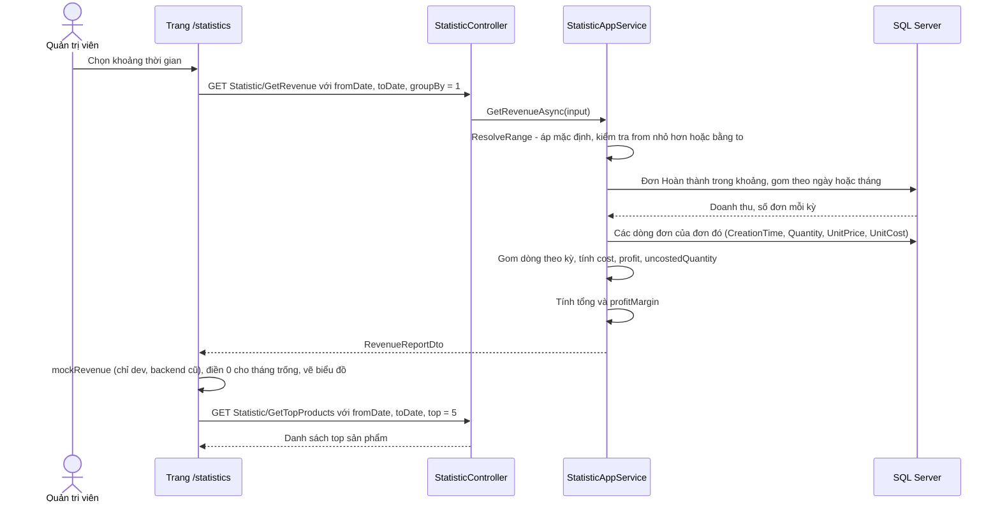
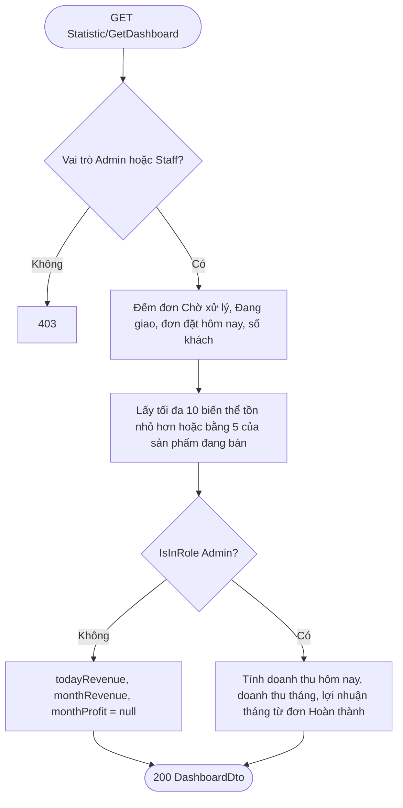

# Thống kê & báo cáo

Trang **Tổng quan** cho Nhân viên và Quản trị viên xem nhanh tình hình đơn hàng, tồn kho. Trang **Thống kê** cho Quản trị viên xem doanh thu, giá vốn, lợi nhuận gộp theo kỳ và sản phẩm bán chạy.

---

## 1. Mục đích & phạm vi

| Nội dung | Mô tả |
|---|---|
| Mục đích | Giúp cửa hàng biết việc cần làm ngay (đơn chờ xử lý, hàng sắp hết) và kết quả kinh doanh (doanh thu, lợi nhuận). |
| Trong phạm vi | Dashboard (`Statistic/GetDashboard`), báo cáo doanh thu – giá vốn – lợi nhuận theo ngày / tháng (`Statistic/GetRevenue`), sản phẩm bán chạy (`Statistic/GetTopProducts`), trang `/` và `/statistics` của `HornViet_admin`. |
| Ngoài phạm vi | Cách hình thành giá vốn: xem [Nhập kho & giá vốn](07-nhap-kho-gia-von.md). Vòng đời đơn hàng: xem [Đặt hàng & đơn hàng](06-dat-hang-don-hang.md). Không có xuất file Excel / PDF. |

## 2. Vai trò & quyền

| Chức năng | Nhân viên (`Staff`) | Quản trị viên (`Admin`) |
|---|---|---|
| Dashboard — số đơn, số khách, biến thể sắp hết | Có | Có |
| Dashboard — doanh thu hôm nay / tháng, lợi nhuận tháng | Không (backend trả `null`) | Có |
| Báo cáo doanh thu, giá vốn, lợi nhuận (`GetRevenue`) | Không (403) | Có |
| Sản phẩm bán chạy (`GetTopProducts`) | Không (403) | Có |
| Trang `/statistics` | Menu ẩn, vào thẳng thấy "Chức năng này chỉ dành cho Quản trị viên" | Có |

- Backend: `StatisticController` gắn policy `Management` (Admin hoặc Staff) cho cả controller; `GetRevenue` và `GetTopProducts` gắn thêm `AdminOnly`.
- Trong `GetDashboardAsync`, ba trường tiền chỉ được tính khi `_session.IsInRole(RoleName.Admin)`; với Nhân viên chúng giữ `null`.
- Frontend: `/statistics` có `adminOnly: true` trong `HornViet_admin/app/(panel)/layout.tsx`.

Xem thêm: [Phân quyền người dùng](02-phan-quyen-nguoi-dung.md).

## 3. Khái niệm & quy tắc nghiệp vụ

### 3.1 Quy tắc chung

| # | Quy tắc |
|---|---|
| 1 | **Doanh thu chỉ tính đơn ở trạng thái Hoàn thành** (`OrderStatus.Completed = 2`). Đơn Chờ xử lý, Đang giao, Đã hủy không vào doanh thu / lợi nhuận. |
| 2 | Đơn được xếp vào kỳ theo **ngày đặt hàng** (`Order.CreationTime`), không theo ngày hoàn thành. Một đơn đặt 31/01 hoàn thành 02/02 thuộc tháng 1. |
| 3 | Doanh thu một đơn = `Order.TotalAmount` = Σ (`UnitPrice` × `Quantity`) các dòng đơn. |
| 4 | Giá vốn dùng `OrderItem.UnitCost` — giá vốn bình quân chụp lúc bán (có thể được tính lại khi sửa / hủy phiếu nhập, xem [Nhập kho & giá vốn](07-nhap-kho-gia-von.md)). |
| 5 | Dòng đơn có `UnitCost = null` (bán khi biến thể chưa có phiếu nhập, VD đơn cũ trước khi có chức năng nhập kho) **không tính vào giá vốn và lợi nhuận**, chỉ được đếm số lượng ở `uncostedQuantity` để cảnh báo. Doanh thu của các dòng này **vẫn** tính vào doanh thu. |
| 6 | Khoảng thời gian `[fromDate, toDate]` tính trọn ngày: lọc `CreationTime >= fromDate 00:00` và `< toDate + 1 ngày`. Mặc định `toDate` = hôm nay, `fromDate` = `toDate − 29 ngày` (30 ngày gần nhất). |
| 7 | Báo cáo chỉ trả các kỳ **có doanh thu**. Frontend tự điền 0 cho kỳ trống khi vẽ biểu đồ. |

### 3.2 Công thức từng chỉ số

Ký hiệu: *L* = tập dòng đơn (`OrderItems`) thuộc đơn Hoàn thành trong kỳ; *L có giá vốn* = các dòng trong *L* có `UnitCost != null`.

#### Dashboard (`GetDashboardAsync`)

| Chỉ số | Trường | Công thức theo code |
|---|---|---|
| Đơn chờ xử lý | `pendingOrderCount` | Số đơn `Status = Pending` (mọi thời điểm) |
| Đơn đang giao | `shippingOrderCount` | Số đơn `Status = Shipping` (mọi thời điểm) |
| Đơn hôm nay | `todayOrderCount` | Số đơn có `CreationTime >= 00:00 hôm nay`, **mọi trạng thái** (kể cả đã hủy) |
| Số khách | `customerCount` | Số người dùng có vai trò `Customer` |
| Doanh thu hôm nay 👑 | `todayRevenue` | Σ `TotalAmount` đơn Hoàn thành đặt hôm nay (không có đơn → 0) |
| Doanh thu tháng 👑 | `monthRevenue` | Σ `TotalAmount` đơn Hoàn thành đặt từ ngày 1 tháng này đến trước ngày 1 tháng sau |
| Lợi nhuận tháng 👑 | `monthProfit` | Σ (`UnitPrice` − `UnitCost`) × `Quantity` trên dòng có giá vốn của đơn Hoàn thành trong tháng |
| Biến thể sắp hết | `lowStockVariants` | Biến thể có `StockQuantity <= 5` (`AppConsts.LowStockThreshold`), sản phẩm đang bán (`IsActive`), chưa xóa; sắp theo tồn tăng dần rồi Id; **tối đa 10** |

👑 = `null` với Nhân viên.

#### Báo cáo doanh thu (`GetRevenueAsync`)

| Chỉ số | Trường | Công thức theo code |
|---|---|---|
| Doanh thu kỳ | `items[].revenue` | Σ `TotalAmount` các đơn Hoàn thành trong kỳ |
| Số đơn kỳ | `items[].orderCount` | Số đơn Hoàn thành trong kỳ |
| Giá vốn kỳ | `items[].cost` | Σ `UnitCost` × `Quantity` trên *L có giá vốn* của kỳ |
| Lợi nhuận gộp kỳ | `items[].profit` | Σ (`UnitPrice` − `UnitCost`) × `Quantity` trên *L có giá vốn* của kỳ |
| SL chưa có giá vốn kỳ | `items[].uncostedQuantity` | Σ `Quantity` các dòng `UnitCost = null` của kỳ |
| Tổng doanh thu | `totalRevenue` | Σ `items[].revenue` (gồm cả dòng chưa có giá vốn) |
| Tổng số đơn | `orderCount` | Σ `items[].orderCount` |
| Giá vốn hàng bán | `totalCost` | Σ `items[].cost` |
| Lợi nhuận gộp | `totalProfit` | Σ `items[].profit` |
| Tỷ suất lợi nhuận (%) | `profitMargin` | `round(totalProfit / doanhThuCóGiáVốn × 100, 1)`, trong đó *doanhThuCóGiáVốn* = Σ `UnitPrice` × `Quantity` trên *L có giá vốn*. `null` nếu *doanhThuCóGiáVốn* = 0 |
| Tổng SL chưa có giá vốn | `uncostedQuantity` | Σ `items[].uncostedQuantity` |
| Khoảng thực tế | `fromDate`, `toDate` | Ngày bắt đầu / kết thúc sau khi áp mặc định |

Lưu ý: khi có dòng chưa có giá vốn, `totalRevenue − totalCost` **lớn hơn** `totalProfit` (vì doanh thu của dòng đó không có giá vốn đi kèm). `profitMargin` chia cho doanh thu **có giá vốn**, không phải `totalRevenue`, để tỷ lệ không bị méo.

Kỳ (`items[].period`):

| `groupBy` | Giá trị | `period` |
|---|---|---|
| `Day` (mặc định) | `0` | Ngày đặt hàng (00:00) |
| `Month` | `1` | Ngày 1 của tháng |

#### Sản phẩm bán chạy (`GetTopProductsAsync`)

| Trường | Công thức theo code |
|---|---|
| `productId` | Gom theo `ProductVariant.ProductId` (kể cả biến thể đã xóa mềm) |
| `productName` | Tên sản phẩm lưu trên dòng đơn (`OrderItem.ProductName`, lấy `Max` trong nhóm) |
| `quantitySold` | Σ `Quantity` |
| `revenue` | Σ `UnitPrice` × `Quantity` |
| `profit` | Σ (`UnitPrice` − `UnitCost`) × `Quantity`, dòng không có giá vốn tính 0 |
| `uncostedQuantity` | Σ `Quantity` các dòng `UnitCost = null` |

Sắp theo `quantitySold` giảm dần, rồi `revenue` giảm dần. `top` mặc định 10, bị kẹp trong 1–50. Cùng điều kiện đơn Hoàn thành và khoảng thời gian như báo cáo doanh thu.

### 3.3 Ví dụ số (dữ liệu giả)

Tháng 1, chỉ bán một sản phẩm "Lược sừng" giá 500 (theo ví dụ (a) của [Nhập kho & giá vốn](07-nhap-kho-gia-von.md)), tất cả đơn đã Hoàn thành. Thêm một đơn cũ 4 sp bán khi chưa có phiếu nhập (`UnitCost = null`).

| Dòng đơn | SL | Giá bán | `UnitCost` | Doanh thu | Giá vốn | Lợi nhuận |
|---|---|---|---|---|---|---|
| Đợt 1 | 10 | 500 | 300 | 5.000 | 3.000 | 2.000 |
| Đợt 2 | 20 | 500 | 400 | 10.000 | 8.000 | 2.000 |
| Đơn cũ | 4 | 500 | null | 2.000 | (không tính) | (không tính) |

| Chỉ số báo cáo | Kết quả |
|---|---|
| `totalRevenue` | 5.000 + 10.000 + 2.000 = **17.000** |
| `totalCost` | 3.000 + 8.000 = **11.000** |
| `totalProfit` | 2.000 + 2.000 = **4.000** |
| `profitMargin` | 4.000 / 15.000 × 100 = 26,67 → **26,7 %** |
| `uncostedQuantity` | **4** → trang Thống kê hiện cảnh báo |

Nếu bỏ đơn cũ, kết quả trùng ví dụ (a): doanh thu 15.000, giá vốn 11.000, lợi nhuận 4.000, tỷ suất 26,7 %.

## 4. Flow logic

### 4.1 Báo cáo doanh thu

| Bước | Mô tả | File / hàm |
|---|---|---|
| 1 | Frontend tính `fromDate`, `toDate` (yyyy-MM-dd) cho khoảng đã chọn, luôn gửi `groupBy = Month`. | `HornViet_admin/app/(panel)/statistics/page.tsx` — `buildRanges` |
| 2 | Chuẩn hóa khoảng: mặc định 30 ngày gần nhất; `from > to` → 400. Trả `toExclusive = to + 1 ngày`. | `StatisticAppService.ResolveRange` |
| 3 | Lọc đơn Hoàn thành theo `CreationTime`. | `StatisticAppService.CompletedOrders` |
| 4 | Gom doanh thu, số đơn theo ngày (`CreationTime.Date`) hoặc tháng (năm, tháng) bằng SQL. | `GetRevenueAsync` |
| 5 | Tải dòng đơn của các đơn đó, gom theo cùng kỳ bằng `ToLookup` trong bộ nhớ, tính giá vốn / lợi nhuận / SL chưa có giá vốn. | `GetRevenueAsync` |
| 6 | Tính tổng và tỷ suất lợi nhuận. | `GetRevenueAsync` |
| 7 | Gọi song song top 5 sản phẩm cùng khoảng. | `StatisticAppService.GetTopProductsAsync` |

### 4.2 Dashboard

Trang `/` gọi `statistic.getDashboard()` rồi `mockDashboard` (chỉ dev), đồng thời gọi `Order/GetAll` lấy 5 đơn mới nhất. Layout của trang quản trị cũng gọi `GetDashboard` mỗi khi đổi trang (dùng `pendingOrderCount` cho thanh menu).

## 5. Hướng dẫn sử dụng

### 5.1 Trang Tổng quan (`/`)

Mở trang quản trị (`http://localhost:3001`), menu **Tổng quan**. Có 4 thẻ KPI ở hàng trên, bấm vào thẻ để đến trang chi tiết:

| Thẻ | Hiển thị | Bấm vào |
|---|---|---|
| Đơn chờ xử lý | `pendingOrderCount`, ghi chú "Cần xác nhận" | `/orders?status=0` |
| Đơn đang giao | `shippingOrderCount`, ghi chú "Đang vận chuyển" | `/orders?status=1` |
| **Quản trị viên**: Doanh thu tháng N | `monthRevenue`; ghi chú "Lợi nhuận: … · Hôm nay: …" (thêm "(ảo)" nếu là dữ liệu ảo) | `/statistics` |
| **Nhân viên**: Đơn đặt hôm nay | `todayOrderCount`; ghi chú "N khách hàng" (`customerCount`) | `/orders` |
| Biến thể sắp hết | Số biến thể trong `lowStockVariants` ("10+" nếu đủ 10); ghi chú "Tồn kho ≤ 5" | `/products?warn=1` |

Bên dưới:
- **Đơn hàng mới nhất**: 5 đơn gần nhất (mã đơn, người nhận, thời gian, trạng thái, tổng tiền). Bấm một dòng → mở đơn ở `/orders`. Liên kết "Tất cả đơn →".
- **Biến thể sắp hết hàng**: danh sách biến thể, hiện "Hết hàng" (tồn 0, màu đỏ) hoặc "Còn N". Bấm → mở sửa sản phẩm ở `/products`.

### 5.2 Trang Thống kê (`/statistics`) — chỉ Quản trị viên

1. Menu **Thống kê** (tiêu đề "Thống kê báo cáo").
2. Chọn **Khoảng thời gian** (chip ở đầu trang). Các khoảng được tính theo ngày hiện tại:

   | Chip | Từ ngày | Đến ngày |
   |---|---|---|
   | 6 tháng gần nhất (mặc định) | Ngày 1 của tháng cách đây 5 tháng | Hôm nay |
   | Quý Q/YYYY (quý trước) | Ngày đầu quý trước | Ngày cuối quý trước |
   | Năm YYYY (năm nay) | 01/01 năm nay | Hôm nay |
   | Năm YYYY−1 (năm trước) | 01/01 năm trước | 31/12 năm trước |

   Ngày kết thúc không vượt quá hôm nay.
3. Đọc **cảnh báo** (nếu có): "N sản phẩm đã bán chưa có giá vốn (bán trước khi có phiếu nhập kho) nên không được tính vào giá vốn và lợi nhuận." — hiện khi `uncostedQuantity > 0`.
4. Đọc **4 thẻ KPI**:

   | Thẻ | Giá trị | Ghi chú |
   |---|---|---|
   | Doanh thu | `totalRevenue` | "N đơn hoàn thành" |
   | Giá vốn hàng bán | `totalCost` | |
   | Lợi nhuận gộp | `totalProfit` (màu đỏ nếu âm) | |
   | Tỷ suất lợi nhuận | `profitMargin` + "%" ("—" nếu `null`) | |

5. Xem **biểu đồ cột "Doanh thu theo tháng"**: mỗi cột là một tháng trong khoảng (nhãn T1, T2…). Cột cao nhất màu vàng đậm. Nếu ≤ 6 tháng thì hiện số tiền rút gọn trên mọi cột, nhiều hơn thì chỉ hiện trên cột cao nhất. **Di chuột** lên cột để xem tooltip: "Tháng M/YYYY", doanh thu · số đơn, "Lợi nhuận: …".
6. **Bảng theo tháng** (Tháng, Doanh thu, Số đơn, Lợi nhuận) được render ẩn (`sr-only`) dành cho trình đọc màn hình — không hiện trên giao diện thường.
7. Xem **Sản phẩm bán chạy**: top 5 sản phẩm theo số lượng bán, mỗi dòng có hạng, tên, "N sản phẩm", doanh thu và "Lãi …" (đỏ nếu âm).
8. Nếu khoảng không có đơn Hoàn thành nào: hiện "Chưa có dữ liệu — Không có đơn hoàn thành trong khoảng thời gian này."

### 5.3 Tự điền 0 cho kỳ trống

Backend chỉ trả các tháng có doanh thu. Trang `/statistics` tạo danh sách tất cả tháng của khoảng (`range.months`), ghép với `items` theo khóa `yyyy-MM` (7 ký tự đầu của `period`); tháng không có dữ liệu được gán doanh thu 0, số đơn 0, lợi nhuận 0 và vẽ cột thấp 2px.

### 5.4 Dữ liệu ảo khi backend cũ (chỉ dev)

Trong `HornViet_admin/lib/hsv/mock-cost.ts`, khi `MOCK_COST_ENABLED` (`NODE_ENV !== "production"`) và backend **cũ** không trả các trường giá vốn / lợi nhuận:

| Hàm | Điều kiện bật | Số liệu ảo |
|---|---|---|
| `mockRevenue` | `totalCost === undefined` | Mỗi kỳ: `cost = round(revenue × 0,62)`, `profit = revenue − cost`, `uncostedQuantity = 0`. `profitMargin = totalProfit / totalRevenue` (1 chữ số thập phân). |
| `mockTopProducts` | Có sản phẩm thiếu `profit` | `profit = round(revenue × (1 − tỷ lệ))`, tỷ lệ giá vốn 55–70% cố định theo `productId` |
| `mockDashboard` | `monthProfit === undefined` và `monthRevenue` khác `null` | `monthProfit = round(monthRevenue × 0,38)`; thẻ doanh thu hiện chữ "(ảo)" |

Bản production không bao giờ dùng số liệu ảo: thiếu trường thì hiện "—". Với backend hiện tại (đã có đủ trường), các hàm này trả nguyên dữ liệu thật (`mocked: false`).

## 6. API liên quan

Chi tiết request / response: [API.md — mục 2.9 Thống kê & Dashboard](../API.md). Enum `RevenueGroupBy`: [API.md — mục 1.2](../API.md).

| Method | Endpoint | Quyền | Input | Kết quả |
|---|---|---|---|---|
| GET | `/api/services/app/Statistic/GetDashboard` | 🛠 Nhân viên + Quản trị viên | — | `DashboardDto` |
| GET | `/api/services/app/Statistic/GetRevenue` | 👑 Quản trị viên | `fromDate?, toDate?` (yyyy-MM-dd), `groupBy` (`0` ngày — mặc định, `1` tháng) | `RevenueReportDto` |
| GET | `/api/services/app/Statistic/GetTopProducts` | 👑 Quản trị viên | `fromDate?, toDate?, top` (mặc định 10, 1–50) | `{ items: TopProductDto[] }` |

## 7. Dữ liệu

Chức năng này **chỉ đọc**, không có bảng riêng.

| Bảng | Cột sử dụng | Dùng cho |
|---|---|---|
| `Orders` | `Status`, `CreationTime`, `TotalAmount` | Lọc đơn Hoàn thành theo ngày đặt, doanh thu, đếm đơn |
| `OrderItems` | `OrderId`, `ProductVariantId`, `ProductName`, `Quantity`, `UnitPrice`, `UnitCost` | Giá vốn, lợi nhuận, SL chưa có giá vốn, top sản phẩm |
| `ProductVariants` | `ProductId`, `StockQuantity`, `Size`, `Style`, `IsDeleted` | Biến thể sắp hết, gom top sản phẩm theo sản phẩm |
| `Products` | `Name`, `IsActive` | Biến thể sắp hết |
| `AbpUsers` + vai trò | Vai trò `Customer` | Đếm số khách |

Nguồn của `OrderItems.UnitCost`: xem [Nhập kho & giá vốn — mục 7](07-nhap-kho-gia-von.md). Cấu trúc đầy đủ: [Cơ sở dữ liệu](10-co-so-du-lieu.md).

## 8. Lỗi thường gặp & cách xử lý

| Tình huống | HTTP | Thông báo / hiện tượng | Cách xử lý |
|---|---|---|---|
| `fromDate` sau `toDate` | 400 | Ngày bắt đầu phải trước ngày kết thúc. | Chọn lại khoảng (giao diện dùng chip nên không gặp). |
| Nhân viên gọi `GetRevenue` / `GetTopProducts` | 403 | Bạn không có quyền thực hiện chức năng này. | Dùng tài khoản Quản trị viên. |
| Chưa đăng nhập / token hết hạn | 401 | Bạn chưa đăng nhập hoặc phiên đăng nhập đã hết hạn. | Đăng nhập lại. |
| Doanh thu thấp hơn mong đợi | 200 | Đơn Chờ xử lý / Đang giao chưa được tính | Chỉ đơn **Hoàn thành** vào doanh thu. Cập nhật trạng thái đơn ở `/orders`. |
| Đơn hoàn thành tháng này nhưng nằm ở tháng trước | 200 | Đơn xếp theo ngày **đặt** | Đúng thiết kế. |
| Cảnh báo "N sản phẩm đã bán chưa có giá vốn…" | 200 | `uncostedQuantity > 0` | Các đơn đó bán trước phiếu nhập đầu tiên. Lợi nhuận chỉ phản ánh phần có giá vốn. |
| Tỷ suất lợi nhuận hiện "—" | 200 | `profitMargin = null` | Chưa có dòng đơn nào có giá vốn trong khoảng. Lập phiếu nhập ở `/inventory`. |
| Lợi nhuận âm (màu đỏ) | 200 | Giá vốn lớn hơn giá bán | Kiểm tra phiếu nhập có gõ nhầm giá; sửa phiếu mới nhất để giá vốn đơn được tính lại. |
| Số lợi nhuận "đẹp" bất thường khi chạy dev | 200 | Đang ở chế độ dữ liệu ảo (backend cũ) | Cập nhật backend và chạy migration `AddStockReceiptsAndCost`. |
| Lỗi hệ thống | 500 | Đã có lỗi xảy ra trong quá trình xử lý. | Xem log backend. |

## 9. Mã nguồn liên quan

| Tầng | File |
|---|---|
| Application | `HornViet.Application/Statistics/StatisticAppService.cs` (`GetDashboardAsync`, `GetRevenueAsync`, `GetTopProductsAsync`, `CompletedOrders`, `ResolveRange`) |
| Application — enum | `HornViet.Application/Statistics/Enums` (`RevenueGroupBy`) |
| Domain — hằng số | `HornViet.Domain/AppConsts.cs` (`LowStockThreshold = 5`) |
| Domain — đơn hàng | `HornViet.Domain/Orders/Entities/Order.cs` (`Order.TotalAmount`, `OrderItem.UnitCost`) |
| API | `HornViet.Api/Controllers/Admin/StatisticController.cs` |
| Phân quyền | `HornViet.Api/Authorization/Authentication.cs` (`Management`, `AdminOnly`) |
| Frontend — Thống kê | `HornViet_admin/app/(panel)/statistics/page.tsx` |
| Frontend — Tổng quan | `HornViet_admin/app/(panel)/page.tsx` |
| Frontend — dữ liệu ảo | `HornViet_admin/lib/hsv/mock-cost.ts` (`mockRevenue`, `mockTopProducts`, `mockDashboard`) |
| Frontend — gọi API | `HornViet_admin/lib/api/services.ts` (`statisticApi`) |
| Frontend — menu, chặn quyền | `HornViet_admin/app/(panel)/layout.tsx` |

Tài liệu liên quan: [Tổng quan](00-tong-quan.md) · [Đặt hàng & đơn hàng](06-dat-hang-don-hang.md) · [Nhập kho & giá vốn](07-nhap-kho-gia-von.md) · [Giao diện frontend](09-giao-dien-frontend.md)
