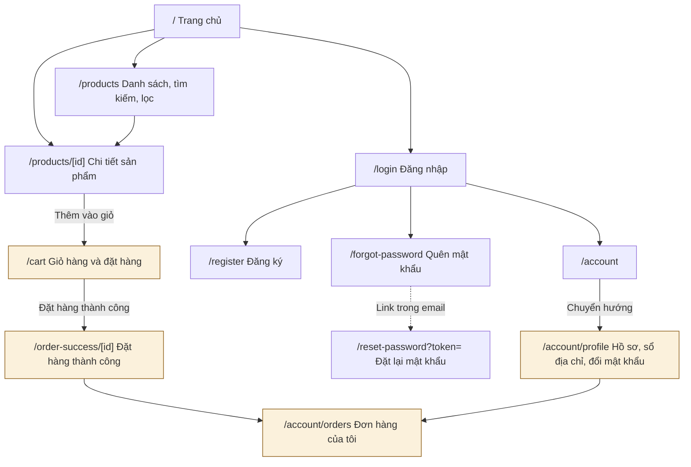
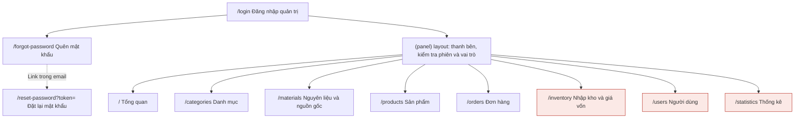
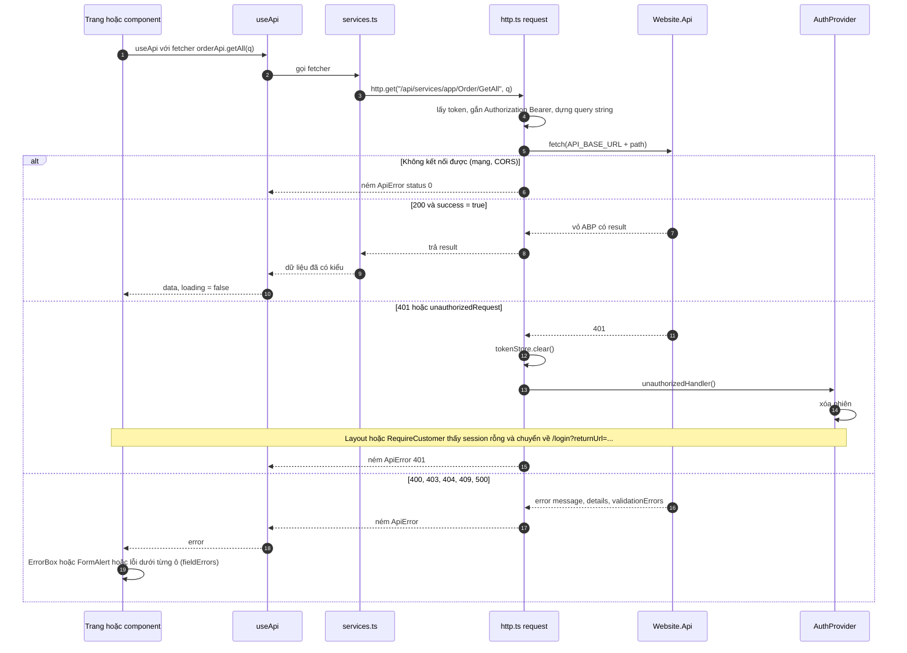
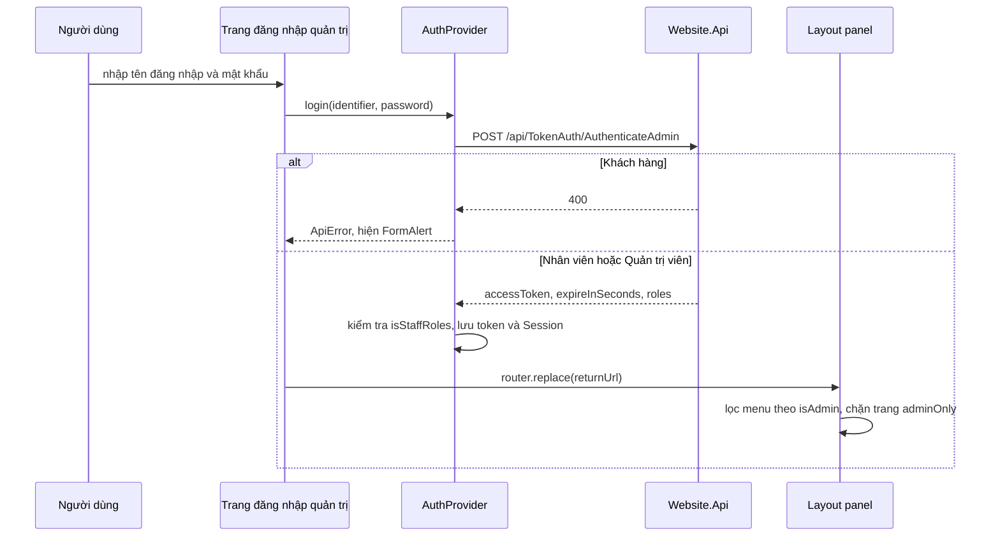

# Giao diện frontend (2 ứng dụng)

Hệ thống Hồn Sừng Việt có hai ứng dụng web Next.js gọi chung một backend `Website.Api`: **trang cửa hàng** cho Khách hàng (`HornViet_customer`, cổng 3000) và **trang quản trị** cho Nhân viên, Quản trị viên (`HornViet_admin`, cổng 3001). Tài liệu này mô tả cấu trúc, sơ đồ màn hình, lớp gọi API, quản lý phiên, các thành phần dùng chung và cách mở rộng hai ứng dụng.

---

## 1. Tổng quan, công nghệ và cách chạy

### 1.1 Hai ứng dụng

| | Trang cửa hàng | Trang quản trị |
| --- | --- | --- |
| Repo | `HornViet_customer` | `HornViet_admin` |
| Người dùng | Khách vãng lai, Khách hàng | Nhân viên, Quản trị viên |
| Địa chỉ dev | `http://localhost:3000` (cổng mặc định của `next dev`) | `http://localhost:3001` (`next dev -p 3001`) |
| API đăng nhập | `POST /api/TokenAuth/Authenticate` | `POST /api/TokenAuth/AuthenticateAdmin` |
| Khóa lưu phiên (localStorage) | `hsv-session` | `hsv-admin-session` |
| Context riêng | `cart-context` (giỏ hàng) | — |
| Chỉ có ở repo này | `components/hsv/guards.tsx`, `store-header.tsx`, `product-card.tsx`, thư mục `components/ui` (bộ shadcn sinh sẵn, các trang hiện không dùng) | `lib/hsv/events.ts`, `lib/hsv/mock-cost.ts`, `components/hsv/catalog-admin.tsx`, `product-form-drawer.tsx`, `change-password-drawer.tsx` |

Hai ứng dụng chạy trên hai origin khác nhau nên `localStorage` tách biệt: đăng nhập ở cửa hàng không làm đăng nhập trang quản trị và ngược lại.

### 1.2 Công nghệ

| Thành phần | Phiên bản / thư viện |
| --- | --- |
| Framework | Next.js 15 (App Router), React 19, TypeScript |
| Giao diện | Tailwind CSS 3, `tailwindcss-animate`, icon `lucide-react` |
| Thông báo (toast) | `sonner` |
| Gộp class | `clsx` + `tailwind-merge` qua hàm `cn()` (`lib/utils.ts`) |
| Gọi API | `fetch` thuần (không dùng axios), xem [mục 3](#3-lớp-gọi-api) |
| Font | Be Vietnam Pro (chữ thường), Literata (chữ có chân) qua `next/font/google` |

Toàn bộ cây giao diện được bọc trong `components/ClientOnly.tsx` ở `app/layout.tsx`: vì token nằm trong `localStorage`, ứng dụng chỉ render phía trình duyệt (không có dữ liệu render sẵn từ server).

### 1.3 Cách chạy

Yêu cầu: backend `Website.Api` đang chạy (dev: `http://localhost:21021` hoặc `https://localhost:44311`) và origin của frontend có trong `App:CorsOrigins` của backend (mặc định `http://localhost:3000,http://localhost:3001`). Xem thêm [Cấu hình và triển khai](11-cau-hinh-trien-khai.md).

```bash
# Trong thư mục HornViet_customer hoặc HornViet_admin
npm install
cp .env.example .env.local   # sửa địa chỉ backend nếu cần
npm run dev                  # cửa hàng: http://localhost:3000, quản trị: http://localhost:3001
```

Biến môi trường (`.env.local`, lấy mẫu từ `.env.example`):

| Biến | Repo | Ý nghĩa | Giá trị dev mẫu |
| --- | --- | --- | --- |
| `NEXT_PUBLIC_API_BASE_URL` | cả hai | Địa chỉ backend, không có `/` cuối (code tự cắt) | `http://localhost:21021` |
| `NEXT_PUBLIC_STORE_URL` | admin | Địa chỉ cửa hàng cho nút "Xem cửa hàng" / "Về cửa hàng". Để trống ở bản production thì các nút này tự ẩn | `http://localhost:3000` |
| `NEXT_PUBLIC_ADMIN_URL` | customer | Link "Mở trang đăng nhập quản trị" khi Nhân viên lỡ đăng nhập ở cửa hàng. Để trống thì ẩn link | `http://localhost:3001` |

> Biến `NEXT_PUBLIC_*` được Next.js nhúng vào mã lúc khởi động/build: sửa `.env.local` xong phải chạy lại `npm run dev` (hoặc build lại).

Các script trong `package.json`:

| Script | `HornViet_admin` | `HornViet_customer` |
| --- | --- | --- |
| `dev` | `next dev -p 3001` | `next dev` |
| `build` / `start` | `next build` / `next start -p 3001` | `next build` / `next start` |
| Kiểm tra kiểu | `npm run typecheck` (`tsc --noEmit`) | không có script, chạy `npx tsc --noEmit` |
| Khác | — | `lint` (`next lint`) |

### 1.4 Cấu trúc thư mục

Hai repo dùng chung bố cục, alias `@/*` trỏ về thư mục gốc repo (`tsconfig.json`).

```text
HornViet_customer/
  app/
    layout.tsx            Gốc: font, ClientOnly, AuthProvider, CatalogProvider, CartProvider, ConfirmProvider, Toaster
    (store)/layout.tsx    Khung cửa hàng: StoreHeader + StoreFooter
    (store)/...           Các trang cửa hàng (mục 2.1)
    not-found.tsx
  components/hsv/         UI dùng chung, header, thẻ sản phẩm, guards (RequireCustomer), form quên/đặt lại mật khẩu
  components/ui/          Bộ component shadcn sinh sẵn (các trang hiện không import)
  contexts/               auth-context, catalog-context, cart-context
  hooks/                  use-api.ts (useApi, useDebounced), use-toast, use-mobile
  lib/api/                http.ts, services.ts, types.ts
  lib/hsv/                format.ts, validation.ts, tones.ts
  lib/storage.ts, lib/utils.ts

HornViet_admin/
  app/
    layout.tsx            Gốc: font, ClientOnly, AuthProvider, CatalogProvider, ConfirmProvider, Toaster
    login/, forgot-password/, reset-password/   Trang công khai (không có thanh bên)
    (panel)/layout.tsx    Thanh bên + kiểm tra đăng nhập/vai trò (mục 7)
    (panel)/...           Các trang quản trị (mục 2.2)
    not-found.tsx
  components/hsv/         ui.tsx, confirm-provider, catalog-admin (danh mục/nguyên liệu), product-form-drawer,
                          change-password-drawer, password-reset-forms
  contexts/               auth-context, catalog-context
  hooks/                  use-api.ts
  lib/api/                http.ts, services.ts, types.ts
  lib/hsv/                format.ts, validation.ts, tones.ts, events.ts, mock-cost.ts
  lib/storage.ts, lib/utils.ts
```

Thư mục `(store)` và `(panel)` là *route group* của Next.js: tên trong ngoặc không xuất hiện trên URL, chỉ dùng để gom các trang có chung layout.

---

## 2. Sơ đồ trang và danh sách màn hình

### 2.1 Trang cửa hàng (`HornViet_customer`)



Các ô tô màu vàng cần đăng nhập bằng tài khoản Khách hàng (bọc trong `RequireCustomer`).

| Đường dẫn | Chức năng | Truy cập | Tài liệu nghiệp vụ |
| --- | --- | --- | --- |
| `/` | Trang chủ: sản phẩm mới nhất, bán chạy, lối tắt theo danh mục / nguyên liệu | Công khai | [Sản phẩm](04-san-pham-bien-the-ton-kho.md), [Danh mục](03-danh-muc-nguyen-lieu.md) |
| `/products` | Danh sách sản phẩm; bộ lọc lưu trên URL: `q`, `cat`, `mat`, `price`, `sort`, `page` | Công khai | [Sản phẩm](04-san-pham-bien-the-ton-kho.md) |
| `/products/[id]` | Chi tiết, chọn biến thể, thêm vào giỏ (chưa đăng nhập thì chuyển `/login?returnUrl=...`), sản phẩm liên quan | Công khai | [Sản phẩm](04-san-pham-bien-the-ton-kho.md), [Giỏ hàng](05-gio-hang.md) |
| `/cart` | Giỏ hàng, chọn địa chỉ, phương thức thanh toán và đặt hàng | Khách hàng | [Giỏ hàng](05-gio-hang.md), [Đặt hàng](06-dat-hang-don-hang.md) |
| `/order-success/[id]` | Xác nhận đơn vừa đặt | Khách hàng | [Đặt hàng](06-dat-hang-don-hang.md) |
| `/account` | Chuyển hướng sang `/account/profile` | Khách hàng | — |
| `/account/profile` | Tab `?tab=info` (thông tin), `addr` (sổ địa chỉ), `pw` (đổi mật khẩu) | Khách hàng | [Xác thực, tài khoản](01-xac-thuc-tai-khoan.md) |
| `/account/orders` | Đơn hàng của tôi theo trạng thái (`?status=`, `?page=`), xem chi tiết, hủy đơn | Khách hàng | [Đặt hàng](06-dat-hang-don-hang.md) |
| `/login` | Đăng nhập; tài khoản Nhân viên / Quản trị viên bị từ chối và được hướng sang trang quản trị | Công khai | [Xác thực](01-xac-thuc-tai-khoan.md) |
| `/register` | Đăng ký tài khoản Khách hàng | Công khai | [Xác thực](01-xac-thuc-tai-khoan.md) |
| `/forgot-password` | Nhập email để nhận link đặt lại mật khẩu | Công khai | [Xác thực](01-xac-thuc-tai-khoan.md) |
| `/reset-password?token=` | Đặt mật khẩu mới từ link trong email | Công khai | [Xác thực](01-xac-thuc-tai-khoan.md) |

### 2.2 Trang quản trị (`HornViet_admin`)



Ô tô màu đỏ chỉ dành cho Quản trị viên (`adminOnly: true`); các ô còn lại trong `(panel)` dành cho cả Nhân viên và Quản trị viên.

| Đường dẫn | Chức năng | Truy cập | Tài liệu nghiệp vụ |
| --- | --- | --- | --- |
| `/login` | Đăng nhập qua `AuthenticateAdmin`; hỗ trợ `?returnUrl=` (chỉ nhận đường dẫn nội bộ) | Công khai | [Xác thực](01-xac-thuc-tai-khoan.md) |
| `/forgot-password`, `/reset-password?token=` | Quên / đặt lại mật khẩu (dùng chung form với cửa hàng) | Công khai | [Xác thực](01-xac-thuc-tai-khoan.md) |
| `/` | Tổng quan: đơn chờ xử lý, đang giao, doanh thu tháng (Quản trị viên) hoặc đơn hôm nay (Nhân viên), biến thể sắp hết hàng, đơn gần đây | Nhân viên, Quản trị viên | [Thống kê](08-thong-ke-bao-cao.md) |
| `/categories` | Quản lý danh mục (`CatalogAdmin kind="category"`) | Nhân viên, Quản trị viên | [Danh mục, nguyên liệu](03-danh-muc-nguyen-lieu.md) |
| `/materials` | Quản lý nguyên liệu và nguồn gốc | Nhân viên, Quản trị viên | [Danh mục, nguyên liệu](03-danh-muc-nguyen-lieu.md) |
| `/products` | Danh sách, ẩn/hiện, xóa; form thêm/sửa sản phẩm và biến thể mở bằng `?edit=new` hoặc `?edit={id}`; `?warn=1` lọc sắp hết hàng | Nhân viên, Quản trị viên | [Sản phẩm, biến thể, tồn kho](04-san-pham-bien-the-ton-kho.md) |
| `/orders` | Lọc theo trạng thái / từ khóa / ngày, mở chi tiết bằng `?open={id}`, chuyển trạng thái hoặc hủy đơn | Nhân viên, Quản trị viên | [Đặt hàng, đơn hàng](06-dat-hang-don-hang.md) |
| `/inventory` | Giá vốn bình quân, giá trị tồn, lãi mỗi sản phẩm; nhập hàng, xem trước giá vốn mới, sửa / hủy phiếu mới nhất | Quản trị viên | [Nhập kho, giá vốn](07-nhap-kho-gia-von.md) |
| `/users` | Tạo tài khoản, đổi vai trò, khóa / mở khóa, đặt lại mật khẩu (không áp dụng cho chính mình) | Quản trị viên | [Phân quyền người dùng](02-phan-quyen-nguoi-dung.md) |
| `/statistics` | Doanh thu, giá vốn hàng bán, lợi nhuận gộp, tỷ suất lợi nhuận, sản phẩm bán chạy | Quản trị viên | [Thống kê, báo cáo](08-thong-ke-bao-cao.md) |

Nút **Đổi mật khẩu** ở cuối thanh bên (mọi tài khoản quản trị) mở `ChangePasswordDrawer`; đổi xong thì đăng xuất và về `/login` vì backend thu hồi mọi phiên của tài khoản.

> Việc chặn theo vai trò ở frontend chỉ để ẩn/hiện giao diện. Backend luôn kiểm tra quyền lại cho từng API (xem [Phân quyền](02-phan-quyen-nguoi-dung.md)).

---

## 3. Lớp gọi API

Ba file trong `lib/api` của mỗi repo:

| File | Vai trò |
| --- | --- |
| `lib/api/http.ts` | HTTP client: địa chỉ backend, lưu token, gắn `Bearer`, giải vỏ response ABP, chuẩn hóa lỗi, xử lý 401 |
| `lib/api/services.ts` | Hàm gọi từng API, gom theo nhóm: `authApi`, `profileApi`, `categoryApi`, `materialApi`, `productApi`, `fileApi`, `cartApi`, `orderApi`, `userApi`, `statisticApi`, `stockReceiptApi` |
| `lib/api/types.ts` | Kiểu DTO theo backend: enum (`OrderStatus`, `PaymentMethod`, `ProductSorting`, `RevenueGroupBy`), `RoleName`, `PagedResult<T>`, `ListResult<T>`, `PageInput` và các DTO nghiệp vụ |

Đặc tả từng API xem [docs/API.md](../API.md).

### 3.1 `lib/api/http.ts`

| Thành phần | Mô tả |
| --- | --- |
| `API_BASE_URL` | Lấy từ `NEXT_PUBLIC_API_BASE_URL`, tự cắt `/` ở cuối. Rỗng thì gọi đường dẫn tương đối (sai, xem [mục 10](#10-lỗi-thường-gặp)) |
| `STORE_URL` | Chỉ có ở `HornViet_admin`: `NEXT_PUBLIC_STORE_URL`, nếu trống thì dùng `http://localhost:3000` khi dev và chuỗi rỗng khi production |
| `tokenStore` | `get` / `set` / `clear` token ở `localStorage` khóa `hsv-access-token`; có biến dự phòng trong bộ nhớ khi trình duyệt chặn storage |
| `request()` | Gắn `Accept: application/json`, `Authorization: Bearer <token>` nếu có token; body JSON (`Content-Type: application/json`) hoặc `FormData` khi upload |
| Query string | `buildQuery` bỏ giá trị `undefined` / `null` / chuỗi rỗng; mảng được lặp tên (`categoryIds=1&categoryIds=2`) |
| Giải vỏ ABP | Thành công trả thẳng `json.result` (hoặc `null`) |
| Lỗi mạng | `fetch` ném lỗi (backend tắt, CORS, chứng chỉ HTTPS) thành `ApiError(0, "Không kết nối được máy chủ.")` |
| Lỗi HTTP | `!res.ok` hoặc `success === false` thành `ApiError(status, error.message, error.details, error.validationErrors)`. Thiếu `message` thì dùng câu mặc định theo mã 401 / 403 / 404 / 409 / 500 |
| 401 | Khi `status === 401` hoặc `unauthorizedRequest === true`: `tokenStore.clear()` rồi gọi `unauthorizedHandler` do `AuthProvider` đăng ký |
| `http` | `get`, `post`, `put`, `delete`, `upload` (POST `FormData`) |
| `assetUrl(path)` | Ghép đường dẫn ảnh tương đối `/uploads/...` với `API_BASE_URL`; giữ nguyên URL `http(s):`, `data:`, `blob:` |

`ApiError` (kế thừa `Error`):

| Thuộc tính / hàm | Ý nghĩa |
| --- | --- |
| `status` | Mã HTTP; `0` là không kết nối được |
| `message` | Thông báo của backend, hiển thị nguyên văn cho người dùng |
| `details` | Chi tiết (có thể `null`), VD danh sách sản phẩm thiếu hàng khi đặt đơn |
| `validationErrors` | Mảng `{ message, members? }` từ ABP |
| `fieldErrors()` | Gom lỗi theo trường: lấy `members[0]`, đổi chữ đầu thành chữ thường (camelCase), mỗi trường giữ lỗi đầu tiên. Dùng để gắn lỗi dưới từng ô nhập |
| `fullMessage` | `message` kèm `details` trên dòng mới |

`toApiError(e)` chuyển mọi lỗi bất kỳ thành `ApiError` để giao diện chỉ phải xử lý một kiểu.

Mẫu dùng trong form (rút gọn từ `HornViet_admin/app/login/page.tsx`):

```ts
try {
  await login(identifier, pass);
} catch (err) {
  const api = toApiError(err);
  const f = api.fieldErrors();
  setErrors({
    identifier: f.userNameOrEmailAddress,
    pass: f.password,
    form: f.userNameOrEmailAddress || f.password ? undefined : api.message,
  });
}
```

### 3.2 Luồng một lời gọi API



### 3.3 Đồng bộ `lib/api` và `lib/hsv` giữa hai repo

Theo README của trang quản trị, `lib/api` và `lib/hsv` được sao từ repo cửa hàng; khi backend đổi API phải sửa ở **cả hai** repo. Hiện trạng so sánh file:

| File | Trạng thái giữa hai repo |
| --- | --- |
| `lib/api/types.ts`, `hooks/use-api.ts` | Giống nhau |
| `lib/hsv/format.ts`, `validation.ts`, `tones.ts` | Giống nhau |
| `components/hsv/ui.tsx`, `confirm-provider.tsx`, `password-reset-forms.tsx` | Giống nhau |
| `contexts/catalog-context.tsx`, `lib/storage.ts`, `lib/utils.ts` | Giống nhau |
| `lib/api/http.ts` | Admin có thêm hằng `STORE_URL` |
| `lib/api/services.ts` | Admin: `authApi.authenticate` gọi `/api/TokenAuth/AuthenticateAdmin` (cửa hàng gọi `/api/TokenAuth/Authenticate`) và có thêm `userApi.resetPassword` (`PUT /api/services/app/User/ResetPassword`) |
| `contexts/auth-context.tsx` | Khác nhau về khóa phiên và quy tắc vai trò (xem [mục 4](#4-quản-lý-phiên-đăng-nhập)) |
| `lib/hsv/events.ts`, `lib/hsv/mock-cost.ts` | Chỉ có ở admin |

---

## 4. Quản lý phiên đăng nhập

Mỗi repo có `contexts/auth-context.tsx` cung cấp `AuthProvider` và hook `useAuth()`. Backend dùng JWT không lưu phiên, nên "phiên" ở frontend gồm hai mục trong `localStorage`:

| Khóa | Nội dung |
| --- | --- |
| `hsv-access-token` | Access token (do `tokenStore` quản lý) |
| `hsv-session` (cửa hàng) / `hsv-admin-session` (quản trị) | `Session`: `userId`, `userName`, `name`, `roles`, `expiresAt` (epoch ms = lúc đăng nhập + `expireInSeconds`; backend mặc định 24 giờ) |

### 4.1 Vòng đời phiên

| Bước | Cách làm |
| --- | --- |
| Khởi tạo | `loadSession()` đọc phiên; bỏ phiên (xóa cả token) nếu thiếu token, đã hết hạn hoặc **sai vai trò** của ứng dụng |
| Đăng nhập | `login(identifier, password)` gọi `authApi.authenticate`, kiểm tra vai trò, lưu token bằng `tokenStore.set`, lưu `Session` |
| Hồ sơ | Phiên lấy `name`, `roles` từ kết quả đăng nhập, không gọi API hồ sơ lúc khởi động. Trang `/account/profile` của cửa hàng tự tải `profileApi.get()`; lưu hồ sơ xong gọi `setName()` để cập nhật tên trên header |
| Hết hạn | `setTimeout` tự gọi `logout()` đúng thời điểm `expiresAt` |
| 401 | `AuthProvider` đăng ký `setUnauthorizedHandler(() => persist(null))`; mọi API trả 401 (token hết hạn, tài khoản bị khóa, mật khẩu vừa đổi) đều xóa phiên |
| Đăng xuất | `logout()` xóa token và phiên phía trình duyệt (không gọi API) |
| Chuyển trang | Trang quản trị: `(panel)/layout.tsx` thấy `session` rỗng thì `router.replace("/login?returnUrl=...")`. Cửa hàng: `RequireCustomer` (`components/hsv/guards.tsx`) làm tương tự cho các trang cần đăng nhập |

`returnUrl` chỉ được chấp nhận khi bắt đầu bằng `/` và không phải `//` để tránh open redirect (`adminReturnUrl` ở admin, `safeReturnUrl` ở cửa hàng).

### 4.2 Tách vai trò giữa hai ứng dụng

| | Trang cửa hàng | Trang quản trị |
| --- | --- | --- |
| Tài khoản được giữ phiên | Chỉ Khách hàng | Chỉ Nhân viên, Quản trị viên (`isStaffRoles`) |
| Khi đăng nhập sai cổng | Kết quả có vai trò `Staff`/`Admin` thì ném `ApiError(403, STAFF_ACCOUNT_MESSAGE)`, không lưu phiên; trang `/login` hiện hướng dẫn và link `NEXT_PUBLIC_ADMIN_URL/login` | Server (`AuthenticateAdmin`) từ chối Khách hàng (400). Frontend vẫn kiểm tra lại: không có vai trò quản trị thì ném `ApiError(403, NOT_STAFF_MESSAGE)` |
| Giá trị thêm trong `useAuth()` | `setName(name)` | `isAdmin` (`roles` có `Admin`) |

Như vậy Khách hàng **không** vào được trang quản trị ở ba lớp: server từ chối cấp token, `login()` kiểm tra lại vai trò, `loadSession()` bỏ mọi phiên không phải quản trị.



---

## 5. Hook `useApi` và `useDebounced`

File `hooks/use-api.ts` (giống nhau ở hai repo).

```ts
const { data, error, loading, reload, setData } = useApi(fetcher, deps, enabled = true);
```

| Đặc điểm | Mô tả |
| --- | --- |
| Tự gọi | Gọi `fetcher` khi mount và mỗi khi `deps` hoặc `enabled` đổi |
| `enabled = false` | Không gọi API, đặt `data = undefined`, `loading = false` (VD layout admin chỉ tải dashboard khi đã có phiên) |
| Giữ dữ liệu cũ | Khi tải lại chỉ bật `loading`, xóa `error`, **giữ nguyên `data` cũ** để bảng không bị nháy trắng |
| Bỏ response về trễ | Mỗi lần gọi tăng bộ đếm `seq`; kết quả của lần gọi cũ về sau lần gọi mới bị bỏ qua (tránh hiển thị sai khi gõ tìm kiếm nhanh hoặc đổi trang liên tục) |
| `error` | Luôn là `ApiError` (đã qua `toApiError`) |
| `reload()` | Gọi lại ngay; trả về dữ liệu mới hoặc `undefined` nếu lỗi. Dùng sau khi thêm / sửa / xóa |
| `setData(v)` | Sửa dữ liệu tại chỗ không cần gọi lại API (nhận giá trị hoặc hàm `prev => next`) |
| `fetcher` mới nhất | Lưu trong `ref`, nên không cần đưa `fetcher` vào `deps` |

`useDebounced(value, ms = 350)` trả về `value` sau khi giá trị ngừng thay đổi `ms` mili giây. Các trang quản trị (sản phẩm, đơn hàng, người dùng, nhập kho) dùng nó cho ô tìm kiếm để không gọi API theo từng phím.

Mẫu dùng điển hình:

```tsx
const kw = useDebounced(keyword);
const list = useApi(
  () => productApi.getAdminList({ keyword: kw, skipCount: (page - 1) * PAGE_SIZE, maxResultCount: PAGE_SIZE }),
  [kw, page]
);

if (list.error && !list.data) return <ErrorBox error={list.error} onRetry={list.reload} />;
if (!list.data) return <LoadingRows />;
```

---

## 6. Thành phần dùng chung

### 6.1 `components/hsv/ui.tsx`

| Thành phần | Công dụng |
| --- | --- |
| `notify(message)` | Toast (`sonner`) ở đáy giữa màn hình, tự ẩn sau 2,6 giây (cấu hình `Toaster` trong `app/layout.tsx`) |
| `ProductImage` | Ảnh sản phẩm qua `assetUrl`; không có ảnh hoặc ảnh lỗi thì hiện nền gradient màu sừng theo `seed` (`lib/hsv/tones.ts`) |
| `StatusBadge` | Nhãn màu trạng thái đơn theo `ORDER_STATUS` |
| `OrderProgress` | Thanh tiến trình Chờ xử lý, Đang giao, Hoàn thành |
| `Chip` | Nút dạng chip cho lọc, sắp xếp, chọn vai trò (`aria-pressed`) |
| `Radio`, `QtyStepper` | Nút chọn tròn, bộ tăng giảm số lượng |
| `FieldError` | Dòng lỗi dưới ô nhập (class `hsv-error`) |
| `FormAlert` | Khung thông báo đầu form, `tone` = `danger` / `warn` / `ok`, giữ xuống dòng |
| `EmptyState` | Khung "không có dữ liệu" kèm hành động |
| `ErrorBox` | Hiện nguyên văn `error.message` khi tải dữ liệu lỗi, có nút **Thử lại** |
| `Skeleton`, `LoadingRows` | Khối nhấp nháy khi đang tải |
| `Pager` | Phân trang: trang `n` (bắt đầu từ 1) tương ứng `skipCount = (n - 1) * pageSize`; ẩn khi chỉ có 1 trang |
| `Drawer` | Ngăn kéo bên phải (độ rộng truyền vào), đóng bằng Esc hoặc bấm nền, khóa cuộn trang khi mở |

`components/hsv/confirm-provider.tsx`: `ConfirmProvider` (đặt ở `app/layout.tsx`) và hook `useConfirm()` trả về hàm `confirm({ title, body, okLabel?, danger? })` dạng `Promise<boolean>`. Dùng cho mọi thao tác hủy / xóa / khóa / đổi quyền:

```tsx
const confirm = useConfirm();
if (!(await confirm({ title: "Hủy đơn hàng?", body: "...", okLabel: "Hủy đơn", danger: true }))) return;
```

`components/hsv/password-reset-forms.tsx` (`ForgotPasswordForm`, `ResetPasswordForm`) giống hệt nhau ở hai repo.

### 6.2 `lib/hsv/format.ts`

| Hàm / hằng | Ý nghĩa |
| --- | --- |
| `formatVND(v)` | Định dạng `vi-VN` kèm `₫`; `null`/`undefined` thành `0₫` |
| `formatShortVND(v)` | Nhãn biểu đồ: `1.250.000` thành `1,3tr`, `95.000` thành `95k` |
| `formatDate(iso)`, `formatDateTime(iso)` | `dd/MM/yyyy` và `dd/MM/yyyy HH:mm`, cắt chuỗi trực tiếp vì backend đã trả giờ Việt Nam kèm `+07:00` (không đổi múi giờ theo trình duyệt) |
| `toDateParam(d)` | Tham số lọc ngày dạng `yyyy-MM-dd` theo giờ địa phương |
| `ORDER_STATUS`, `ORDER_FLOW`, `ORDER_TABS`, `parseOrderTab` | Nhãn, màu, thứ tự trạng thái đơn và tab lọc |
| `ROLE_LABEL`, `roleLabel(roles)` | Tên vai trò tiếng Việt, ưu tiên Quản trị viên > Nhân viên > Khách hàng |
| `PAYMENT_LABEL` | Tên phương thức thanh toán |
| `LOW_STOCK_THRESHOLD` | Ngưỡng sắp hết hàng `5`, phải trùng `AppConsts.LowStockThreshold` của backend |
| `BANK_INFO` | Chuỗi thông tin chuyển khoản hiển thị ở trang giỏ hàng (giá trị cụ thể không ghi lại ở đây) |
| `gradient`, `initialOf`, `lastName` | Tiện ích hiển thị |

### 6.3 `lib/hsv/validation.ts`

Kiểm tra phía client để phản hồi nhanh; backend vẫn validate lại và lỗi theo trường từ server được ghép vào cùng form qua `fieldErrors()`.

| Hàm / kiểu | Quy tắc |
| --- | --- |
| `isValidPhone`, `normalizePhone`, `PHONE_RE` | Di động Việt Nam `0` hoặc `+84` theo sau 9 chữ số, bỏ khoảng trắng |
| `isValidEmail`, `EMAIL_RE` | Email dạng `a@b.c` |
| `isStrongPassword` | Tối thiểu 6 ký tự, có cả chữ và số |
| `FieldErrors<K>`, `hasErrors` | Kiểu lỗi theo trường của form và hàm kiểm tra có lỗi |

### 6.4 `lib/hsv/events.ts` (chỉ admin)

Sự kiện trình duyệt `hsv:orders-changed`. Trang `/orders` gọi `emitOrdersChanged()` sau khi đổi trạng thái đơn; `(panel)/layout.tsx` lắng nghe để tải lại dashboard và cập nhật badge số đơn chờ trên menu.

### 6.5 Context khác

| Context | Repo | Mô tả |
| --- | --- | --- |
| `CatalogProvider` / `useCatalog()` | cả hai | Tải danh mục và nguyên liệu một lần (API công khai), dùng cho header, bộ lọc, form; trang quản trị gọi `reload()` sau khi thêm / sửa / xóa |
| `CartProvider` / `useCart()` | cửa hàng | Giữ giỏ hàng của người đã đăng nhập; mọi API giỏ trả về toàn bộ giỏ nên chỉ thay state bằng kết quả; `count` hiện trên header; `clearLocal()` sau khi đặt hàng. Xem [Giỏ hàng](05-gio-hang.md) |

---

## 7. Menu quản trị theo vai trò

`HornViet_admin/app/(panel)/layout.tsx` khai báo mảng `ADMIN_NAV`:

| `href` | Nhãn menu | `adminOnly` |
| --- | --- | --- |
| `/` | Tổng quan | `false` |
| `/categories` | Danh mục | `false` |
| `/materials` | Nguyên liệu | `false` |
| `/products` | Sản phẩm | `false` |
| `/orders` | Đơn hàng | `false` |
| `/inventory` | Nhập kho | `true` |
| `/users` | Người dùng | `true` |
| `/statistics` | Thống kê | `true` |

Cách layout xử lý:

1. Chưa có phiên thì không render gì và chuyển `/login?returnUrl=<trang hiện tại>`.
2. Menu chỉ hiện mục có `!adminOnly || isAdmin`.
3. Xác định mục hiện tại theo `pathname`; nếu là mục `adminOnly` mà người dùng không phải Quản trị viên (VD Nhân viên gõ thẳng `/users`), tiêu đề đổi thành "Không có quyền truy cập" và nội dung trang được thay bằng thông báo "Chức năng này chỉ dành cho Quản trị viên".
4. **Badge đơn chờ**: layout gọi `statisticApi.getDashboard()` (qua `useApi`, tải lại mỗi khi đổi trang và khi nhận sự kiện `hsv:orders-changed`) và hiện `pendingOrderCount` cạnh mục "Đơn hàng" khi lớn hơn 0.
5. Cuối thanh bên: tên, vai trò (`roleLabel`), link "Xem cửa hàng" (khi có `STORE_URL`), "Đổi mật khẩu", "Đăng xuất".
6. Màn hình nhỏ hơn `lg`: thanh bên ẩn, mở bằng nút menu.

---

## 8. Dữ liệu ảo ở trang quản trị (`lib/hsv/mock-cost.ts`)

Mục đích: cho phép chạy thử trang quản trị khi đang dev với **backend bản cũ** chưa có chức năng nhập kho (không trả các trường giá vốn / lợi nhuận, API `StockReceipt` trả 404).

| Điều kiện | Hành vi |
| --- | --- |
| Bật khi nào | `MOCK_COST_ENABLED = process.env.NODE_ENV !== "production"`, tức chỉ khi chạy `npm run dev` |
| Production (`next build` / `next start`) | Không bao giờ dùng dữ liệu ảo; thiếu dữ liệu thì hiện `—` |
| Backend bản mới | Trường giá vốn / lợi nhuận có trong response, các hàm `mock*` trả nguyên dữ liệu thật (`mocked: false`) |

Các điểm áp dụng:

| Màn hình | Hàm | Điều kiện dùng dữ liệu ảo |
| --- | --- | --- |
| `/` Tổng quan | `mockDashboard` | `monthProfit` không có trong response và `monthRevenue` khác `null` (tức Quản trị viên); ô doanh thu ghi "Lợi nhuận (ảo)" |
| `/statistics` | `mockRevenue`, `mockTopProducts` | Response thiếu `totalCost` / `profit` |
| `/inventory` | `inventorySource` | API `StockReceipt` đọc trả 404: chuyển sang chế độ ảo, sinh 2 phiếu nhập ảo cho mỗi biến thể thật; phiếu người dùng nhập / sửa / hủy chỉ lưu trong trình duyệt (`localStorage` khóa `hsv-mock-stock-receipts`), giá vốn tính lại bằng `movingAverage` giống backend, **không ghi vào database** |

`movingAverage(stock, average, qty, cost)` cũng được trang `/inventory` dùng để **xem trước** giá vốn mới trước khi lưu phiếu, ở cả chế độ thật lẫn ảo.

Nghiệp vụ thật của giá vốn, lợi nhuận xem [Nhập kho, giá vốn](07-nhap-kho-gia-von.md) và [Thống kê, báo cáo](08-thong-ke-bao-cao.md).

---

## 9. Hướng dẫn mở rộng

### 9.1 Thêm một API mới (backend đã có endpoint)

1. Cập nhật đặc tả trong [docs/API.md](../API.md).
2. **Type**: thêm DTO vào `lib/api/types.ts` ở **cả hai** repo (giữ hai file giống nhau).
3. **Service**: thêm hàm vào nhóm phù hợp trong `lib/api/services.ts`, dùng `app("Service/Action")` cho đường dẫn `/api/services/app/...`:

   ```ts
   export const supplierApi = {
     getAll: (q: PageInput & { keyword?: string } = {}) =>
       http.get<PagedResult<Supplier>>(app("Supplier/GetAll"), q),
     create: (input: SupplierInput) => http.post<Supplier>(app("Supplier/Create"), input),
   };
   ```

   Thêm ở cả hai repo nếu cả hai cùng dùng; API chỉ dành cho quản trị có thể chỉ thêm ở admin nhưng nên ghi chú như `userApi.resetPassword`.
4. Chạy `npx tsc --noEmit` ở từng repo đã sửa.

### 9.2 Thêm một màn hình quản trị

1. Tạo `HornViet_admin/app/(panel)/<ten-trang>/page.tsx`, bắt đầu bằng `"use client"`.
2. Tải dữ liệu bằng `useApi` (+ `useDebounced` cho ô tìm kiếm); hiển thị `LoadingRows` khi chưa có dữ liệu, `ErrorBox` khi lỗi, `Pager` khi phân trang, `Drawer` cho form thêm / sửa.
3. Lưu trạng thái lọc / trang / bản ghi đang mở trên URL bằng `useSearchParams` (như `?status=`, `?open=`, `?edit=`) để tải lại trang hay chia sẻ link vẫn giữ nguyên.
4. Thao tác ghi: `try/catch` với `toApiError`, gắn lỗi trường bằng `fieldErrors()`, lỗi chung bằng `FormAlert`; thành công gọi `notify(...)` rồi `reload()`. Thao tác hủy / xóa / khóa phải qua `useConfirm()`.
5. **Menu**: thêm phần tử vào `ADMIN_NAV` trong `app/(panel)/layout.tsx` với `href`, `label`, `title` (tiêu đề trang), `icon` (lucide-react) và `adminOnly`.
6. Cập nhật bảng "Màn hình" trong `HornViet_admin/README.md` và [mục 2.2](#22-trang-quản-trị-hornviet_admin).

### 9.3 Thêm một trang cửa hàng

1. Tạo `HornViet_customer/app/(store)/<ten-trang>/page.tsx` (tự có header và footer).
2. Trang cần đăng nhập thì bọc nội dung trong `<RequireCustomer>` (`components/hsv/guards.tsx`).
3. Link vào trang từ `components/hsv/store-header.tsx` nếu cần.

### 9.4 Quy ước code

| Quy ước | Chi tiết |
| --- | --- |
| Ngôn ngữ | Mọi chuỗi hiển thị (nhãn, thông báo, lỗi) bằng tiếng Việt có dấu; chú thích code cũng viết tiếng Việt |
| Thông báo lỗi | Hiện nguyên văn `error.message` của backend, không tự viết lại |
| Màu sắc | Dùng token màu khai báo trong `tailwind.config.ts`: `navy`, `gold`, `champagne`, `ink`, `muted2`, `subtle`, `faint`, `line`, `surface`, `danger`, `warn`, `ok` (VD `bg-navy`, `text-gold`, `border-danger-line`), hạn chế mã màu viết cứng |
| Class dựng sẵn | `app/globals.css` khai báo các class tiền tố `hsv-`: `hsv-container`, `hsv-input`, `hsv-input-error`, `hsv-btn-primary`, `hsv-btn-outline`, `hsv-btn-gold`, `hsv-card`, `hsv-label`, `hsv-error`, `hsv-page-title` |
| Gộp class | Dùng `cn(...)` từ `lib/utils.ts` |
| Tiền, ngày | Luôn qua `formatVND`, `formatDate`, `formatDateTime`, `toDateParam` |
| Ảnh | Dùng `ProductImage` hoặc `assetUrl()`, không ghép URL thủ công |
| Đồng bộ | Sửa `lib/api`, `lib/hsv`, `hooks/use-api.ts`, `components/hsv/ui.tsx` ở một repo thì sao sang repo kia |

---

## 10. Lỗi thường gặp

| Hiện tượng | Nguyên nhân thường gặp | Cách xử lý |
| --- | --- | --- |
| Mọi trang báo "Không kết nối được máy chủ.", console trình duyệt có lỗi CORS | Origin của frontend không có trong `App:CorsOrigins` của backend, hoặc ghi lệch (thừa `/` cuối, sai cổng, `127.0.0.1` thay vì `localhost`) | Thêm đúng origin (`http://localhost:3000`, `http://localhost:3001`) vào `App:CorsOrigins` trong `Website.Api/appsettings.json`, chạy lại backend. Xem [Cấu hình, triển khai](11-cau-hinh-trien-khai.md) |
| "Không kết nối được máy chủ." dù không có lỗi CORS | Backend chưa chạy, sai cổng, hoặc dùng `https://localhost:44311` mà trình duyệt chưa tin chứng chỉ dev | Kiểm tra backend; dev nên dùng `http://localhost:21021` |
| Mọi API báo "Không tìm thấy dữ liệu." (404) | `NEXT_PUBLIC_API_BASE_URL` trống hoặc sai nên request đi vào chính server Next.js | Kiểm tra `.env.local` (tạo từ `.env.example`), sau đó **chạy lại** `npm run dev` |
| Ảnh sản phẩm chỉ hiện nền gradient | Ảnh lỗi hoặc base URL sai (`assetUrl` ghép với `API_BASE_URL`) | Kiểm tra biến môi trường và file trong thư mục upload của backend |
| Đang dùng thì bị đá về `/login` | 401: token hết hạn (mặc định 24 giờ), tài khoản bị khóa, hoặc mật khẩu vừa đổi (backend thu hồi mọi phiên) | Đăng nhập lại; nếu bị khóa thì nhờ Quản trị viên mở khóa |
| Đăng nhập cửa hàng bằng tài khoản Nhân viên bị từ chối | Cố ý: cửa hàng chỉ giữ phiên Khách hàng | Đăng nhập ở trang quản trị (link hiện khi có `NEXT_PUBLIC_ADMIN_URL`) |
| Khách hàng không đăng nhập được trang quản trị | Cố ý: `AuthenticateAdmin` trả 400 cho Khách hàng | Dùng tài khoản có vai trò Nhân viên hoặc Quản trị viên |
| Nhân viên mở `/users`, `/inventory`, `/statistics` thấy "Không có quyền truy cập" | Các mục này `adminOnly` | Đúng thiết kế; cần quyền Quản trị viên |
| Tổng quan / Thống kê / Nhập kho có chữ "(ảo)" hoặc số liệu lạ khi dev | Backend đang chạy bản cũ chưa có nhập kho, trang quản trị dùng dữ liệu ảo ([mục 8](#8-dữ-liệu-ảo-ở-trang-quản-trị-libhsvmock-costts)) | Cập nhật backend và database lên bản mới |
| Lỗi kiểu TypeScript | Sửa `types.ts` / `services.ts` ở một repo mà không sửa repo kia, sai kiểu DTO | Chạy `npx tsc --noEmit` ở từng repo (admin có sẵn `npm run typecheck`). Lưu ý `HornViet_customer/next.config.mjs` đặt `typescript.ignoreBuildErrors: true` và `eslint.ignoreDuringBuilds: true`, nên `next build` của cửa hàng **không** báo lỗi kiểu: phải tự chạy `tsc` |
| Sửa `.env.local` không có tác dụng | Biến `NEXT_PUBLIC_*` được nhúng lúc khởi động | Dừng và chạy lại `npm run dev` |

---

## Mã nguồn liên quan

| Nhóm | File |
| --- | --- |
| HTTP client | `HornViet_customer/lib/api/http.ts`, `HornViet_admin/lib/api/http.ts` |
| Service, DTO | `HornViet_customer/lib/api/services.ts`, `HornViet_admin/lib/api/services.ts`, `lib/api/types.ts` (cả hai repo) |
| Phiên đăng nhập | `HornViet_customer/contexts/auth-context.tsx`, `HornViet_admin/contexts/auth-context.tsx`, `HornViet_customer/components/hsv/guards.tsx` |
| Layout | `HornViet_customer/app/layout.tsx`, `HornViet_customer/app/(store)/layout.tsx`, `HornViet_admin/app/layout.tsx`, `HornViet_admin/app/(panel)/layout.tsx` |
| Hook | `hooks/use-api.ts` (cả hai repo) |
| UI dùng chung | `components/hsv/ui.tsx`, `components/hsv/confirm-provider.tsx`, `components/hsv/password-reset-forms.tsx` (cả hai repo) |
| Tiện ích | `lib/hsv/format.ts`, `lib/hsv/validation.ts`, `lib/hsv/tones.ts`, `lib/storage.ts`, `lib/utils.ts` (cả hai repo); `HornViet_admin/lib/hsv/events.ts` |
| Dữ liệu ảo | `HornViet_admin/lib/hsv/mock-cost.ts` |
| Context khác | `contexts/catalog-context.tsx` (cả hai repo), `HornViet_customer/contexts/cart-context.tsx` |
| Cấu hình | `.env.example`, `package.json`, `tailwind.config.ts`, `app/globals.css`, `next.config.mjs` (từng repo); `Website.Api/appsettings.json` (`App:CorsOrigins`) |
| Tài liệu | `HornViet_admin/README.md`, [docs/API.md](../API.md) |
