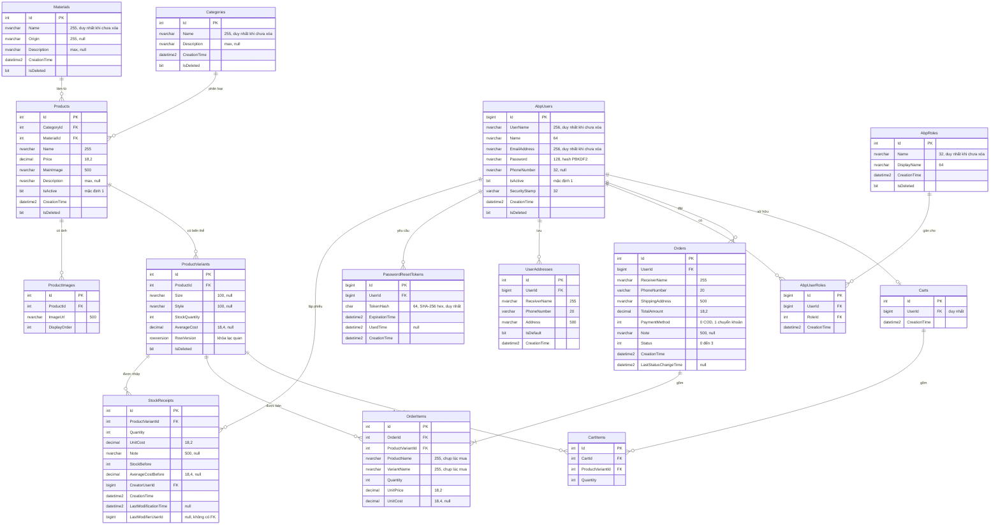
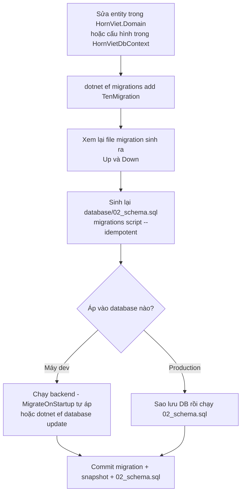

# Cơ sở dữ liệu

Database `HonSungVietDb` trên SQL Server 2019+, gồm 15 bảng nghiệp vụ được sinh từ EF Core 10 (code-first). Tài liệu mô tả sơ đồ quan hệ, từng bảng, các quy ước (collation, xóa mềm, khóa lạc quan, giờ địa phương), chỉ mục, migration, seed và sao lưu.

## 1. Mục đích & phạm vi

- Giúp người mới hiểu dữ liệu được lưu ở đâu, quan hệ ra sao, vì sao thiết kế như vậy.
- Hướng dẫn thêm migration, sinh lại script SQL, khởi tạo dữ liệu mẫu, sao lưu/khôi phục.
- Nguồn sự thật là model EF Core: `HornViet.Infrastructure/Persistence/HornVietDbContext.cs` + entity trong `HornViet.Domain`. Script `database/02_schema.sql` được **sinh ra** từ migration, không sửa tay.

## 2. Vai trò & quyền

CSDL không phân quyền theo người dùng cuối; mọi truy cập đi qua Web API bằng một chuỗi kết nối (`ConnectionStrings:Default`). Quyền nghiệp vụ (Customer / Staff / Admin) do backend kiểm tra, xem [Phân quyền](02-phan-quyen-nguoi-dung.md). Vai trò người dùng được lưu trong `AbpRoles` / `AbpUserRoles`.

Ở máy dev, chuỗi kết nối dùng đăng nhập Windows (`Trusted_Connection=True`). Khi triển khai, nên dùng một tài khoản SQL riêng cho ứng dụng; quyền tạo/sửa bảng chỉ cần khi áp migration (xem [Cấu hình & triển khai](11-cau-hinh-trien-khai.md)).

## 3. Khái niệm & quy tắc thiết kế

### 3.1 Sơ đồ ERD



Ngoài 15 bảng trên còn bảng hệ thống `__EFMigrationsHistory` (EF Core ghi các migration đã áp).

### 3.2 Mô tả từng bảng

| Bảng | Entity (Domain) | Ý nghĩa | Ghi chú quan trọng |
|---|---|---|---|
| `Categories` | `Catalog/Entities/Catalog.cs` → `Category` | Danh mục sản phẩm (Lược sừng, Trâm cài…) | Xóa mềm; tên duy nhất trong các bản ghi chưa xóa |
| `Materials` | `Material` | Nguyên liệu và nguồn gốc (Sừng trâu – làng nghề…) | Xóa mềm; tên duy nhất |
| `Products` | `Product` | Sản phẩm: giá bán, ảnh chính, mô tả, trạng thái hiển thị `IsActive` | Xóa mềm; giá bán ở cấp sản phẩm (biến thể không có giá riêng) |
| `ProductVariants` | `ProductVariant` | Biến thể theo `Size` / `Style`, nơi giữ **tồn kho** và **giá vốn bình quân** | Xóa mềm; `RowVersion` chống bán vượt; tồn kho chỉ đổi qua hàm của entity |
| `ProductImages` | `ProductImage` | Ảnh phụ của sản phẩm, sắp theo `DisplayOrder` | Xóa dây chuyền theo sản phẩm |
| `Carts` | `Carts/Entities/Cart.cs` → `Cart` | Giỏ hàng, mỗi người dùng tối đa một giỏ | `UserId` duy nhất |
| `CartItems` | `CartItem` | Dòng giỏ: biến thể + số lượng | Mỗi biến thể một dòng trong một giỏ (chỉ mục duy nhất `CartId, ProductVariantId`) |
| `Orders` | `Orders/Entities/Order.cs` → `Order` | Đơn hàng: người nhận, SĐT, địa chỉ, phương thức thanh toán, trạng thái | Không xóa mềm; mã hiển thị `HSV` + Id 6 chữ số (`Order.FormatCode`), không lưu thành cột |
| `OrderItems` | `OrderItem` | Dòng đơn **bất biến**: tên sản phẩm, tên biến thể, đơn giá, giá vốn tại thời điểm mua | `UnitCost` `NULL` nếu lúc bán biến thể chưa có giá vốn |
| `AbpUsers` | `Users/Entities/User.cs` → `User` | Tài khoản (khách hàng, nhân viên, quản trị viên) | Xóa mềm; `Password` lưu hash; `SecurityStamp` để thu hồi token |
| `AbpRoles` | `Role` | Vai trò `Admin`, `Staff`, `Customer` | Có cột `IsDeleted` (xóa mềm) |
| `AbpUserRoles` | `UserRole` | Gán vai trò cho người dùng (nhiều–nhiều) | Duy nhất `UserId, RoleId` |
| `UserAddresses` | `UserAddress` | Sổ địa chỉ giao hàng của người dùng | `IsDefault` đánh dấu địa chỉ mặc định |
| `PasswordResetTokens` | `Users/Entities/PasswordResetToken.cs` | Mã đặt lại mật khẩu (Quên mật khẩu) | Chỉ lưu SHA-256 của mã; hiệu lực 30 phút; `UsedTime` ≠ null = đã dùng/thu hồi |
| `StockReceipts` | `Inventory/Entities/StockReceipt.cs` | Phiếu nhập kho: số lượng, giá nhập, người lập | `StockBefore`, `AverageCostBefore` lưu trạng thái trước phiếu để sửa/hủy phiếu mới nhất |

Đường dẫn entity tính từ `HornViet.Domain/`. Tên `AbpUsers`, `AbpRoles`, `AbpUserRoles` giữ theo quy ước ABP như thiết kế CSDL (mục 3.6 của báo cáo).

### 3.3 Hành vi xóa của khóa ngoại

| Quan hệ | `ON DELETE` | Lý do |
|---|---|---|
| `Products` → `ProductVariants`, `ProductImages` | `CASCADE` | Quan hệ hợp thành |
| `Carts` → `CartItems` | `CASCADE` | Quan hệ hợp thành |
| `Orders` → `OrderItems` | `CASCADE` | Quan hệ hợp thành |
| `AbpUsers` → `AbpUserRoles`, `UserAddresses`, `PasswordResetTokens` | `CASCADE` | Thuộc về tài khoản |
| Còn lại (`Products` → `Categories`/`Materials`, `CartItems`/`OrderItems`/`StockReceipts` → `ProductVariants`, `Orders`/`Carts`/`StockReceipts` → `AbpUsers`, `AbpUserRoles` → `AbpRoles`) | `NO ACTION` (Restrict) | Không cho xóa cứng bản ghi đang được tham chiếu |

Trên thực tế ứng dụng hầu như không xóa cứng: các bảng chính dùng xóa mềm (mục 3.5), nên cascade chỉ có hiệu lực với bảng không xóa mềm (VD `CartItems` khi xóa dòng giỏ thì xóa thật).

### 3.4 Collation `Latin1_General_100_CI_AI`

- Khai báo ở cả `b.UseCollation("Latin1_General_100_CI_AI")` (`HornVietDbContext.OnModelCreating`) và `CREATE DATABASE ... COLLATE Latin1_General_100_CI_AI` (`database/01_create_database.sql`).
- `CI` = không phân biệt hoa thường, `AI` = không phân biệt dấu. Khách gõ "luoc sung" vẫn tìm ra "Lược sừng", "do trang tri" ra "Đồ trang trí". Các truy vấn tìm kiếm chỉ dùng `Contains` (VD `ProductAppService.GetAllAsync`), phần bỏ dấu do collation đảm nhận.
- Không dùng `Vietnamese_CI_AI` vì collation này coi `ư`, `ơ`, `đ` là chữ cái riêng, nên "duong" không khớp "đường".
- Hệ quả: chỉ mục duy nhất cũng không phân biệt dấu/hoa thường — "Lược sừng" và "luoc sung" bị coi là trùng tên danh mục.

### 3.5 Xóa mềm & query filter toàn cục

| Thành phần | Cơ chế | File |
|---|---|---|
| Đánh dấu | Entity cài `ISoftDelete` (cột `IsDeleted`): `Category`, `Material`, `Product`, `ProductVariant`, `User`, `Role` | `SharedKernel/Entity.cs`, entity trong `HornViet.Domain` |
| Xóa | `Repository.Delete` gán `IsDeleted = true` trực tiếp (tránh EF xóa dây chuyền thực thể con); `ApplyAuditConcepts` cũng đổi `EntityState.Deleted` thành `Modified` + `IsDeleted = true` | `HornViet.Infrastructure/Persistence/Repositories/Repository.cs`, `HornVietDbContext.ApplyAuditConcepts` |
| Lọc | Vòng lặp trong `OnModelCreating` đăng ký `HasQueryFilter(x => !x.IsDeleted)` cho mọi entity cài `ISoftDelete` | `HornVietDbContext.OnModelCreating` |
| Bỏ lọc khi cần | `IgnoreQueryFilters()` để đọc lịch sử: tên tài khoản của đơn (`OrderAppService.GetAsync`), biến thể đã xóa trong thống kê (`StatisticAppService`), người lập phiếu (`StockReceiptAppService`) | `HornViet.Application/...` |
| Chỉ mục duy nhất | Có điều kiện `WHERE [IsDeleted] = 0` → tạo lại được danh mục/tài khoản trùng tên với bản ghi đã xóa | `HasFilter("[IsDeleted] = 0")` |

Lưu ý: dòng giỏ / vai trò trỏ tới bản ghi đã xóa mềm cũng bị lọc cùng; cảnh báo EF tương ứng (`PossibleIncorrectRequiredNavigationWithQueryFilterInteractionWarning`) được tắt có chủ đích trong `HornViet.Infrastructure/DependencyInjectionRegister.cs`.

### 3.6 `RowVersion` — khóa lạc quan chống bán vượt tồn kho

- Cột `ProductVariants.RowVersion` kiểu `rowversion`, khai báo `IsRowVersion()`; SQL Server tự tăng giá trị mỗi khi dòng bị cập nhật.
- Khi EF cập nhật biến thể (trừ kho lúc đặt hàng, hoàn kho lúc hủy, nhập kho, sửa tồn kho), câu `UPDATE` có thêm điều kiện `WHERE RowVersion = <giá trị đã đọc>`. Nếu giao dịch khác vừa sửa dòng đó, không dòng nào được cập nhật → EF ném `DbUpdateConcurrencyException`.
- `BusinessErrors.TryMap` (`HornViet.Api/Middlewares/ResponseHandling.cs`) đổi lỗi này thành **HTTP 409** với thông báo "Dữ liệu (tồn kho) vừa được cập nhật bởi giao dịch khác. Vui lòng tải lại và thử lại.".
- Vì mỗi use case chỉ gọi một lần `SaveChangesAsync`, toàn bộ thay đổi (tạo đơn + trừ kho + xóa giỏ) được hoàn tác cùng nhau.

### 3.7 Các quy ước khác

| Quy ước | Chi tiết | File |
|---|---|---|
| `CreationTime` tự động | Entity cài `IHasCreationTime` được gán `DateTime.Now` khi thêm mới (nếu chưa có) | `HornVietDbContext.ApplyAuditConcepts` |
| Giờ địa phương | Mọi cột `DateTime` lưu giờ địa phương của máy chủ (`DateTime.Now`); khi đọc ra được đánh dấu `DateTimeKind.Local` để JSON có offset (VD `+07:00`) | `HornVietDbContext.OnModelCreating` (ValueConverter) |
| Tiền | `decimal(18,2)` cho giá bán, tổng tiền, giá nhập; `decimal(18,4)` cho giá vốn bình quân và giá vốn dòng đơn (tránh lệch khi chia bình quân) | `HasPrecision` |
| SĐT | `varchar(20)` (không Unicode) ở `Orders`, `UserAddresses`; định dạng kiểm tra bằng `AppConsts.PhoneRegex` | `HornViet.Domain/AppConsts.cs` |
| `SecurityStamp` | `varchar(32)`, mặc định CSDL `REPLACE(CONVERT(char(36), NEWID()), '-', '')` để bản ghi cũ / chèn bằng SQL cũng có giá trị | `HornVietDbContext` (cấu hình `User`) |
| Truy vấn tách | `UseQuerySplittingBehavior(SplitQuery)` khi `Include` nhiều collection (biến thể + ảnh) | `DependencyInjectionRegister.AddPersistence` |
| Thử lại kết nối | `EnableRetryOnFailure()` | `DependencyInjectionRegister.AddPersistence` |

## 4. Flow logic

### 4.1 Chỉ mục quan trọng

| Bảng | Chỉ mục | Loại | Phục vụ |
|---|---|---|---|
| `Categories`, `Materials`, `AbpRoles` | `IX_*_Name` | Duy nhất, `WHERE IsDeleted = 0` | Chống trùng tên |
| `AbpUsers` | `IX_AbpUsers_UserName`, `IX_AbpUsers_EmailAddress` | Duy nhất, `WHERE IsDeleted = 0` | Đăng nhập bằng tên hoặc email, chống trùng |
| `AbpUserRoles` | `IX_AbpUserRoles_UserId_RoleId` | Duy nhất | Không gán trùng vai trò |
| `Carts` | `IX_Carts_UserId` | Duy nhất | Một giỏ / người dùng |
| `CartItems` | `IX_CartItems_CartId_ProductVariantId` | Duy nhất | Một dòng / biến thể trong giỏ (cộng dồn số lượng) |
| `Orders` | `IX_Orders_UserId_CreationTime` | Thường | "Đơn của tôi" sắp theo thời gian |
| `Orders` | `IX_Orders_Status_CreationTime` | Thường | Lọc đơn theo trạng thái, thống kê theo ngày |
| `Products` | `IX_Products_IsActive_CategoryId` | Thường | Danh sách sản phẩm đang bán theo danh mục |
| `PasswordResetTokens` | `IX_PasswordResetTokens_TokenHash` | Duy nhất | Tra mã khi đặt lại mật khẩu |
| `PasswordResetTokens` | `IX_PasswordResetTokens_UserId_CreationTime` | Thường | Chống gửi lại trong 60 giây, thu hồi mã cũ |
| `StockReceipts` | `IX_StockReceipts_ProductVariantId_Id` | Thường | Tìm phiếu mới nhất của biến thể |
| `StockReceipts` | `IX_StockReceipts_CreationTime` | Thường | Danh sách phiếu theo thời gian |

Ngoài ra EF tự tạo chỉ mục cho mọi cột khóa ngoại (VD `IX_Products_CategoryId`, `IX_OrderItems_ProductVariantId`).

### 4.2 Migration

Migration hiện có (`HornViet.Infrastructure/Persistence/Migrations/`):

| Migration | Nội dung |
|---|---|
| `20261006031334_InitialCreate` | 13 bảng đầu tiên (catalog, giỏ, đơn, người dùng, vai trò, địa chỉ) + chỉ mục |
| `20261006103643_AddPasswordResetTokens` | Bảng `PasswordResetTokens` |
| `20261007021638_AddUserSecurityStamp` | Cột `AbpUsers.SecurityStamp` (token cũ hết hiệu lực, mọi người phải đăng nhập lại một lần) |
| `20261009084805_AddStockReceiptsAndCost` | Bảng `StockReceipts`, cột `ProductVariants.AverageCost`, `OrderItems.UnitCost` |

Quy trình khi đổi model:



Các lệnh (chạy ở thư mục gốc repo backend):

```powershell
dotnet tool restore
dotnet ef migrations add <TenMigration> -p HornViet.Infrastructure -s HornViet.Api -o Persistence/Migrations
dotnet ef migrations script --idempotent -p HornViet.Infrastructure -s HornViet.Api -o database/02_schema.sql
dotnet ef database update -p HornViet.Infrastructure -s HornViet.Api
```

- `dotnet-ef` phiên bản `10.0.9` được ghim trong `dotnet-tools.json`, nên chạy `dotnet tool restore` trước.
- `-s HornViet.Api` (startup project): công cụ đọc cấu hình của `HornViet.Api` (chuỗi kết nối, `Jwt:SecurityKey` ở `appsettings.Development.json`). Thiếu `Jwt:SecurityKey` hợp lệ thì ứng dụng không dựng được, lệnh `dotnet ef` cũng lỗi.
- `--idempotent`: mỗi migration được bọc trong `IF NOT EXISTS (SELECT * FROM [__EFMigrationsHistory] ...)`, nên `02_schema.sql` chạy lại an toàn trên database đã có một phần migration.
- Gỡ migration chưa áp: `dotnet ef migrations remove -p HornViet.Infrastructure -s HornViet.Api`.

### 4.3 Seed dữ liệu

Có hai đường, cùng dữ liệu:

| | `DataSeeder` (C#) | `database/03_seed.sql` |
|---|---|---|
| Khi chạy | Lúc backend khởi động nếu `Database:MigrateOnStartup = true` (`HornViet.Api/Program.cs`) | Chạy tay bằng SSMS / `sqlcmd` |
| Điều kiện | Từng phần: thêm vai trò còn thiếu; tạo `admin`/`staff` nếu chưa có tên đó; tạo catalog mẫu nếu chưa có danh mục nào | Bỏ qua **toàn bộ** nếu bảng `AbpRoles` đã có dữ liệu |
| Mật khẩu demo | `Seed:AdminPassword`, `Seed:StaffPassword` (mặc định `123qwe`), băm bằng `PasswordHasher<User>` | Hash PBKDF2 của `123qwe` viết sẵn |
| Catalog mẫu | Bật/tắt bằng `Seed:SampleCatalog` (mặc định `true`) | Luôn chèn |
| File | `HornViet.Application/DataSeeder.cs` | `database/03_seed.sql` |

Dữ liệu tạo ra: 3 vai trò (`Admin` – Quản trị viên, `Staff` – Nhân viên, `Customer` – Khách hàng), 2 tài khoản demo (`admin / 123qwe`, `staff / 123qwe`, email đuôi `@honsungviet.local`), 6 danh mục, 2 nguyên liệu, 7 sản phẩm, 12 biến thể. Ảnh mẫu dùng `/uploads/sample/placeholder.svg`. Seed **không** tạo tài khoản khách hàng, đơn hàng hay phiếu nhập (nên `AverageCost` của biến thể mẫu là `NULL`).

## 5. Hướng dẫn sử dụng

### 5.1 Tạo database mới bằng script

Mở SSMS và chạy (F5) lần lượt `01` → `02` → `03`; từ script `02` chọn database `HonSungVietDb` trên thanh công cụ. Hoặc dùng dòng lệnh:

```powershell
cd database
sqlcmd -S localhost -E -C -b -I -f 65001 -i 01_create_database.sql
sqlcmd -S localhost -E -C -b -I -f 65001 -d HonSungVietDb -i 02_schema.sql
sqlcmd -S localhost -E -C -b -I -f 65001 -d HonSungVietDb -i 03_seed.sql
```

| Tham số | Ý nghĩa |
|---|---|
| `-E` | Đăng nhập Windows |
| `-C` | Tin chứng chỉ máy chủ |
| `-b` | Dừng khi có lỗi |
| `-I` | Bật `QUOTED_IDENTIFIER` — **bắt buộc** cho chỉ mục có điều kiện `WHERE [IsDeleted] = 0` |
| `-f 65001` | Đọc file UTF-8 (tiếng Việt) |

Đổi `localhost` thành tên instance nếu cần, VD `.\SQLEXPRESS`.

### 5.2 Để ứng dụng tự tạo

Ở Development (`Database:MigrateOnStartup = true` trong `HornViet.Api/appsettings.Development.json`), chỉ cần `dotnet run --project HornViet.Api`: `Database.MigrateAsync()` tạo database (nếu chưa có), áp migration còn thiếu, rồi `DataSeeder.SeedAsync` khởi tạo dữ liệu.

Lưu ý: database do EF tự tạo nhận collation từ `UseCollation` trong model. Nếu tạo database thủ công mà không qua `01_create_database.sql`, hãy đảm bảo collation là `Latin1_General_100_CI_AI`.

### 5.3 Sao lưu trước khi áp migration

Luôn sao lưu trước khi áp migration lên database có dữ liệu thật (đặc biệt migration có xóa/đổi cột).

```sql
-- Sao lưu đầy đủ (đổi đường dẫn cho phù hợp máy chủ; thư mục phải tồn tại và SQL Server có quyền ghi)
BACKUP DATABASE [HonSungVietDb]
TO DISK = N'D:\Backup\HonSungVietDb_truoc_migration.bak'
WITH INIT, COMPRESSION, CHECKSUM, STATS = 10;

-- Kiểm tra file sao lưu đọc được
RESTORE VERIFYONLY FROM DISK = N'D:\Backup\HonSungVietDb_truoc_migration.bak' WITH CHECKSUM;
```

Khôi phục khi migration lỗi:

```sql
USE [master];
ALTER DATABASE [HonSungVietDb] SET SINGLE_USER WITH ROLLBACK IMMEDIATE;
RESTORE DATABASE [HonSungVietDb]
FROM DISK = N'D:\Backup\HonSungVietDb_truoc_migration.bak'
WITH REPLACE, STATS = 10;
ALTER DATABASE [HonSungVietDb] SET MULTI_USER;
```

- `COMPRESSION` không có trên bản SQL Server Express; bỏ tùy chọn này nếu báo lỗi.
- Dừng backend trước khi khôi phục (lệnh `SINGLE_USER ... ROLLBACK IMMEDIATE` sẽ ngắt mọi kết nối đang mở).
- Ảnh sản phẩm không nằm trong database mà ở `HornViet.Api/wwwroot/uploads/` — sao lưu thư mục này cùng lúc (xem [Cấu hình & triển khai](11-cau-hinh-trien-khai.md)).

## 6. API liên quan

CSDL không có API riêng. Bảng ↔ nhóm API (chi tiết ở [`../API.md`](../API.md)):

| Bảng | Nhóm API |
|---|---|
| `Categories`, `Materials` | `Category/*`, `Material/*` |
| `Products`, `ProductVariants`, `ProductImages` | `Product/*`, `File/UploadImage` |
| `Carts`, `CartItems` | `Cart/*` |
| `Orders`, `OrderItems` | `Order/*`, `Statistic/*` |
| `AbpUsers`, `AbpRoles`, `AbpUserRoles`, `UserAddresses` | `TokenAuth/*`, `Account/Register`, `Profile/*`, `User/*` |
| `PasswordResetTokens` | `Account/ForgotPassword`, `Account/ResetPassword` |
| `StockReceipts` | `StockReceipt/*` |

## 7. Dữ liệu

- Không có dữ liệu khách hàng trong seed. Khi cần dữ liệu thử, tạo bằng giao diện với thông tin giả (VD "Khách hàng A", `09xx xxx xxx`, `khach@example.com`).
- Không sao chép database production về máy cá nhân khi chưa ẩn dữ liệu cá nhân (tên, SĐT, địa chỉ trong `AbpUsers`, `Orders`, `UserAddresses`).
- Dữ liệu nhạy cảm được bảo vệ ở mức ứng dụng: mật khẩu lưu hash PBKDF2 (`AbpUsers.Password`), mã đặt lại mật khẩu chỉ lưu SHA-256 (`PasswordResetTokens.TokenHash`).

## 8. Lỗi thường gặp & cách xử lý

| Hiện tượng | Nguyên nhân | Cách xử lý |
|---|---|---|
| `CREATE INDEX failed because the following SET options have incorrect settings: 'QUOTED_IDENTIFIER'` khi chạy `02_schema.sql` | Thiếu `-I` khi chạy `sqlcmd` | Chạy lại với `-I` (SSMS bật sẵn tùy chọn này) |
| Tiếng Việt trong dữ liệu seed bị lỗi font (`?`, ký tự lạ) | `sqlcmd` đọc file không theo UTF-8 | Thêm `-f 65001` |
| Tìm "luoc sung" không ra "Lược sừng" | Database tạo với collation khác | Kiểm tra `SELECT DATABASEPROPERTYEX('HonSungVietDb','Collation')`; tạo lại database bằng `01_create_database.sql` |
| `There is already an object named '...' in the database` khi backend khởi động | Bảng đã được tạo bằng cách khác nhưng `__EFMigrationsHistory` không ghi migration tương ứng | Dùng đúng `02_schema.sql` (có ghi lịch sử migration), hoặc tạo lại database sạch |
| `dotnet ef` báo không tìm thấy lệnh | Chưa khôi phục công cụ cục bộ | `dotnet tool restore` |
| `Jwt:SecurityKey phải có tối thiểu 32 ký tự.` khi chạy `dotnet ef` | Môi trường không phải Development hoặc thiếu khóa | Đặt `ASPNETCORE_ENVIRONMENT=Development` hoặc cấu hình `Jwt:SecurityKey` (xem [11](11-cau-hinh-trien-khai.md)) |
| HTTP 409 khi đặt hàng / sửa tồn kho | Khóa lạc quan `RowVersion`: giao dịch khác vừa đổi biến thể | Bình thường; tải lại dữ liệu và thử lại |
| Seed SQL in "Database đã có dữ liệu, bỏ qua seed." | Bảng `AbpRoles` đã có dữ liệu | Bình thường; muốn seed lại thì tạo database mới |

## 9. Mã nguồn liên quan

| Nội dung | Đường dẫn |
|---|---|
| DbContext, cấu hình bảng, query filter, audit | `HornViet.Infrastructure/Persistence/HornVietDbContext.cs` |
| Migration và snapshot | `HornViet.Infrastructure/Persistence/Migrations/` (`HornVietDbContextModelSnapshot.cs`) |
| Repository generic | `HornViet.Infrastructure/Persistence/Repositories/Repository.cs` |
| Interface repository, Unit of Work | `HornViet.Domain/Interfaces/Repositories/IRepository.cs` |
| Đăng ký DbContext | `HornViet.Infrastructure/DependencyInjectionRegister.cs` |
| `ISoftDelete`, `IHasCreationTime`, `Entity<TKey>` | `SharedKernel/Entity.cs` |
| Entity | `HornViet.Domain/Catalog/Entities/Catalog.cs`, `HornViet.Domain/Carts/Entities/Cart.cs`, `HornViet.Domain/Orders/Entities/Order.cs`, `HornViet.Domain/Users/Entities/User.cs`, `HornViet.Domain/Users/Entities/PasswordResetToken.cs`, `HornViet.Domain/Inventory/Entities/StockReceipt.cs` |
| Seed C# | `HornViet.Application/DataSeeder.cs` |
| Áp migration lúc khởi động | `HornViet.Api/Program.cs` (`Database:MigrateOnStartup`) |
| Script SQL | `database/01_create_database.sql`, `database/02_schema.sql`, `database/03_seed.sql`, `database/README.md` |
