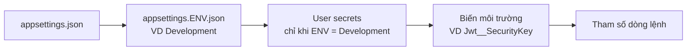
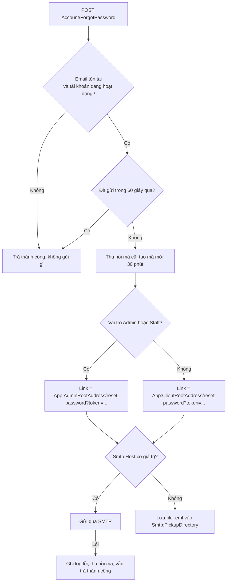
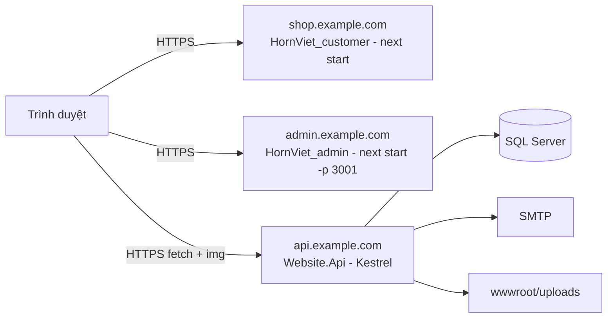

# Cấu hình & triển khai

Hướng dẫn cấu hình backend (`appsettings`, user-secrets, biến môi trường), biến môi trường của hai frontend, gửi email qua Gmail, thư mục ảnh, build – triển khai production, chạy test, debug và xử lý sự cố thường gặp.

## 1. Mục đích & phạm vi

| Thành phần | Nội dung trong tài liệu |
|---|---|
| Backend `Website.Api` | Các khóa cấu hình, thứ tự nạp cấu hình, user-secrets, triển khai |
| `HornViet_admin`, `HornViet_customer` | Biến `NEXT_PUBLIC_*`, build và chạy production |
| Hạ tầng | SQL Server, SMTP, HTTPS, CORS, thư mục `wwwroot/uploads` |

Cách chạy nhanh ở máy dev: xem [Tổng quan](00-tong-quan.md#7-chạy-cả-3-ứng-dụng-ở-máy-dev). Chi tiết database: [Cơ sở dữ liệu](10-co-so-du-lieu.md).

## 2. Vai trò & quyền

Tài liệu dành cho người phát triển / người vận hành. Liên quan đến quyền người dùng cuối chỉ có hai điểm:

- Tài khoản demo `admin / 123qwe` (Quản trị viên) và `staff / 123qwe` (Nhân viên) do seed tạo — **phải đổi mật khẩu** trước khi triển khai thật.
- Khóa ký JWT (`Jwt:SecurityKey`) quyết định ai phát hành được token hợp lệ; lộ khóa = kẻ gian tự tạo được token Admin.

## 3. Cấu hình backend

### 3.1 Nguồn và thứ tự nạp cấu hình

`WebApplication.CreateBuilder` (`Website.Api/Program.cs`) nạp cấu hình theo thứ tự, nguồn sau ghi đè nguồn trước:



- Môi trường do `ASPNETCORE_ENVIRONMENT` quyết định; profile `https` trong `Website.Api/Properties/launchSettings.json` đặt `Development`.
- Biến môi trường dùng `__` (hai dấu gạch dưới) thay cho `:`, VD `Smtp:Password` → `Smtp__Password`.
- User-secrets lưu ngoài repo (theo `UserSecretsId` trong `Website.Api/Website.Api.csproj`), dùng cho mật khẩu SMTP ở máy dev.

### 3.2 Bảng khóa cấu hình

| Khóa | Mặc định (`appsettings.json`) | Development (`appsettings.Development.json`) | Ý nghĩa | Đọc ở |
|---|---|---|---|---|
| `ConnectionStrings:Default` | `Server=localhost; Database=HonSungVietDb; Trusted_Connection=True; TrustServerCertificate=True;` | Như mặc định | Chuỗi kết nối SQL Server. Thiếu → không khởi động ("Thiếu ConnectionStrings:Default.") | `Website.Infrastructure/DependencyInjectionRegister.cs` |
| `Jwt:Issuer`, `Jwt:Audience` | `HonSungViet` | — | Kiểm tra khi xác thực token | `Website.Api/Authorization/Authentication.cs` |
| `Jwt:SecurityKey` | `""` (cố ý để trống) | Khóa dev | Khóa HMAC-SHA256 ký token, **≥ 32 ký tự**. Thiếu/ngắn → không khởi động ("Jwt:SecurityKey phải có tối thiểu 32 ký tự.") | `AuthenticationSetup.AddJwtAuthentication` |
| `Jwt:ExpirationHours` | `24` | — | Thời hạn token | `TokenService.CreateToken` |
| `App:CorsOrigins` | `http://localhost:3000,http://localhost:3001` | — | Danh sách origin được gọi API, cách nhau dấu phẩy. Chỉ nạp lúc khởi động | `Program.cs` (`AddCors`) |
| `App:ClientRootAddress` | `http://localhost:3000/` | — | Gốc link đặt lại mật khẩu cho Khách hàng | `AccountAppService.ForgotPasswordAsync` |
| `App:AdminRootAddress` | `http://localhost:3001/` | — | Gốc link đặt lại mật khẩu cho Nhân viên / Quản trị viên | `AccountAppService.ForgotPasswordAsync` |
| `App:ServerRootAddress` | `https://localhost:44311/` | — | Có trong file cấu hình nhưng hiện không được code nào đọc | — |
| `Database:MigrateOnStartup` | `false` | `true` | `true` = lúc khởi động áp migration và chạy `DataSeeder` | `Program.cs` |
| `Seed:AdminPassword`, `Seed:StaffPassword` | (không có mục `Seed` → mặc định trong code `123qwe`) | `123qwe` | Mật khẩu tài khoản demo khi seed tạo mới | `Website.Application/DataSeeder.cs` (`SeedOptions`) |
| `Seed:SampleCatalog` | (mặc định trong code `true`) | `true` | Tạo danh mục/nguyên liệu/sản phẩm mẫu nếu chưa có danh mục | `DataSeeder.SeedCatalogAsync` |
| `Smtp:Host` | `""` | — | Máy chủ SMTP; trống = không gửi thật, lưu file `.eml` | `Website.Infrastructure/Services/SmtpEmailSender.cs` |
| `Smtp:Port` | `587` | — | Cổng SMTP | `SmtpOptions` |
| `Smtp:EnableSsl` | `true` | — | Bật TLS (STARTTLS trên cổng 587) | `SmtpOptions` |
| `Smtp:UserName`, `Smtp:Password` | `""` | — | Tài khoản đăng nhập SMTP (Gmail: địa chỉ Gmail + App Password) | `SmtpOptions` |
| `Smtp:FromAddress` | `""` | — | Địa chỉ người gửi; trống → dùng `Smtp:UserName` nếu có `@`, cuối cùng `no-reply@honsungviet.local` | `SmtpOptions.EffectiveFromAddress` |
| `Smtp:FromName` | `Hồn Sừng Việt` | — | Tên người gửi | `SmtpOptions` |
| `Smtp:PickupDirectory` | `App_Data/mails` | — | Thư mục lưu `.eml` khi `Smtp:Host` trống (tương đối với thư mục chạy) | `SmtpEmailSender.SendAsync` |
| `Logging:LogLevel` | `Default=Information`, `Microsoft.AspNetCore=Warning`, `Microsoft.EntityFrameworkCore.Database.Command=Warning` | — | Mức log | ASP.NET Core |

Khóa JWT trong `appsettings.Development.json` chỉ dùng cho máy dev; **không** dùng lại ở production.

### 3.3 User-secrets ở máy dev

Chạy ở thư mục gốc repo backend:

```bash
dotnet user-secrets list --project Website.Api
dotnet user-secrets set "Smtp:Host" "smtp.gmail.com" --project Website.Api
dotnet user-secrets remove "Smtp:Host" --project Website.Api
```

Trong Visual Studio: chuột phải project `Website.Api` → **Manage User Secrets** để sửa trực tiếp file `secrets.json`. User-secrets chỉ được nạp khi môi trường là `Development`.

### 3.4 Email & link đặt lại mật khẩu

Luồng gửi email Quên mật khẩu (`AccountAppService.ForgotPasswordAsync` → `IEmailSender.SendAsync`):



- Link luôn lấy tên miền từ cấu hình (`AppUrlOptions`), không lấy từ request, để kẻ gian không đổi được tên miền trong link.
- Lúc khởi động, `Program.cs` ghi cảnh báo `Cấu hình email: ...` cho mỗi vấn đề tìm thấy bởi `SmtpOptions.GetConfigurationProblems()` (thiếu `UserName`, thiếu `Password`, địa chỉ gửi đuôi `.local`), và ghi thông tin nơi lưu `.eml` nếu `Smtp:Host` trống.
- Nghiệp vụ đầy đủ: [Xác thực & tài khoản](01-xac-thuc-tai-khoan.md).

### 3.5 Cấu hình Gmail App Password

Người dùng tự thực hiện bằng tài khoản Google của mình; **không ghi mật khẩu thật vào repo hay tài liệu**.

1. Bật **Xác minh 2 bước** cho tài khoản Google: https://myaccount.google.com/security
2. Tạo **Mật khẩu ứng dụng** (App Password, 16 ký tự) tại https://myaccount.google.com/apppasswords
3. Đặt cấu hình bằng user-secrets (dev) — thay giá trị trong `<...>` bằng của bạn:

   ```bash
   dotnet user-secrets set "Smtp:Host" "smtp.gmail.com" --project Website.Api
   dotnet user-secrets set "Smtp:UserName" "<dia-chi>@gmail.com" --project Website.Api
   dotnet user-secrets set "Smtp:Password" "<app-password-16-ky-tu>" --project Website.Api
   ```

   Ở production, đặt bằng biến môi trường `Smtp__Host`, `Smtp__UserName`, `Smtp__Password` (và `Smtp__FromAddress` nếu cần).
4. Giữ `Smtp:Port = 587`, `Smtp:EnableSsl = true`. Gmail bắt buộc gửi bằng chính tài khoản đăng nhập, nên để trống `Smtp:FromAddress` (tự lấy `Smtp:UserName`).
5. Chạy lại backend, kiểm tra log:

| Dòng log | Ý nghĩa |
|---|---|
| `Cấu hình email: ...` | Cấu hình còn thiếu (đọc nội dung để sửa) |
| `Đã gửi email "..." qua smtp.gmail.com:587` | Gửi thành công |
| `Không gửi được email đặt lại mật khẩu cho người dùng {UserId}. Kiểm tra mục Smtp ...` | Gửi lỗi; chi tiết lỗi SMTP nằm trong exception kèm theo |

6. Thử bằng một tài khoản có **email thật** (tự đăng ký ở cửa hàng). Tài khoản demo `admin`, `staff` dùng email `@honsungviet.local` không nhận được thư.

### 3.6 Thư mục ảnh `wwwroot/uploads`

| Mục | Chi tiết |
|---|---|
| API tải ảnh | `POST /api/services/app/File/UploadImage` (Nhân viên, Quản trị viên), trường `file` |
| Ràng buộc | `.jpg`, `.jpeg`, `.png`, `.webp`, content-type `image/*`, ≤ 5 MB |
| Nơi lưu | `<WebRootPath>/uploads/{yyyyMM}/{guid}.{ext}` — ở máy dev là `Website.Api/wwwroot/uploads/` |
| URL trả về | `/uploads/{yyyyMM}/{guid}.{ext}` (tương đối), frontend ghép với `NEXT_PUBLIC_API_BASE_URL` |
| Phục vụ file | `app.UseStaticFiles()` trong `Program.cs`; thẻ `` không cần CORS |
| Git | `.gitignore` bỏ qua `Website.Api/wwwroot/uploads/*`, chỉ giữ `uploads/sample/` (ảnh mẫu `placeholder.svg` của seed) |

Khi triển khai: thư mục `uploads` chứa dữ liệu thật — không xóa khi cập nhật bản mới, và sao lưu cùng database. Tài khoản chạy ứng dụng cần quyền ghi vào `wwwroot/uploads`.

Mã nguồn: `Website.Api/Controllers/Admin/FileController.cs`.

## 4. Cấu hình frontend

Hai repo đọc biến môi trường từ `.env.local` (tạo từ `.env.example`). Biến `NEXT_PUBLIC_*` được Next.js **nhúng vào mã lúc build**: đổi giá trị thì phải build lại.

| Biến | Repo | Giá trị dev (`.env.example`) | Ý nghĩa | Dùng ở |
|---|---|---|---|---|
| `NEXT_PUBLIC_API_BASE_URL` | Cả hai | `http://localhost:21021` | Địa chỉ backend (không có `/` cuối — code tự cắt) | `lib/api/http.ts` |
| `NEXT_PUBLIC_STORE_URL` | `HornViet_admin` | `http://localhost:3000` | Nút "Xem cửa hàng". Trống: ở dev mặc định `http://localhost:3000`, ở production thì ẩn nút | `HornViet_admin/lib/api/http.ts` |
| `NEXT_PUBLIC_ADMIN_URL` | `HornViet_customer` | `http://localhost:3001` | Link sang trang quản trị khi Nhân viên lỡ đăng nhập ở cửa hàng; trống thì ẩn link | `HornViet_customer/app/(store)/login/page.tsx` |

- `.env.example` gợi ý thêm giá trị `https://localhost:44311` (HTTPS của backend dev). Dùng HTTP `21021` ở máy dev tránh được lỗi chứng chỉ tự ký.
- Trong git chỉ có `.env.example` được commit; `.env.local` là file riêng của từng máy.

## 5. Build & triển khai production

### 5.1 Sơ đồ triển khai gợi ý



Tên miền trên chỉ là ví dụ. Code không cấu hình reverse proxy hay HTTPS redirect (không có `UseHttpsRedirection`/`UseHsts` trong `Program.cs`), nên HTTPS cần được bố trí ở Kestrel (`ASPNETCORE_URLS` + chứng chỉ) hoặc ở reverse proxy/IIS phía trước.

### 5.2 Backend

1. **Chuẩn bị database** (chọn một):
   - Chạy `database/02_schema.sql` (idempotent) trên database đã tạo bằng `01_create_database.sql`; chạy `03_seed.sql` nếu là database mới. Cách này không cần cấp quyền DDL cho tài khoản chạy ứng dụng.
   - Hoặc đặt `Database__MigrateOnStartup=true` để ứng dụng tự áp migration và seed. Khi đó **bắt buộc** đặt `Seed__AdminPassword`, `Seed__StaffPassword` (nếu không sẽ dùng mặc định `123qwe`) và cân nhắc `Seed__SampleCatalog=false` để không tạo sản phẩm mẫu.
2. **Publish:**

   ```bash
   dotnet publish Website.Api -c Release -o ./publish
   ```

3. **Đặt biến môi trường** trên máy chủ (giá trị trong `<...>` là ví dụ):

   | Biến | Ví dụ |
   |---|---|
   | `ASPNETCORE_ENVIRONMENT` | `Production` |
   | `ConnectionStrings__Default` | `Server=<may-chu>; Database=HonSungVietDb; User Id=<tai-khoan>; Password=<mat-khau>; TrustServerCertificate=True;` |
   | `Jwt__SecurityKey` | Chuỗi ngẫu nhiên ≥ 32 ký tự (VD sinh bằng trình quản lý mật khẩu) |
   | `App__CorsOrigins` | `https://shop.example.com,https://admin.example.com` |
   | `App__ClientRootAddress` | `https://shop.example.com/` |
   | `App__AdminRootAddress` | `https://admin.example.com/` |
   | `Smtp__Host`, `Smtp__UserName`, `Smtp__Password`, `Smtp__FromAddress` | Theo nhà cung cấp email |

4. **Chạy:** `dotnet Website.Api.dll` trong thư mục `publish` (hoặc cấu hình dịch vụ/IIS tương đương).
5. **Kiểm tra:** Swagger chỉ bật ở Development, nên ở Production thử bằng một lời gọi công khai, VD `GET /api/services/app/Category/GetAll` phải trả `success: true`.

Lưu ý giờ hệ thống: backend dùng `DateTime.Now` (giờ máy chủ) cho `CreationTime`, thống kê theo ngày và hạn mã đặt lại mật khẩu. Máy chủ cần đặt múi giờ Việt Nam (UTC+7) để ngày đặt hàng và báo cáo đúng.

### 5.3 Hai frontend

Với mỗi repo (`HornViet_admin`, `HornViet_customer`):

```bash
npm ci
# tạo .env.local (hoặc đặt biến môi trường) TRƯỚC khi build
npm run build
npm run start
```

| Repo | `.env.local` production | Lệnh chạy |
|---|---|---|
| `HornViet_admin` | `NEXT_PUBLIC_API_BASE_URL=https://api.example.com`, `NEXT_PUBLIC_STORE_URL=https://shop.example.com` | `npm run start` (= `next start -p 3001`) |
| `HornViet_customer` | `NEXT_PUBLIC_API_BASE_URL=https://api.example.com`, `NEXT_PUBLIC_ADMIN_URL=https://admin.example.com` | `npm run start` (= `next start`, cổng mặc định 3000) |

Ghi chú:

- `HornViet_customer/next.config.mjs` đặt `typescript.ignoreBuildErrors` và `eslint.ignoreDuringBuilds` = `true`: build không dừng khi có lỗi kiểu — nên kiểm tra thủ công trước khi triển khai.
- `HornViet_customer/package.json` có một số gói khai báo phiên bản `latest`; dùng `npm ci` với `package-lock.json` để cài đúng phiên bản đã khóa.
- Trang quản trị có `lib/hsv/mock-cost.ts` hiển thị dữ liệu ảo khi chạy dev mà backend thiếu API nhập kho; bản build production không dùng dữ liệu ảo.

### 5.4 CORS & HTTPS

- `App:CorsOrigins` phải chứa **chính xác** origin của cả hai frontend: đúng `http`/`https`, đúng cổng, **không** có `/` cuối. VD `https://admin.example.com` đúng, `https://admin.example.com/` sai.
- CORS chỉ nạp lúc khởi động: sửa xong phải khởi động lại backend.
- Chính sách CORS không bật `AllowCredentials` vì token gửi qua header `Authorization`, không dùng cookie.
- Dùng HTTPS cho cả backend lẫn hai frontend: trang HTTPS gọi API HTTP sẽ bị trình duyệt chặn (mixed content).

## 6. Checklist trước khi triển khai

| # | Việc cần làm | Kiểm tra |
|---|---|---|
| 1 | Đặt `Jwt__SecurityKey` mới, ngẫu nhiên, ≥ 32 ký tự; không dùng khóa dev | Ứng dụng khởi động được; khóa không nằm trong repo |
| 2 | Đổi mật khẩu `admin` / `staff` (qua `Seed__*` trước lần seed đầu, hoặc đổi ngay sau khi đăng nhập lần đầu bằng **Đổi mật khẩu**) | Đăng nhập bằng `123qwe` thất bại |
| 3 | Đặt `ConnectionStrings__Default` qua biến môi trường, tài khoản SQL riêng | — |
| 4 | Sao lưu database **và** thư mục `wwwroot/uploads` trước khi áp migration (lệnh ở [Cơ sở dữ liệu](10-co-so-du-lieu.md#53-sao-lưu-trước-khi-áp-migration)) | File `.bak` kiểm tra được bằng `RESTORE VERIFYONLY` |
| 5 | Áp `02_schema.sql` mới nhất (hoặc `MigrateOnStartup`) | `__EFMigrationsHistory` có migration mới nhất |
| 6 | `App__CorsOrigins` chứa tên miền thật của cả hai frontend | Không có lỗi CORS trong console trình duyệt |
| 7 | `App__ClientRootAddress`, `App__AdminRootAddress` là tên miền thật | Link trong email trỏ đúng trang |
| 8 | Cấu hình `Smtp__*`; không còn dòng log `Cấu hình email: ...` | Thử Quên mật khẩu với email thật |
| 9 | Build frontend với `NEXT_PUBLIC_API_BASE_URL` trỏ API thật (HTTPS) | Ảnh sản phẩm hiển thị, gọi API thành công |
| 10 | Múi giờ máy chủ là UTC+7 | Đơn mới có giờ đúng |
| 11 | Chạy unit test | `dotnet test` xanh |
| 12 | Báo người dùng: sau lần cập nhật đầu có migration `AddUserSecurityStamp`, mọi phiên cũ phải đăng nhập lại | — |

## 7. Chạy test & debug

### 7.1 Unit test

Project `tests/Website.Domain.UnitTests` (xUnit, chỉ tham chiếu `Website.Domain`) kiểm thử quy tắc nghiệp vụ: giỏ hàng, biến thể/tồn kho, phiếu nhập/giá vốn, máy trạng thái đơn, `ValueObject`, mã đặt lại mật khẩu, vai trò, người dùng.

```bash
dotnet test tests/Website.Domain.UnitTests
```

Test không cần SQL Server. Frontend: `HornViet_admin` có `npm run typecheck` (`tsc --noEmit`) để kiểm tra kiểu.

### 7.2 Debug bằng Visual Studio

1. Mở `Website.Api.slnx`, đặt `Website.Api` làm Startup Project, chọn profile **https**.
2. Nhấn **F5**: trình duyệt mở `https://localhost:44311/swagger`. Lần đầu có thể được hỏi tin chứng chỉ dev — chọn đồng ý (hoặc chạy `dotnet dev-certs https --trust`).
3. Trên Swagger, gọi `POST /api/TokenAuth/AuthenticateAdmin` với `admin / 123qwe`, copy `accessToken`, bấm **Authorize** để thử các API cần đăng nhập.
4. Lỗi nghiệp vụ (sai mật khẩu, hết hàng…) được `WebsiteBaseController.Run` bắt ngay trong code dự án nên Visual Studio không dừng ở "Exception User-Unhandled". Muốn dừng tại nơi ném lỗi, bật `UserFriendlyException` trong cửa sổ **Exception Settings**.
5. Chạy song song hai frontend (`npm run dev`) để debug cả luồng; đặt breakpoint trong Application Service tương ứng.

## 8. Xử lý sự cố thường gặp

| Hiện tượng | Nguyên nhân | Cách xử lý |
|---|---|---|
| Console trình duyệt: `blocked by CORS policy: No 'Access-Control-Allow-Origin' header` | Origin frontend không có trong `App:CorsOrigins`, sai `http/https`, sai cổng, có `/` cuối, hoặc chưa khởi động lại backend | Sửa `App:CorsOrigins` cho khớp từng ký tự rồi khởi động lại backend |
| Frontend báo "Không kết nối được máy chủ." | Backend chưa chạy, sai `NEXT_PUBLIC_API_BASE_URL`, hoặc chứng chỉ HTTPS dev chưa được tin | Kiểm tra backend; dùng `http://localhost:21021`; sửa `.env.local` rồi chạy lại `npm run dev` |
| Backend không khởi động: `Jwt:SecurityKey phải có tối thiểu 32 ký tự.` | Thiếu khóa (VD chạy ở Production mà chưa đặt `Jwt__SecurityKey`) | Đặt biến môi trường `Jwt__SecurityKey` |
| Backend không khởi động: `Thiếu ConnectionStrings:Default.` | Thiếu chuỗi kết nối | Đặt `ConnectionStrings__Default` |
| HTTP 401 "Bạn chưa đăng nhập hoặc phiên đăng nhập đã hết hạn." | Token hết hạn (24 giờ); tài khoản bị khóa; đã đổi/đặt lại mật khẩu hoặc đổi vai trò (`SecurityStamp` mới); đổi `Jwt:SecurityKey`; token phát hành trước migration `AddUserSecurityStamp` | Đăng nhập lại. Frontend tự xóa token và về `/login` khi gặp 401 |
| HTTP 403 "Bạn không có quyền thực hiện chức năng này." | Token hợp lệ nhưng thiếu vai trò (VD Nhân viên gọi `Statistic/GetRevenue`) | Đúng thiết kế; dùng tài khoản đủ quyền |
| Đăng nhập trang quản trị báo "Tài khoản không có quyền truy cập trang quản trị." | Tài khoản Khách hàng dùng `AuthenticateAdmin` | Dùng tài khoản Staff/Admin |
| Lỗi migration lúc khởi động / `dotnet ef` | Database tạo bằng cách khác, thiếu `__EFMigrationsHistory`, collation sai, thiếu `-I` khi chạy script | Xem mục 8 của [Cơ sở dữ liệu](10-co-so-du-lieu.md#8-lỗi-thường-gặp--cách-xử-lý) |
| Quên mật khẩu: không có email nào | `Smtp:Host` trống → email nằm ở file `.eml` trong `Website.Api/App_Data/mails/` (đường dẫn in ở log) | Mở file `.eml` lấy link, hoặc cấu hình SMTP |
| Quên mật khẩu: log `Không gửi được email đặt lại mật khẩu ...` với lỗi xác thực (VD `5.7.0 Authentication Required`, `535`) | Sai `Smtp:UserName` / `Smtp:Password`, dùng mật khẩu Gmail thường thay vì App Password, chưa bật Xác minh 2 bước | Tạo lại App Password, đặt lại user-secrets |
| Quên mật khẩu: log lỗi khi dùng cổng 465 | `System.Net.Mail.SmtpClient` không hỗ trợ SSL ngầm định (cổng 465) | Dùng cổng `587` với `EnableSsl = true` |
| Quên mật khẩu: log `Thiếu cấu hình App:ClientRootAddress / App:AdminRootAddress.` | Hai khóa `App:*RootAddress` trống | Đặt địa chỉ hai frontend |
| Quên mật khẩu: giao diện báo thành công nhưng không có thư | Email chưa đăng ký / tài khoản bị khóa (cố ý không báo lỗi), vừa gửi trong 60 giây, email đuôi `.local`, thư vào mục Spam | Kiểm tra log và hộp thư Spam; đợi 60 giây rồi gửi lại |
| Ảnh sản phẩm không hiển thị | `NEXT_PUBLIC_API_BASE_URL` sai, hoặc file trong `wwwroot/uploads` bị mất khi triển khai lại | Sửa biến và build lại; khôi phục thư mục `uploads` từ bản sao lưu |
| Tải ảnh lỗi "Ảnh không được vượt quá 5 MB." / "Chỉ chấp nhận ảnh JPG, PNG hoặc WEBP." | Vi phạm ràng buộc của `FileController` | Nén/đổi định dạng ảnh |
| HTTP 409 khi đặt hàng | Khóa lạc quan `RowVersion` | Tải lại giỏ và thử lại (xem [Đặt hàng](06-dat-hang-don-hang.md)) |

## 9. Mã nguồn liên quan

| Nội dung | Đường dẫn |
|---|---|
| Khởi động, CORS, Swagger, MigrateOnStartup, cảnh báo cấu hình email | `Website.Api/Program.cs` |
| Cấu hình | `Website.Api/appsettings.json`, `Website.Api/appsettings.Development.json`, `Website.Api/Properties/launchSettings.json` |
| `UserSecretsId` | `Website.Api/Website.Api.csproj` |
| JWT, chính sách phân quyền | `Website.Api/Authorization/Authentication.cs` |
| Đăng ký DbContext, email | `Website.Infrastructure/DependencyInjectionRegister.cs` |
| Gửi email, `SmtpOptions` | `Website.Infrastructure/Services/SmtpEmailSender.cs` |
| Địa chỉ frontend cho link email | `Website.Application/Common/AppUrlOptions.cs`, `Website.Application/Accounts/AccountAppService.cs` |
| Seed, `SeedOptions` | `Website.Application/DataSeeder.cs` |
| Tải ảnh | `Website.Api/Controllers/Admin/FileController.cs` |
| Công cụ EF | `dotnet-tools.json` |
| Unit test | `tests/Website.Domain.UnitTests/` |
| Biến môi trường frontend | `HornViet_admin/.env.example`, `HornViet_customer/.env.example`, `HornViet_admin/lib/api/http.ts`, `HornViet_customer/lib/api/http.ts` |
| Script & cấu hình build frontend | `HornViet_admin/package.json`, `HornViet_admin/next.config.mjs`, `HornViet_customer/package.json`, `HornViet_customer/next.config.mjs` |
